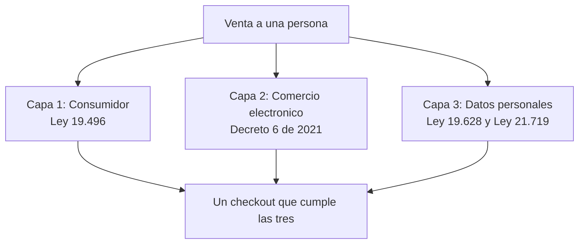
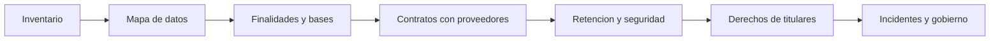

# Consumidor, comercio electrónico y privacidad: cómo vender en línea sin quedar expuesto

> **En una frase:** cuando vendes a personas, además de un producto entregas un contrato, un precio, un despacho, una
> garantía, un pago y un montón de datos personales. Este manual convierte esas obligaciones en un flujo de cumplimiento
> que puedes diseñar desde el primer día, con los artículos de la Ley 19.496 y los deberes de la nueva ley de datos
> personales.

Material educativo, sin revisión legal. Los textos citados se leyeron de Ley Chile (BCN); las **cifras de los ejemplos
son ilustrativas**. La transición de la ley de datos personales tiene fechas que han cambiado: verifica el calendario
vigente en la fuente oficial antes de planificar.

---

## 1. Mapa: tres capas que se superponen

| Capa | Qué regula | Qué te exige en la práctica |
|---|---|---|
| Consumidor (Ley 19.496) | La relación entre proveedor y consumidor | Información veraz, respetar lo ofrecido, contratos claros, garantías, reclamos |
| Comercio electrónico (Decreto 6 de 2021, Economía) | Información y transparencia en plataformas de comercio electrónico | Datos del vendedor y del operador, condiciones visibles, trazabilidad |
| Datos personales (Ley 19.628, y Ley 21.719 desde su vigencia) | Cómo recolectas, usas, proteges y compartes datos | Base de licitud, información al titular, seguridad, derechos del titular, reporte de incidentes |

---

## 2. Consumidor: lo que debes diseñar desde el principio

La **Ley 19.496** aplica a las relaciones proveedor-consumidor en los casos que la propia ley define. Si tu cliente es
una persona que compra para uso propio, asume que te aplica y diseña así:

| Elemento | Qué debes asegurar | Error frecuente |
|---|---|---|
| Información veraz | Lo que dices del producto es verificable y completo | Exagerar atributos en la publicidad |
| Precio total | El precio que ve el cliente es el que paga, con impuestos y cargos | Agregar cargos al final del checkout |
| Identidad del proveedor | Razón social, RUT, domicilio y contacto visibles | Operar «anónimamente» desde redes sociales |
| Términos claros | Condiciones comprensibles y accesibles antes de comprar | Términos escondidos o ilegibles |
| Despacho | Plazos y costos informados y cumplidos | Prometer plazos que no controlas |
| Stock | Vender solo lo disponible o informar el plazo real | Vender sin inventario y cancelar |
| Garantías | Explicar y respetar las garantías legales | Negar la garantía por política interna |
| Reclamos | Un canal visible y respuestas oportunas | Reclamos sin respuesta |
| Postventa | Cambios, reparaciones y devoluciones documentadas | No registrar el historial del cliente |

### 2.1. Respetar lo ofrecido (art. 12)

Todo proveedor debe **respetar los términos, condiciones y modalidades** conforme a las cuales se haya ofrecido o
convenido con el consumidor la entrega del bien o la prestación del servicio (art. 12). Una promoción publicada, un plazo
de entrega prometido o una característica anunciada forman parte de lo que debes cumplir.

### 2.2. Contratos por medios electrónicos (art. 12 A)

En los contratos celebrados por medios electrónicos, y en aquellos en que se acepta una oferta realizada a través de
catálogos, avisos o cualquier forma de comunicación a distancia (art. 12 A):

1. **El consentimiento no se entiende formado** si el consumidor no tuvo previamente acceso claro, comprensible e
   inequívoco a las condiciones generales y la posibilidad de **almacenarlas o imprimirlas**.
2. La sola visita del sitio no impone obligaciones al consumidor, salvo que acepte de forma inequívoca las condiciones.
3. Perfeccionado el contrato, debes **enviar confirmación escrita** (por vía electrónica o el medio indicado
   previamente), con una **copia íntegra, clara y legible del contrato**.

**Qué significa para tu tienda en línea:**

- el enlace a los términos debe estar visible **antes** del pago, con la posibilidad de guardarlos o imprimirlos;
- el botón de compra debe corresponder a una aceptación inequívoca;
- el correo de confirmación debe incluir o adjuntar las condiciones.

### 2.3. Contratos de adhesión (art. 17)

Los contratos de adhesión (aquellos en que el consumidor solo puede aceptar o rechazar) deben estar escritos de modo
**claramente legible, con letra no inferior a 2,5 milímetros y en castellano**. Las cláusulas que no cumplan estos
requisitos **no producen efecto alguno respecto del consumidor**. Debes entregar un ejemplar íntegro al consumidor tan pronto
firme.

### 2.4. Garantía legal (arts. 20 y 21)

En ciertos casos, el consumidor puede optar entre la **reparación gratuita**, la **reposición** o la **devolución de lo
pagado**, sin perjuicio de la indemnización por los daños (art. 20). Algunos de los casos que enumera la ley:

| Caso | Ejemplo |
|---|---|
| Productos sujetos a normas de seguridad o calidad obligatorias que no las cumplen | Un cargador sin la certificación exigida |
| Materiales o ingredientes que no corresponden a lo que dice el rotulado | Un producto «100 % algodón» que no lo es |
| Deficiencias de fabricación que lo hacen no apto para el uso | Un electrodoméstico que no enciende |
| Producto que no reúne las especificaciones convenidas | Se pidió una talla o color y llegó otro |
| Persistencia de deficiencias tras hacer efectiva la garantía la primera vez | Una segunda falla del mismo defecto |

**Plazo.** El consumidor ejerce estos derechos ante el vendedor dentro de los **tres meses** siguientes a la recepción del
producto, siempre que no se haya deteriorado por hecho imputable a él; si el producto tiene una garantía mayor, prevalece
esa (art. 21). Si opta por la reparación, puede dirigirse indistinta o conjuntamente al vendedor, fabricante o importador;
el vendedor y el importador son solidariamente responsables por los perjuicios.

### 2.5. Responsabilidad por negligencia y sanciones (arts. 23 y 24)

| Conducta | Consecuencia |
|---|---|
| Actuar con negligencia y causar menoscabo al consumidor por fallas en calidad, cantidad, identidad, sustancia, procedencia, seguridad, peso o medida (art. 23) | Infracción a la ley |
| Infracciones sin sanción especial (art. 24) | Multa de **hasta 300 UTM** |
| Publicidad falsa o engañosa difundida por medios de comunicación social (art. 24) | Multa de **hasta 1.500 UTM** |
| Publicidad que afecte la salud, la seguridad o el medio ambiente (art. 24) | Sanción mayor, según el texto de la ley |

> **Qué significa en pesos:** como orden de magnitud ilustrativo, 300 UTM equivalen a una cifra que puede superar el
> patrimonio de una microempresa. Calcula con el valor de la UTM del mes en que corresponda.

### 2.6. Derecho de retracto y devoluciones

La ley contempla un derecho de retracto en ciertos contratos a distancia, y algunos proveedores ofrecen políticas de
devolución más amplias como parte de lo que ofrecieron. Verifica en el texto vigente de la Ley 19.496 (art. 3 bis) y en
SERNAC los casos, plazos y excepciones aplicables a tu producto antes de redactar tu política. Lo importante es que
la política **sea clara, visible y se cumpla**.

---

## 3. Comercio electrónico: el Decreto 6 de 2021

El **Decreto 6 de 2021 del Ministerio de Economía** regula la información y la transparencia en las plataformas de
comercio electrónico, para vendedores y operadores. Texto:
[BCN, Decreto 6/2021](https://www.bcn.cl/leychile/navegar?idNorma=1165504).

| Pregunta | Qué conviene mostrar |
|---|---|
| ¿Quién vende? | Identificación completa del vendedor y datos de contacto |
| ¿Quién opera la plataforma? | Identificación del operador y su rol |
| ¿Qué estoy comprando? | Descripción, características y condiciones esenciales |
| ¿Cuánto pago? | Precio total y desglose de cargos |
| ¿Cuándo llega? | Plazos y costos de despacho |
| ¿Qué pasa si hay un problema? | Garantías, cambios, devoluciones y canal de reclamos |

Verifica en el texto vigente qué obligaciones corresponden a vendedores y cuáles a operadores de plataformas, porque
cambian según tu rol.

---

## 4. Datos personales: de la Ley 19.628 a la Ley 21.719

### 4.1. El calendario (verifícalo)

| Período | Régimen |
|---|---|
| **Hasta el 30 de noviembre de 2026** | Opera el régimen vigente de la Ley 19.628 |
| **Desde el 15 de octubre de 2027** | Entra en vigencia la **Ley 21.719**, que reforma profundamente la protección y tratamiento de datos y crea la **Agencia de Protección de Datos Personales** (fecha fijada por la Ley 21.855, publicada el 23-11-2026; la original era el 1-12-2026) |

Texto: [BCN, Ley 21.719](https://www.bcn.cl/leychile/navegar?i=1209272). Como los plazos han cambiado una vez, **confirma
la fecha en la fuente oficial** antes de planificar.

### 4.2. Qué cambia en la práctica

La Ley 21.719 define derechos del titular y deberes del responsable. De lo que se leyó en el texto:

| Elemento | Qué implica para tu negocio |
|---|---|
| Derecho de acceso (art. 5) | El titular puede pedir confirmación de si sus datos se tratan, acceder a ellos y a información como su origen y finalidades |
| Derechos de rectificación, supresión, oposición, portabilidad y bloqueo | Necesitas un procedimiento para recibir, responder y registrar estas solicitudes |
| Deber de seguridad | Medidas proporcionales al riesgo y a la tecnología disponible |
| Deber de reportar vulneraciones (art. 14 sexies) | Reportar a la Agencia, por los medios más expeditos y sin dilaciones indebidas, las vulneraciones a las medidas de seguridad que ocasionen destrucción, filtración, pérdida o alteración accidental o ilícita de datos, o acceso no autorizado, cuando exista un riesgo razonable para los derechos y libertades de los titulares |
| Agencia de Protección de Datos Personales | Fiscaliza y sanciona |

### 4.3. No esperar a la vigencia

Entre 2026 y 2027, construye:

| N.º | Entregable | Para qué sirve |
|---:|---|---|
| 1 | **Inventario de tratamientos** | Saber qué datos tratas y en qué procesos |
| 2 | **Mapa de datos** | Ver de dónde vienen, dónde están y adónde van |
| 3 | **Finalidades y bases** | Justificar cada uso de datos |
| 4 | **Contratos con encargados y proveedores** | Controlar a quienes tratan datos por ti |
| 5 | **Política de retención** | Borrar lo que ya no necesitas |
| 6 | **Medidas de seguridad** | Proteger los datos con controles proporcionales |
| 7 | **Atención de derechos** | Responder solicitudes en plazo |
| 8 | **Gestión de incidentes** | Detectar, contener, reportar y aprender |
| 9 | **Gobierno** | Responsables, políticas, capacitación y revisión |
| 10 | **Evaluación de transferencias y terceros** | Controlar envíos a otros países y proveedores |

---

## 5. El checkout como flujo de cumplimiento

Un checkout combina simultáneamente: **contrato + consumidor + documento tributario + pago + datos + fraude +
seguridad + logística**. Por eso debe diseñarse como un flujo de cumplimiento, no solo como una página web.

| Paso del cliente | Qué debe ocurrir | Obligación asociada |
|---|---|---|
| Ve el producto | Información veraz, precio total y despacho | Ley 19.496, publicidad y precio |
| Elige y agrega al carro | Stock real y condiciones visibles | Art. 12 |
| Revisa los términos | Acceso claro, almacenable o imprimible | Art. 12 A |
| Entrega sus datos | Aviso de privacidad y base de licitud | Ley de datos personales |
| Paga | Medio de pago seguro; no almacenar datos de tarjeta sin cumplir las normas del medio de pago | Seguridad |
| Recibe confirmación | Copia íntegra del contrato | Art. 12 A |
| Recibe el documento tributario | Boleta o factura electrónica | Normativa del SII |
| Recibe el producto | Despacho en el plazo ofrecido | Art. 12 |
| Reclama o devuelve | Canal visible y respuesta oportuna | Garantía legal, arts. 20 y 21 |
| Pide eliminar sus datos | Procedimiento y plazo | Derechos del titular |

---

## 6. Los documentos que necesita una tienda en línea

| Documento | Para qué sirve | Contenido mínimo recomendado |
|---|---|---|
| **Términos y condiciones** | Son el contrato con el cliente | Identidad del vendedor, qué se vende, precio, medios de pago, despacho, cambios y devoluciones, garantías, reclamos, ley aplicable |
| **Política de privacidad** | Informa cómo tratas datos | Responsable, datos que recolectas, finalidades, base de licitud, destinatarios, plazos de conservación, derechos y cómo ejercerlos, contacto |
| **Política de cookies** | Informa el uso de rastreadores | Qué cookies usas, para qué y cómo gestionarlas |
| **Política de cambios y devoluciones** | Evita conflictos | Plazos, condiciones, quién paga el despacho, reembolso |
| **Política de despachos** | Alinea expectativas | Zonas, plazos, costos, seguimiento |
| **Canal de atención** | Recibe reclamos y solicitudes | Correo, formulario y plazo de respuesta |
| **Procedimiento de incidentes** | Reacciona ante filtraciones | Quién decide, cómo se contiene, a quién se avisa |

> **Regla práctica:** no copies textos de otra tienda sin revisarlos. Cada negocio tiene condiciones distintas y copiar
> una política que no cumples es peor que no tenerla, porque queda como lo que ofreciste (art. 12).

---

## 7. Publicidad, promociones y precios

| Situación | Regla de prudencia |
|---|---|
| Publicar un «precio oferta» | Debe ser real y estar vigente durante el período informado |
| Descuentos «hasta X %» | Señala qué productos y condiciones aplican |
| Concursos y sorteos | Define bases por escrito y cúmplelas |
| Testimonios y reseñas | Deben ser genuinos; no inventes opiniones |
| Comparaciones con competidores | Solo con datos verificables |
| Influencers y colaboraciones | Deja claro cuando es publicidad |
| Mensajes comerciales por correo, SMS o WhatsApp | Usa una base de licitud válida y permite darse de baja |

La publicidad falsa o engañosa puede sancionarse con multas de hasta **1.500 UTM** cuando se difunde por medios de
comunicación social (art. 24); verifica en el texto vigente el alcance de «medios de comunicación social» en tu caso.

---

## 8. Pagos, fraude y seguridad

### 8.1. Qué te corresponde y qué no

| Tema | Recomendación |
|---|---|
| Datos de tarjetas | Usa un procesador de pagos que cumpla los estándares del sector; no guardes datos de tarjeta si no es necesario |
| Fraude | Define reglas simples de revisión (pedidos grandes, direcciones inconsistentes, múltiples intentos) |
| Contracargos | Conserva la evidencia de entrega y comunicación con el cliente |
| Reembolsos | Procedimiento y plazos conocidos y cumplidos |
| Comprobantes tributarios | Emite la boleta o factura electrónica que corresponda |

### 8.2. Baseline de ciberseguridad para una tienda

Aun fuera de las categorías con obligaciones reforzadas, toda empresa digital necesita un mínimo:

| Control | Qué hacer |
|---|---|
| Autenticación fuerte | Segundo factor en administración, correo, hosting y pagos |
| Mínimo privilegio | Cada persona accede solo a lo que necesita |
| Copias de respaldo | Periódicas, probadas y fuera del sistema principal |
| Actualizaciones | Aplicar parches de plataforma, plugins y servidores |
| Registros | Guardar logs de accesos y cambios |
| Proveedores | Evaluar a quienes tratan tus datos y exigirles seguridad |
| Respuesta a incidentes | Plan con roles, contactos y pasos |
| Capacitación | Enseñar a reconocer correos fraudulentos |

---

## 9. Ocho situaciones para practicar

> Casos ilustrativos, con nombres y cifras inventados. No son asesoría.

### 9.1. «Compré y no me llegó»

**Situación.** Una tienda promete entrega en cinco días y tarda quince. Un cliente reclama.

**Análisis.** El proveedor debe respetar las condiciones ofrecidas, incluyendo el plazo (art. 12). Un retraso
sistemático puede generar reclamos y sanciones.

**Decisión.** Ajustar la promesa al plazo real, comunicar los retrasos de inmediato y ofrecer solución (nueva fecha o
reembolso).

### 9.2. El checkbox pre-marcado

**Situación.** El formulario trae marcada por defecto la aceptación de recibir publicidad.

**Análisis.** Una aceptación inequívoca requiere una acción afirmativa del consumidor (art. 12 A en lo contractual) y la
nueva ley de datos exige base de licitud válida para los usos comerciales. Los consentimientos pre-marcados son riesgosos.

**Decisión.** Dejar las casillas desmarcadas y separar la aceptación de términos de la de marketing.

### 9.3. El producto con falla a los dos meses

**Situación.** Un cliente recibe un producto que deja de funcionar a los dos meses.

**Análisis.** Dentro de tres meses desde la recepción puede ejercer la garantía legal y optar entre reparación, reposición
o devolución, cuando se cumple alguno de los supuestos del art. 20 (art. 21).

**Decisión.** No imponer una sola opción; registrar la solicitud y resolver dentro de plazo.

### 9.4. La filtración de la base de clientes

**Situación.** Un proveedor de hosting sufre un ataque y se filtran nombres, correos y direcciones de clientes.

**Análisis.** Una vez vigente la Ley 21.719, las vulneraciones que ocasionen filtración o acceso no autorizado y
representen riesgo razonable para los titulares deben reportarse a la Agencia sin dilaciones indebidas (art. 14 sexies).
Hoy, igualmente, conviene actuar: contener, evaluar, informar a afectados y mejorar controles.

**Decisión.** Activar el plan de incidentes, documentar cada paso y consultar a un abogado de datos personales.

### 9.5. El marketplace

**Situación.** Un emprendedor vende en una plataforma de terceros y cree que la plataforma «responde por todo».

**Análisis.** La plataforma tiene obligaciones como operador, pero tú sigues siendo proveedor frente al consumidor en lo
que vendes. Revisa el contrato con la plataforma y el Decreto 6 de 2021.

**Decisión.** Cumplir como vendedor y revisar los términos de la plataforma sobre devoluciones y datos.

### 9.6. La solicitud de eliminación de datos

**Situación.** Un cliente pide que se eliminen todos sus datos. La empresa tiene datos en tres sistemas y en el correo.

**Análisis.** Sin inventario ni mapa de datos es difícil responder. Además, algunos datos deben conservarse por
obligaciones legales (por ejemplo, tributarias).

**Decisión.** Construir el inventario, definir qué se elimina, qué se bloquea y por qué, y responder por escrito.

### 9.7. El influencer que promociona

**Situación.** Una marca paga a un influencer para promocionar sus productos con afirmaciones de salud.

**Análisis.** La marca responde por la publicidad. Las afirmaciones sobre salud exigen respaldo y pueden agravar la sanción
(art. 24, inciso sobre publicidad que afecte la salud).

**Decisión.** Aprobar los mensajes por escrito y exigir respaldo de cada afirmación.

### 9.8. La cláusula «sin devoluciones»

**Situación.** Una tienda pone «no se aceptan devoluciones» en todas sus compras.

**Análisis.** Esa cláusula no puede dejar sin efecto los derechos que la ley reconoce al consumidor, como la garantía
legal de los arts. 20 y 21.

**Decisión.** Reformular la política para distinguir lo que es una cortesía comercial de lo que es un derecho legal.

---

## 10. Catálogo de errores frecuentes

| N.º | Error | Consecuencia | Cómo evitarlo |
|---:|---|---|---|
| 1 | Términos escondidos o imposibles de guardar | Consentimiento cuestionable (art. 12 A) | Enlace visible y descargable |
| 2 | No enviar confirmación del contrato | Incumplimiento (art. 12 A) | Correo automático con las condiciones |
| 3 | Contrato en letra pequeña o ilegible | Cláusulas sin efecto (art. 17) | Diseño legible |
| 4 | Precio final distinto del anunciado | Reclamos y sanciones | Precio total desde el inicio |
| 5 | Prometer plazos irreales | Incumplimiento (art. 12) | Plazos con margen |
| 6 | Negar la garantía legal | Reclamos y multas | Procedimiento de garantía |
| 7 | Publicidad exagerada | Multas hasta 1.500 UTM (art. 24) | Respaldar cada afirmación |
| 8 | Política copiada de otra tienda | Promesas que no cumples | Redactar según tu operación |
| 9 | No tener inventario de datos | No puedes responder derechos | Mapa de datos |
| 10 | Casillas pre-marcadas | Consentimientos inválidos | Opt-in explícito |
| 11 | Contratos sin cláusulas con proveedores de datos | Pérdida de control | Contrato con encargados |
| 12 | Guardar datos «por si acaso» | Riesgo y exposición | Política de retención |
| 13 | Sin plan de incidentes | Reacción tardía | Plan escrito y simulacro |
| 14 | Cobros duplicados o sin comprobante | Reclamos y problemas tributarios | Conciliación diaria |
| 15 | Atender reclamos sin registro | Indefensión | CRM o planilla de reclamos |

---

## 11. Calendario, listas y plantillas

### 11.1. Calendario de una tienda en línea

| Cuándo | Tarea |
|---|---|
| Cada día | Revisar pedidos, stock real, reclamos y pagos |
| Cada semana | Revisar fallas de despacho, devoluciones y fraudes |
| Cada mes | Conciliar pagos con documentos tributarios; revisar accesos y copias de respaldo |
| Cada trimestre | Revisar términos, políticas, proveedores y cookies |
| Cada año | Actualizar el inventario de datos, capacitar al equipo y probar el plan de incidentes |
| Antes de cada campaña | Revisar promesas, bases y respaldos de la publicidad |

### 11.2. Inventario de tratamientos de datos

| Proceso | Datos | Finalidad | Base | Sistema | Encargado | País | Retención |
|---|---|---|---|---|---|---|---|
| Venta | Nombre, RUT, dirección, correo | Cumplir el contrato | Contrato | Tienda | Plataforma | | |
| Despacho | Nombre, dirección, teléfono | Entregar | Contrato | Courier | Courier | | |
| Marketing | Correo | Informar ofertas | Consentimiento | Correo masivo | Proveedor | | |
| Soporte | Historial del cliente | Atender reclamos | Interés legítimo o contrato | CRM | Proveedor | | |

### 11.3. Registro de solicitudes de derechos

| Fecha | Titular | Derecho solicitado | Verificación de identidad | Respuesta | Fecha de respuesta | Resultado |
|---|---|---|---|---|---|---|
| | | | | | | |

### 11.4. Lista de verificación del checkout

- [ ] Precio total y cargos visibles antes de pagar.
- [ ] Identidad del vendedor visible.
- [ ] Enlace a términos, descargable.
- [ ] Aceptación inequívoca y separada de marketing.
- [ ] Aviso de privacidad accesible.
- [ ] Medio de pago seguro.
- [ ] Confirmación con copia íntegra del contrato.
- [ ] Documento tributario emitido.
- [ ] Plazos de despacho reales.
- [ ] Canal de reclamos visible.

### 11.5. Plan de incidentes de datos (esquema)

| Fase | Acciones | Responsable |
|---|---|---|
| Detectar | Alertas, reportes de empleados o clientes | Todos |
| Contener | Aislar sistemas, cambiar credenciales | Tecnología |
| Evaluar | Qué datos, cuántas personas, qué riesgo | Responsable de datos |
| Notificar | Reportar a la autoridad cuando corresponda; informar a los afectados | Dirección y abogado |
| Remediar | Corregir la causa y reforzar controles | Tecnología |
| Aprender | Registrar y mejorar | Dirección |

---

## 12. Preguntas frecuentes

**1. ¿La Ley del Consumidor aplica a una venta entre particulares?**
No necesariamente: se aplica a relaciones proveedor-consumidor en los casos legales. Si vendes habitualmente con ánimo de
lucro, asume que eres proveedor.

**2. ¿Debo tener términos y condiciones?**
Sí, y deben estar accesibles antes de la compra, con posibilidad de guardarlos o imprimirlos (art. 12 A).

**3. ¿Qué pasa si el cliente no los lee?**
Lo importante es que haya tenido acceso claro, comprensible e inequívoco antes de contratar (art. 12 A).

**4. ¿Puedo cobrar un cargo oculto?**
No es prudente: el precio total debe ser claro desde el inicio, y cualquier cargo adicional debe informarse antes.

**5. ¿Cuántos meses de garantía legal hay?**
Para ejercer los derechos de los arts. 19 y 20 ante el vendedor, el plazo general es de tres meses desde la recepción del
producto, salvo garantías mayores (art. 21).

**6. ¿Puedo negarme a una devolución?**
Depende del caso: si se cumple un supuesto de garantía legal, no. Si es una devolución voluntaria, rige lo que ofreciste.

**7. ¿Qué multas existen?**
Hasta 300 UTM por infracciones generales y hasta 1.500 UTM por publicidad falsa o engañosa en medios de comunicación
social, entre otras sanciones (art. 24).

**8. ¿Debo registrar mi sitio en algún lugar?**
Hay obligaciones tributarias y de información; consulta al contador y revisa el Decreto 6 de 2021.

**9. ¿Qué son los datos personales?**
Información sobre una persona identificada o identificable: nombre, RUT, correo, dirección, teléfono, entre otros.

**10. ¿Necesito consentimiento para todo?**
No: existen otras bases de licitud, como la ejecución de un contrato. Define la base de cada uso.

**11. ¿Puedo comprar una base de datos de correos?**
Es riesgoso: debes poder justificar el origen y la base de licitud. Consulta a un abogado de datos antes.

**12. ¿Qué es un encargado de tratamiento?**
Un proveedor que trata datos por cuenta tuya (hosting, correo masivo, CRM). Debe haber un contrato que lo regule.

**13. ¿Qué hago si un cliente pide acceso a sus datos?**
Verifica su identidad, reúne la información, responde por escrito en plazo y registra la solicitud (art. 5 de la
Ley 21.719 una vez vigente).

**14. ¿Hay que reportar todos los incidentes?**
La ley exige reportar a la Agencia las vulneraciones con riesgo razonable para los titulares (art. 14 sexies). Evalúa cada
caso con asesoría.

**15. ¿Los datos de tarjeta los guardo yo?**
No lo hagas si no es necesario; usa un procesador de pagos que cumpla los estándares.

**16. ¿Debo tener una política de cookies?**
Si usas cookies no esenciales, informa y permite gestionarlas.

**17. ¿Puedo enviar publicidad a mis clientes?**
Hay reglas de licitud y de darse de baja; define la base y facilita la baja.

**18. ¿Cuánto tiempo guardo los datos?**
El necesario para la finalidad y las obligaciones legales. Define una política de retención.

**19. ¿Quién fiscaliza?**
En consumidor, SERNAC y los tribunales; en datos personales, la Agencia de Protección de Datos Personales desde la vigencia
de la Ley 21.719.

**20. ¿Qué pasa si mi proveedor de nube está en otro país?**
Debes evaluar la transferencia internacional y exigir garantías contractuales.

**21. ¿Puedo usar IA para atender clientes?**
Puedes, pero revisa qué datos se envían, si el proveedor los reutiliza y qué informas al cliente. Evita cargar datos
sensibles sin evaluación.

**22. ¿Qué hago ante una reclamación del SERNAC?**
Respóndela dentro de plazo, con documentos, y consulta a un abogado si hay riesgo de multa.

**23. ¿Cómo evito reclamos?**
Promesas claras, cumplimiento, comunicación proactiva y un buen canal de atención.

**24. ¿Es suficiente la política de privacidad?**
No: es la parte visible. Además necesitas inventario, contratos, seguridad y procedimientos.

**25. ¿Cuándo llamar a un profesional?**
Para redactar términos, evaluar bases de licitud, contratos con proveedores de datos, incidentes y reclamaciones. Ver la
[guía de cuándo llamar a un profesional](18_WHEN_TO_CALL_A_PROFESSIONAL.md).

---

## 13. Glosario

| Término | Significado |
|---|---|
| Agencia de Protección de Datos Personales | Autoridad creada por la Ley 21.719 |
| Base de licitud | Fundamento legal para tratar datos (consentimiento, contrato, obligación legal, interés legítimo, entre otras) |
| Contrato de adhesión | Contrato cuyas cláusulas dicta una parte y la otra solo acepta o rechaza |
| Encargado de tratamiento | Proveedor que trata datos por cuenta del responsable |
| Garantía legal | Derecho del consumidor a reparación, reposición o devolución en ciertos casos |
| Opt-in | Consentimiento activo del titular |
| Portabilidad | Derecho a recibir los datos en formato estructurado |
| Proveedor | Quien habitualmente vende bienes o presta servicios a consumidores |
| Responsable de datos | Quien decide los fines y medios del tratamiento |
| SERNAC | Servicio Nacional del Consumidor |
| Titular de datos | Persona a quien se refieren los datos |
| UTM | Unidad Tributaria Mensual |

---

## 14. Modelos de cláusulas y qué pedir a tus proveedores

> Son **ideas de redacción** para llevar a un abogado; no son textos listos para usar.

### Ideas de cláusulas para los términos y condiciones

1. **Identificación:** «El vendedor es [razón social], RUT [número], domicilio [dirección], contacto [correo y teléfono].»
2. **Precio:** «Los precios incluyen impuestos. El costo de despacho se informa antes de pagar y se suma al total.»
3. **Despacho:** «El plazo estimado de entrega es de [número] días hábiles desde la confirmación del pago, según la zona.»
4. **Garantía legal:** «Los productos cuentan con la garantía legal de la Ley 19.496. Para ejercerla, el cliente puede
   contactarnos en [canal] dentro de los plazos legales.»
5. **Cambios voluntarios:** «Además de la garantía legal, ofrecemos [descripción], bajo estas condiciones: [lista].»
6. **Reclamos:** «Puedes presentar tu reclamo en [canal]. Responderemos dentro de [plazo].»
7. **Datos personales:** «Tratamos tus datos para [finalidades], según nuestra política de privacidad disponible en [enlace].»

### Qué pedir a cada proveedor que toca datos o dinero

| Proveedor | Qué verificar antes de contratar |
|---|---|
| Plataforma de tienda | Quién es responsable de qué, dónde se almacenan los datos, copias de respaldo, portabilidad al salir |
| Procesador de pagos | Estándares de seguridad, tiempos de liquidación, manejo de contracargos |
| Correo masivo y marketing | Dónde se alojan las listas, cómo se gestionan las bajas, uso de los datos por el proveedor |
| Courier y logística | Qué datos recibe, conservación, seguimiento y manejo de reclamos |
| Hosting y nube | País de alojamiento, seguridad, continuidad, notificación de incidentes |
| Soporte y CRM | Accesos, retención, exportación y eliminación de datos |
| Herramientas de IA | Si reutilizan lo que envías, dónde se procesa y cómo se elimina |

### Qué conviene exigir por escrito en el contrato con un proveedor de datos

1. Que trate los datos **solo según tus instrucciones**.
2. Medidas de **seguridad** y de **confidencialidad** de su personal.
3. **Aviso oportuno** de incidentes que afecten tus datos.
4. Condiciones para **subcontratar** a terceros.
5. Cooperación para atender **derechos de los titulares**.
6. **Devolución o eliminación** de los datos al terminar el contrato.
7. Reglas para **transferencias internacionales**.

---

## 15. Fuentes y vigencia

| Fuente | Qué contiene |
|---|---|
| [Ley 19.496 (BCN)](https://www.bcn.cl/leychile/navegar?idNorma=61438) | Protección de los derechos de los consumidores |
| [Decreto 6 de 2021 (BCN)](https://www.bcn.cl/leychile/navegar?idNorma=1165504) | Información y transparencia en comercio electrónico |
| [Ley 21.719 (BCN)](https://www.bcn.cl/leychile/navegar?i=1209272) | Protección y tratamiento de datos personales |
| [SERNAC](https://www.sernac.cl/) | Orientación y reclamos de consumidores |

**Límites:** este manual no es asesoría legal; las cifras de los ejemplos son ilustrativas; la fecha de vigencia de la
Ley 21.719 ha cambiado y debe verificarse. No se leyó el texto íntegro de todos los reglamentos asociados. Para decidir
a quién consultar, usa la [guía de cuándo llamar a un profesional](18_WHEN_TO_CALL_A_PROFESSIONAL.md).
