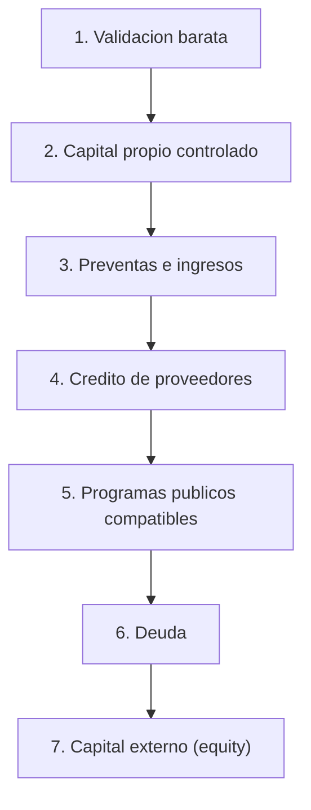
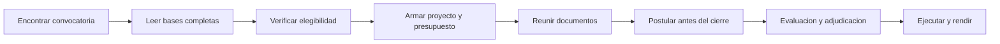

# Financiamiento y apoyo estatal: cómo financiar sin ahogarte

> **En una frase:** el mejor financiamiento es el que se ajusta a la etapa del negocio, no el más grande ni el más
> fácil. Este manual te da el orden para financiarte, las confusiones que arruinan empresas y la carpeta que debes tener
> lista antes de pedir un peso.

Material educativo. Montos, convocatorias, requisitos y plazos de los programas son **dinámicos**: este manual no los
fija. Verifica las bases vigentes en cada institución.

---

## 1. Orden recomendado de financiamiento

| Paso | Qué es | Cuándo tiene sentido | Riesgo principal |
|---|---|---|---|
| 1. Validación barata | Probar la idea con el mínimo gasto | Siempre al comienzo | Gastar antes de saber si hay demanda |
| 2. Capital propio controlado | Aporte de los socios con límite definido | Cuando ya hay evidencia de demanda | Arriesgar ahorros personales sin tope |
| 3. Preventas e ingresos | Clientes que pagan antes o durante | Cuando hay oferta clara | Comprometer entregas que no puedes cumplir |
| 4. Crédito de proveedores | Plazo para pagar insumos | Cuando hay relación comercial | Perder el crédito por atrasos |
| 5. Programas públicos | Fondos concursables, cofinanciamiento, garantías | Cuando calzas con las bases | Depender de un subsidio que no se repite |
| 6. Deuda | Crédito bancario, leasing, factoring | Cuando hay flujo para pagar | Financiar pérdidas estructurales con deuda |
| 7. Equity | Venta de participación | Cuando el crecimiento lo justifica | Ceder control y poner presión de salida |

---

## 2. No confundir

| Confusión peligrosa | Aclaración |
|---|---|
| Subsidio ≠ ingreso recurrente | Una ayuda puntual no sostiene operación permanente |
| Línea de crédito ≠ capital propio | Hay que devolverla con intereses |
| Factoring ≠ mejora de margen | Adelanta caja, pero cuesta margen |
| Inversión ≠ rentabilidad | Recibir dinero no significa ganar dinero |
| Caja ≠ utilidad | Tener efectivo no implica tener ganancia |

---

## 3. Fuentes institucionales a revisar

| Institución | Para qué sirve | Enlace |
|---|---|---|
| SERCOTEC | Apoyo a microempresas y pequeñas empresas | [sercotec.cl](https://www.sercotec.cl/) |
| CORFO | Fomento productivo, innovación, garantías | [corfo.cl](https://www.corfo.cl/) |
| Start-Up Chile | Aceleración de startups | [startupchile.org](https://startupchile.org/) |
| BancoEstado | Crédito y servicios financieros | [bancoestado.cl](https://www.bancoestado.cl/) |
| ProChile | Apoyo a exportadores | [prochile.gob.cl](https://www.prochile.gob.cl/) |

> Convocatorias, montos, elegibilidad y plazos son **DINÁMICOS**. La clase enseña a leer bases y construir
> elegibilidad; no fija montos como si fueran permanentes.

### 3.1. Cómo leer unas bases de postulación

1. **Quién puede postular:** tipo de persona, antigüedad, ventas, ubicación, actividad.
2. **Qué financia y qué no:** gastos elegibles y excluidos.
3. **Cuánto financia:** monto máximo y porcentaje de cofinanciamiento que debes aportar.
4. **Plazos:** apertura, cierre, evaluación y rendición.
5. **Criterios de evaluación:** qué puntúa y con qué peso.
6. **Obligaciones posteriores:** informes, rendiciones, auditorías y plazos de mantención.
7. **Causales de término o devolución:** qué te haría perder el beneficio.

---

## 4. Deuda: preguntas antes de firmar

| Pregunta | Por qué importa |
|---|---|
| ¿Cuánto cuesta realmente (tasa, comisiones, seguros, impuestos)? | La tasa publicada no es el costo total |
| ¿Quién responde si no pago (la empresa, tú, un aval)? | Define el riesgo personal |
| ¿Hay garantías y qué bienes comprometen? | Puedes perder activos clave |
| ¿Qué pasa si me atraso o necesito renegociar? | Cláusulas de aceleración y multas |
| ¿Mi flujo soporta la cuota con un mes malo? | Ejercicio de estrés mínimo |
| ¿Hay alternativas con menor costo o menor garantía? | Compara al menos dos ofertas |

---

## 5. Due diligence: la carpeta que debes tener antes de pedir dinero

Quien te financia revisará tu empresa. Tenerla ordenada acelera la decisión y mejora tu posición.

| Área | Qué preparar |
|---|---|
| Constitución | Escritura, extracto, certificados de vigencia |
| Poderes | Quién representa y con qué facultades |
| SII | Inicio de actividades, carpeta tributaria, declaraciones |
| Ventas | Facturación histórica, clientes principales, concentración |
| Banco | Cartolas, líneas vigentes, historial |
| Contabilidad | Estados financieros, balances, cierres |
| Deudas | Listado de pasivos, vencimientos, garantías |
| Contratos | Clientes, proveedores, arriendos, laborales |
| Cap table | Quién es dueño de qué porcentaje |
| Propiedad intelectual | Marcas, dominios, software, licencias |
| Litigios | Juicios en curso o amenazas |
| Permisos | Patentes y autorizaciones sectoriales |
| Cumplimiento | Políticas y registros relevantes |
| Proyección y uso de fondos | Para qué es el dinero y cómo se mide el retorno |

---

## 6. Cinco errores frecuentes

1. **Pedir más de lo que el flujo puede pagar** por «tener holgura».
2. **Endeudarse para cubrir pérdidas estructurales** en lugar de corregir el modelo.
3. **Postular a fondos sin leer las bases** y descubrir al final que no eras elegible.
4. **Mezclar finanzas personales y de la empresa**, lo que debilita la evaluación.
5. **Entregar equity temprano** sin entender las cláusulas de control y salida.

---

## 7. ¿Cuándo llamar a un profesional?

| Situación | Profesional |
|---|---|
| Revisar un contrato de crédito o garantía | Abogado |
| Construir proyecciones y estados financieros | Contador o asesor financiero |
| Recibir inversión (término de oferta, pacto de socios) | Abogado corporativo y tributario |
| Rendición de fondos públicos | Contador con experiencia en rendiciones |

Más detalle en la [guía de cuándo llamar a un profesional](18_WHEN_TO_CALL_A_PROFESSIONAL.md). Para garantías
específicas, mira también el [anexo 10 sobre sociedades de garantía recíproca](../annexes/10-sociedad-de-garantia-reciproca-sagr.md).

---

## 8. Seis situaciones para practicar

> Casos ilustrativos, con cifras inventadas. No son asesoría.

### 8.1. «Necesito 15 millones para arrancar»

**Situación.** Una diseñadora quiere montar un taller. Piensa pedir un crédito de 15.000.000 de pesos.

**Análisis.** Antes de la deuda, el orden del manual sugiere validar con ventas pequeñas, reunir capital propio acotado y
pedir anticipos a clientes. Si los costos mensuales fijos son 1.200.000 y la cuota del crédito sería 450.000, la cuota
aumenta los costos fijos en 37,5 % (450.000 / 1.200.000). La pregunta es si un mes malo, con la mitad de las ventas
esperadas, todavía cubre ambos montos.

**Decisión.** Empezar con un monto menor, asociado a compras concretas, y dejar la deuda para cuando haya ventas
recurrentes.

### 8.2. El fondo concursable que «paga todo»

**Situación.** Un emprendedor encuentra un fondo que cofinancia un proyecto, pero exige que él aporte una parte y rinda
gastos.

**Análisis.** El aporte propio, la rendición y los plazos son parte del costo del fondo. Si el proyecto necesita comprar
equipos antes de recibir el pago, hay que financiar el intertanto. Lee en las bases qué gastos se aceptan y cuándo se
entrega el dinero.

**Decisión.** Postular solo si tienes la caja para el período previo a recibir los fondos y el equipo para rendir.

### 8.3. El factoring de todas las facturas

**Situación.** Una empresa cede sus facturas a un factoring para tener caja inmediata, mes tras mes.

**Análisis.** Si el descuento promedio es 3 % por 60 días, sobre una factura de 10.000.000 son 300.000 de costo. Repetido
cada mes, la empresa transforma parte de su margen en comisión. El factoring ayuda a un problema de plazo de cobro; no
corrige un margen bajo.

**Decisión.** Medir cuánto margen se va en el factoring y negociar plazos de pago con los clientes.

### 8.4. El socio capitalista

**Situación.** Un conocido ofrece aportar capital a cambio de 40 % de la empresa.

**Análisis.** Antes de aceptar: ¿cuánto vale la empresa hoy?, ¿hay derechos especiales (veto, salida, preferencia)?, ¿qué
ocurre si se necesita más capital?, ¿cómo se vota? Un acuerdo de socios mal pensado pesa más que el dinero recibido.

**Decisión.** Ir a un abogado corporativo antes de firmar y comparar con alternativas de deuda.

### 8.5. El aval personal

**Situación.** El banco pide el aval personal del dueño para un crédito de la empresa.

**Análisis.** Si la empresa no paga, el aval compromete el patrimonio personal. Pregunta qué bienes quedan expuestos,
si el aval es limitado o ilimitado y si existen garantías alternativas, como las que otorgan instituciones de garantía.

**Decisión.** Leer el contrato completo con un abogado y evaluar alternativas de garantía.

### 8.6. La caja que parece utilidad

**Situación.** Un negocio recibe un anticipo grande y cree que ganó mucho ese mes.

**Análisis.** El anticipo es una obligación de entregar el servicio, no una utilidad. Si gasta la caja y luego no tiene
cómo entregar, queda con deuda con el cliente.

**Decisión.** Separar caja comprometida de caja libre y proyectar el flujo por semanas.

---

## 9. Qué financiamiento mirar según la etapa

| Etapa | Pregunta central | Fuentes habituales | Cuidado |
|---|---|---|---|
| Idea | ¿Hay demanda? | Ahorro propio, preventas | No gastar en estructura antes de validar |
| Prototipo | ¿Funciona? | Fondos de innovación, capital propio | Rendiciones y plazos |
| Primeras ventas | ¿Es repetible? | Crédito de proveedores, líneas pequeñas | Mezclar finanzas personales |
| Crecimiento | ¿Puedo escalar con caja? | Deuda, leasing, programas de crecimiento | Aumentar costos fijos antes de ingresos |
| Expansión | ¿Necesito socio o inversión? | Equity, deuda estructurada | Ceder control sin entender cláusulas |
| Madurez | ¿Cómo optimizo capital? | Refinanciamiento, retención de utilidades | Distribuir demasiado y quedar sin caja |

---

## 10. Plantillas

### 10.1. Presupuesto de uso de fondos

| Rubro | Monto | % del total | ¿Elegible en las bases? | Evidencia |
|---|---:|---:|:---:|---|
| Equipos | | | | |
| Servicios externos | | | | |
| Marketing | | | | |
| Capital de trabajo | | | | |
| Otros | | | | |
| **Total** | | 100 % | | |

### 10.2. Lista de verificación antes de postular

- [ ] Leí las bases completas.
- [ ] Cumplo todos los requisitos de elegibilidad.
- [ ] Tengo la documentación al día (SII, banco, constitución).
- [ ] Sé cuánto debo aportar y de dónde saldrá.
- [ ] Sé cuándo se recibe el dinero y cómo se rinde.
- [ ] Anoté las fechas de cierre y de rendición.
- [ ] Un tercero revisó la postulación.

### 10.3. Prueba de estrés de una cuota

| Concepto | Mes normal | Mes malo (−30 %) |
|---|---:|---:|
| Ventas | | |
| Costos variables | | |
| Costos fijos | | |
| Cuota de la deuda | | |
| Saldo | | |

Si el saldo del mes malo es negativo, necesitas colchón de caja o una deuda menor.

---

## 11. Preguntas frecuentes

**1. ¿Puedo postular a un fondo público si no tengo ventas?**
Depende de las bases; algunos programas son para ideas o prototipos y otros exigen ventas. Lee la elegibilidad.

**2. ¿Un fondo público me exige devolver el dinero?**
Algunos son subsidios o cofinanciamientos y otros son créditos o garantías. El tipo se define en cada convocatoria.

**3. ¿Me conviene más deuda o socio?**
Depende del flujo, la etapa y cuánto control quieres conservar. La deuda se paga con caja; el socio cede participación.

**4. ¿Qué es un cap table?**
La tabla que muestra quién es dueño de qué porcentaje de la empresa.

**5. ¿Puedo usar mis ahorros personales?**
Sí, pero fija un tope y registra el aporte (como capital o préstamo) para no mezclar finanzas.

**6. ¿Qué diferencia hay entre aporte y préstamo de un socio?**
El aporte es capital; el préstamo se devuelve. Cómo se documenta tiene efectos contables y tributarios: consulta al contador.

**7. ¿Cuánto debo pedir?**
Lo necesario para un objetivo concreto con resultado medible, más un colchón razonable, sin superar lo que el flujo pueda pagar.

**8. ¿Qué pasa si no cumplo las rendiciones de un fondo?**
Puedes tener que devolver parte o la totalidad y quedar inhabilitado en futuras convocatorias, según las bases.

**9. ¿Cómo evalúa un banco a una empresa nueva?**
Mira historial, flujo, garantías y a los socios; con empresas nuevas suele pedir respaldos adicionales.

**10. ¿Debo contratar a un asesor para postular?**
No siempre; pero revisar una postulación con alguien con experiencia puede evitar errores de elegibilidad.

**11. ¿Es mala idea el leasing?**
No necesariamente; es una forma de financiar equipos. Compara costo total y condiciones de término.

**12. ¿Cuándo llamar a un profesional?**
Antes de firmar créditos, garantías o aportes de capital, y para estructurar rendiciones.

---

## 12. Glosario

| Término | Significado |
|---|---|
| Aval | Garantía personal que respalda una deuda |
| Cap table | Registro de quién posee qué porcentaje |
| Capital de trabajo | Recursos para operar el día a día |
| Cofinanciamiento | Programa que paga una parte y exige aporte propio |
| Due diligence | Revisión detallada de una empresa antes de financiarla |
| Equity | Financiamiento a cambio de participación |
| Factoring | Venta o cesión de facturas para adelantar caja |
| Leasing | Arriendo con opción de compra de un bien |
| Prueba de estrés | Simular un mes malo para ver si se puede pagar |
| Rendición | Informe de cómo se usaron los fondos recibidos |
| Subsidio | Apoyo económico no reembolsable bajo condiciones |

---

## 13. Los instrumentos de deuda más comunes, explicados

| Instrumento | Qué es | Cuándo sirve | Cuidado principal |
|---|---|---|---|
| **Crédito de proveedores** | Plazo para pagar lo que compraste | Capital de trabajo inicial | Perder condiciones por atrasos |
| **Línea de crédito** | Cupo renovable que usas y pagas | Descalces de caja de corto plazo | Usarla como si fuera capital permanente |
| **Crédito comercial a plazo** | Monto fijo con cuotas | Inversiones o capital de trabajo estable | Cuota fija en meses de baja venta |
| **Leasing** | Arriendo de un bien con opción de compra | Equipos y vehículos | Costo total y cláusulas de término |
| **Factoring** | Cesión de facturas para recibir caja anticipada | Cobros largos de clientes confiables | Costo que erosiona margen |
| **Confirming** | Pago a proveedores gestionado por una entidad financiera | Empresas que quieren ordenar pagos | Condiciones para proveedores |
| **Tarjeta de crédito empresarial** | Pagos con crédito rotativo | Gastos menores y trazabilidad | Intereses altos si se revuelve |
| **Préstamo de socios** | Un socio presta a la empresa | Cuando no hay otra fuente | Documentarlo por escrito y revisar efectos contables y tributarios |

> Para el detalle de leasing, factoring y confirming, y para el análisis del crédito comercial, revisa las clases de la
> Parte 16 del programa.

### 13.1. El costo total de una deuda: más que la tasa

Antes de comparar ofertas, calcula el **costo total del crédito**:

| Componente | Qué incluir |
|---|---|
| Intereses | La tasa efectiva, no solo la nominal |
| Comisiones | Apertura, evaluación, mantención |
| Seguros | De desgravamen, de bienes, otros |
| Impuestos | Los que correspondan a la operación |
| Gastos legales | Escrituras, inscripciones |
| Garantías | Costo de constituirlas y mantenerlas |

**Ejemplo ilustrativo.** Dos ofertas para financiar 10.000.000 de pesos a 12 meses:

| Concepto | Oferta A | Oferta B |
|---|---:|---:|
| Cuota mensual | 905.000 | 880.000 |
| Total de cuotas | 10.860.000 | 10.560.000 |
| Comisión de apertura | 0 | 300.000 |
| Seguro | 120.000 | 0 |
| **Costo total pagado** | **10.980.000** | **10.860.000** |
| **Costo sobre el monto financiado** | 9,8 % | 8,6 % |

La oferta B tiene la cuota más baja y el menor costo total, pero exige pagar 300.000 al inicio. Si la caja del primer mes
es ajustada, esa diferencia importa. Compara siempre **costo total y flujo**, no solo la cuota.

---

## 14. Proyectar el flujo de caja antes de pedir plata

### 14.1. Los tres números que debes conocer

| Indicador | Cómo se calcula | Qué responde |
|---|---|---|
| **Punto de equilibrio** | Costos fijos / margen de contribución por unidad (o por porcentaje) | ¿Cuánto debo vender para no perder? |
| **Colchón de caja (runway)** | Caja disponible / gasto neto mensual | ¿Cuántos meses sobrevivo? |
| **Cobertura de la cuota** | Flujo operativo mensual / cuota | ¿Cuántas veces puedo pagar la cuota? |

**Ejemplo ilustrativo de punto de equilibrio.** Un taller tiene costos fijos de 2.000.000 de pesos al mes. Cada servicio se
vende en 50.000 y cuesta 30.000 en insumos y mano de obra variable. El margen de contribución es 20.000 por servicio
(40 %). Punto de equilibrio: 2.000.000 / 20.000 = 100 servicios al mes. Si hoy vende 80, pierde 400.000 al mes
(20 servicios × 20.000).

**Ejemplo ilustrativo de runway.** Con 6.000.000 de caja y un gasto neto mensual de 1.500.000, el colchón es 4 meses.

**Ejemplo de cobertura.** Si el flujo operativo mensual es 1.200.000 y la cuota es 450.000, la cobertura es 2,7 veces
(1.200.000 / 450.000). Si cae 50 %, queda en 1,3 veces: aún alcanza, pero con poco margen.

### 14.2. Flujo de caja simple a 12 meses (plantilla)

| Mes | Saldo inicial | Ventas cobradas | Costos variables | Costos fijos | Cuota de deuda | Impuestos | Saldo final |
|---:|---:|---:|---:|---:|---:|---:|---:|
| 1 | | | | | | | |
| 2 | | | | | | | |
| … | | | | | | | |
| 12 | | | | | | | |

**Tres escenarios** que debes proyectar:

1. **Base:** lo que esperas.
2. **Malo:** ventas 30 % menores o cobros 30 días más lentos.
3. **Muy malo:** ventas 50 % menores durante tres meses.

Si el escenario malo deja la caja en negativo, la deuda o el plan necesitan ajustes.

---

## 15. Postular a fondos públicos: paso a paso

| Paso | Qué hacer | Error frecuente |
|---:|---|---|
| 1 | Buscar convocatorias en los sitios oficiales y suscribirte a avisos | Enterarse a último minuto |
| 2 | Leer las bases **completas**, incluyendo anexos | Leer solo el resumen |
| 3 | Verificar elegibilidad con una lista | Postular sin cumplir un requisito |
| 4 | Armar el proyecto: problema, solución, resultados y presupuesto | Presupuesto con gastos no elegibles |
| 5 | Reunir documentos: tributarios, constitución, cotizaciones, certificados | Documentos vencidos |
| 6 | Postular con margen antes del cierre | Dejar la carga para el último día |
| 7 | Responder a aclaraciones en plazo | Perder la oportunidad por no responder |
| 8 | Ejecutar según el proyecto | Cambiar gastos sin autorización |
| 9 | Rendir con evidencia | Perder facturas o respaldos |

### 15.1. Lista de elegibilidad (plantilla)

| Requisito de las bases | Lo cumplo (sí/no) | Documento que lo prueba |
|---|:---:|---|
| Tipo de persona o empresa | | |
| Antigüedad mínima o máxima | | |
| Nivel de ventas | | |
| Ubicación o sector | | |
| Sin deudas tributarias o previsionales | | |
| Aporte propio disponible | | |
| Otros | | |

### 15.2. Rendición de cuentas: la clave de no perder el beneficio

1. **Guarda cada factura y comprobante** con el proyecto y el rubro.
2. **Paga con medios trazables** (transferencia, tarjeta de la empresa).
3. **Respeta el presupuesto aprobado**; pide autorización para cambios.
4. **Registra horas y actividades** cuando la rendición lo exija.
5. **Calendario de informes** con fechas internas anteriores a las oficiales.
6. **Carpeta ordenada por rubro** y copia de respaldo.

---

## 16. Garantías para acceder a crédito

Cuando una pyme no tiene suficientes bienes para respaldar un crédito, existen mecanismos de **garantía** que
complementan o reemplazan las garantías propias:

| Mecanismo | Idea general | Dónde informarte |
|---|---|---|
| **Fondos de garantía estatales** | El Estado respalda una parte del crédito que otorga un banco | Bancos adheridos, BancoEstado, CORFO |
| **Sociedades de garantía recíproca** | Entidades que afianzan obligaciones de sus socios beneficiarios | [Anexo 10: SAGR](../annexes/10-sociedad-de-garantia-reciproca-sagr.md) |
| **Aval de socios o terceros** | Una persona responde con su patrimonio | Abogado: revisar alcance y límites |
| **Garantías reales** | Prenda o hipoteca sobre bienes | Abogado y conservador |

> Los fondos estatales de garantía tienen coberturas, montos y requisitos que se actualizan; revisa siempre las
> condiciones vigentes en la institución. Las clases sobre FOGAPE y garantías profundizan en cómo evalúa un banco una
> operación con garantía.

---

## 17. Equity: vender participación sin vender tu futuro

### 17.1. La dilución, con números

| Etapa | Capital antes | Se emite | Capital después | Fundador |
|---|---:|---:|---:|---:|
| Constitución | 1.000 acciones | — | 1.000 | 100 % |
| Ronda semilla (inversionista compra 20 %) | 1.000 | 250 | 1.250 | 80 % |
| Opciones para el equipo (10 % post-ronda) | 1.250 | 139 | 1.389 | 72 % |
| Ronda siguiente (inversionista compra 20 %) | 1.389 | 347 | 1.736 | 57,6 % |

Cada ronda diluye al fundador; lo que importa es que el valor de la empresa suba más que lo que se diluye. Calcula
siempre cuánto queda de **cada** socio después de cada emisión.

### 17.2. Qué mirar en una oferta de inversión

| Tema | Pregunta |
|---|---|
| Valoración | ¿Cuánto vale la empresa y cómo se calculó? |
| Participación | ¿Qué porcentaje se entrega y en qué condiciones? |
| Derechos políticos | ¿Veto, directorio, información, decisiones reservadas? |
| Derechos económicos | ¿Preferencias de liquidación, dividendos, antidilución? |
| Salida | ¿Arrastre y acompañamiento de venta, restricciones de transferencia? |
| Vesting | ¿Los fundadores ganan sus acciones con el tiempo? |
| Uso de fondos | ¿Qué se financia y qué se prohíbe? |
| Exclusividad | ¿Te impide negociar con otros? |

> **Antes de firmar un acuerdo de inversión, consulta a un abogado corporativo y a un asesor tributario.** Las cláusulas
> de control y de salida son difíciles de revertir.

---

## 18. Calendario y plantillas de financiamiento

### 18.1. Calendario de una empresa que se financia

| Cuándo | Tarea |
|---|---|
| Cada mes | Flujo de caja real vs proyectado; conciliación bancaria; cobertura de cuota |
| Cada trimestre | Revisión de condiciones de deuda, seguimiento de rendiciones y de covenants |
| Cada año | Actualizar la carpeta de due diligence y revisar alternativas de financiamiento |
| Antes de cada postulación | Lista de elegibilidad y de documentos |
| Antes de cada firma | Revisión legal y tributaria |

### 18.2. Comparador de ofertas de financiamiento

| Concepto | Oferta 1 | Oferta 2 | Oferta 3 |
|---|---|---|---|
| Tipo de instrumento | | | |
| Monto | | | |
| Plazo | | | |
| Costo total | | | |
| Garantías exigidas | | | |
| Efecto en el flujo mensual | | | |
| Flexibilidad (prepago, renegociación) | | | |
| Riesgos principales | | | |
| Decisión y motivo | | | |

---

## 19. Catálogo de errores frecuentes

| N.º | Error | Consecuencia | Cómo evitarlo |
|---:|---|---|---|
| 1 | Pedir financiamiento antes de validar demanda | Deuda sin ingresos | Validación barata primero |
| 2 | Comparar solo la cuota | Costo total mayor | Comparar costo total y flujo |
| 3 | No leer las bases completas | Postulación inelegible | Lista de elegibilidad |
| 4 | Sin rendición ordenada | Devolución de fondos | Carpeta por rubro |
| 5 | Mezclar caja personal y empresarial | Evaluación débil | Cuentas separadas |
| 6 | Aval sin entender alcance | Riesgo patrimonial | Revisión legal |
| 7 | Factoring permanente | Margen erosionado | Negociar plazos de cobro |
| 8 | Ignorar la dilución | Perder control sin darse cuenta | Tabla de capital por ronda |
| 9 | No tener escenario malo | Sorpresas de caja | Proyectar tres escenarios |
| 10 | Firmar sin revisar las cláusulas de salida | Quedar atado | Abogado antes de firmar |
| 11 | Depender de un solo banco | Riesgo de corte | Diversificar fuentes |
| 12 | Usar subsidio como ingreso recurrente | Caja negativa al terminar | Plan sin subsidio |

---

## 20. Más preguntas frecuentes

**13. ¿Cómo sé si necesito deuda o capital?**
Si tu negocio genera caja estable y el uso es financiar activos o capital de trabajo, la deuda puede servir. Si el
crecimiento requiere más riesgo del que puedes soportar con cuotas, el capital externo puede ser mejor.

**14. ¿Qué es un covenant?**
Una condición de un contrato de crédito (por ejemplo, mantener cierto nivel de liquidez) cuyo incumplimiento puede
adelantar el pago.

**15. ¿Qué es la tasa efectiva?**
La que incluye el efecto de la capitalización y otros costos, y permite comparar ofertas. Pídela por escrito.

**16. ¿Puedo pagar un crédito antes de tiempo?**
Depende del contrato; revisa las condiciones de prepago.

**17. ¿Qué pasa si no pago un crédito?**
Pueden generarse intereses, cobranza, ejecución de garantías y registro como moroso. Negocia antes del incumplimiento.

**18. ¿Qué es un term sheet?**
Un documento que resume las condiciones principales de una inversión antes del contrato definitivo.

**19. ¿Es mejor un inversionista que aporte más que dinero?**
Muchas veces sí: contactos, experiencia y credibilidad pueden valer tanto como el capital. Evalúa su historial.

**20. ¿Cómo evito que me roben la idea al buscar inversión?**
Comparte lo necesario, usa acuerdos de confidencialidad cuando corresponda y no entregues información crítica en la
primera conversación.

**21. ¿Puedo aceptar dinero de una persona sin firmar nada?**
No es prudente: documenta si es aporte, préstamo o inversión, con sus condiciones.

**22. ¿Cuándo llamar a un profesional?**
Antes de firmar créditos, garantías, pactos de socios o términos de inversión, y para armar proyecciones y rendiciones.
Ver la [guía de cuándo llamar a un profesional](18_WHEN_TO_CALL_A_PROFESSIONAL.md).

---

## 21. Cuatro perfiles de empresa y cómo podrían financiarse

> Ejemplos ilustrativos para razonar; no son recomendaciones personalizadas.

### 21.1. Servicios profesionales de una persona

**Perfil.** Una diseñadora independiente con ventas mensuales irregulares y bajos costos fijos.

| Necesidad | Fuente razonable | Cuidado |
|---|---|---|
| Notebook y software | Capital propio o compra en cuotas con tarjeta, si el flujo lo permite | No financiar consumo personal con la tarjeta de la empresa |
| Meses sin ventas | Colchón de 3 meses de gastos | No usar línea de crédito como sueldo |
| Crecer a un pequeño equipo | Preventas con clientes recurrentes, subsidios para microempresas | Contratar solo con ingresos recurrentes |

### 21.2. Comercio con inventario

**Perfil.** Una tienda de ropa que necesita comprar stock para temporadas.

| Necesidad | Fuente razonable | Cuidado |
|---|---|---|
| Stock estacional | Crédito de proveedores y línea de crédito de corto plazo | Que el stock rote antes de vencer el crédito |
| Equipamiento del local | Leasing o crédito a plazo con garantía | Cuota fija en meses de baja venta |
| Cobros a clientes corporativos | Factoring solo para facturas confiables | Erosión del margen |

### 21.3. Producción y exportación

**Perfil.** Un productor de alimentos que quiere exportar.

| Necesidad | Fuente razonable | Cuidado |
|---|---|---|
| Capital de trabajo para el primer embarque | Crédito de exportación o preembarque, apoyo de agencias de fomento | Riesgo cambiario y de cobro |
| Certificaciones y adaptación del producto | Programas públicos de apoyo a exportadores | Plazos de postulación y de rendición |
| Garantías | Fondos de garantía o SAGR | Condiciones y costos |

Revisa también el [manual de importación y exportación](12_EXPORT_IMPORT_FLOW.md).

### 21.4. Startup tecnológica

**Perfil.** Un equipo de tres personas con un producto digital en desarrollo.

| Necesidad | Fuente razonable | Cuidado |
|---|---|---|
| Primer prototipo | Ahorros de los socios, fondos de innovación o aceleración | Documentar aportes y acuerdos entre socios |
| Crecimiento rápido | Inversionistas ángeles o capital de riesgo | Dilución y derechos políticos |
| Equipo | Opciones o acciones con vesting | Efectos tributarios y de gobierno |

**Regla común a los cuatro perfiles:** el financiamiento sigue a la evidencia. Cuanta más demanda y más control de
costos demuestres, más opciones tendrás y mejores condiciones obtendrás.

**Tres preguntas finales antes de aceptar cualquier financiamiento:**

1. **¿Qué pasa si mis ventas caen a la mitad durante tres meses?** Si la respuesta es «no puedo pagar», reduce el monto,
   alarga el plazo o busca otra fuente.
2. **¿Qué pierdo si no pago?** Identifica qué bienes, qué relaciones y qué patrimonio personal quedan expuestos.
3. **¿Qué alternativa más barata o más flexible existe?** Compara al menos dos fuentes por escrito antes de decidir, y
   guarda la comparación junto con la decisión: te servirá para explicar por qué elegiste lo que elegiste.

Anota las respuestas, la fecha y quién participó en la decisión. Esa nota es parte de la evidencia de que financiaste con
información y no por urgencia.

---

## 22. Límites de este manual

Este manual no es asesoría financiera ni legal; no recomienda productos ni instituciones; las cifras de los ejemplos son
ilustrativas; los programas públicos, sus montos y plazos cambian y deben verificarse en las fuentes oficiales. Para
revisar tus fuentes, consulta el [catálogo de fuentes oficiales](16_OFFICIAL_SOURCE_CATALOG.md).
