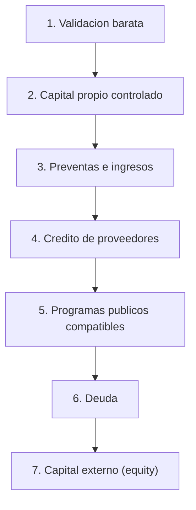

# Financiamiento y apoyo estatal: cómo financiar sin ahogarte

> **En una frase:** el mejor financiamiento es el que se ajusta a la etapa del negocio, no el más grande ni el más
> fácil. Este manual te da el orden para financiarte, las confusiones que arruinan empresas y la carpeta que debes tener
> lista antes de pedir un peso.

Material educativo. Montos, convocatorias, requisitos y plazos de los programas son **dinámicos**: este manual no los
fija. Verifica las bases vigentes en cada institución.

---

## 1. Orden recomendado de financiamiento

| Paso | Qué es | Cuándo tiene sentido | Riesgo principal |
|---|---|---|---|
| 1. Validación barata | Probar la idea con el mínimo gasto | Siempre al comienzo | Gastar antes de saber si hay demanda |
| 2. Capital propio controlado | Aporte de los socios con límite definido | Cuando ya hay evidencia de demanda | Arriesgar ahorros personales sin tope |
| 3. Preventas e ingresos | Clientes que pagan antes o durante | Cuando hay oferta clara | Comprometer entregas que no puedes cumplir |
| 4. Crédito de proveedores | Plazo para pagar insumos | Cuando hay relación comercial | Perder el crédito por atrasos |
| 5. Programas públicos | Fondos concursables, cofinanciamiento, garantías | Cuando calzas con las bases | Depender de un subsidio que no se repite |
| 6. Deuda | Crédito bancario, leasing, factoring | Cuando hay flujo para pagar | Financiar pérdidas estructurales con deuda |
| 7. Equity | Venta de participación | Cuando el crecimiento lo justifica | Ceder control y poner presión de salida |

---

## 2. No confundir

| Confusión peligrosa | Aclaración |
|---|---|
| Subsidio ≠ ingreso recurrente | Una ayuda puntual no sostiene operación permanente |
| Línea de crédito ≠ capital propio | Hay que devolverla con intereses |
| Factoring ≠ mejora de margen | Adelanta caja, pero cuesta margen |
| Inversión ≠ rentabilidad | Recibir dinero no significa ganar dinero |
| Caja ≠ utilidad | Tener efectivo no implica tener ganancia |

---

## 3. Fuentes institucionales a revisar

| Institución | Para qué sirve | Enlace |
|---|---|---|
| SERCOTEC | Apoyo a microempresas y pequeñas empresas | [sercotec.cl](https://www.sercotec.cl/) |
| CORFO | Fomento productivo, innovación, garantías | [corfo.cl](https://www.corfo.cl/) |
| Start-Up Chile | Aceleración de startups | [startupchile.org](https://startupchile.org/) |
| BancoEstado | Crédito y servicios financieros | [bancoestado.cl](https://www.bancoestado.cl/) |
| ProChile | Apoyo a exportadores | [prochile.gob.cl](https://www.prochile.gob.cl/) |

> Convocatorias, montos, elegibilidad y plazos son **DINÁMICOS**. La clase enseña a leer bases y construir
> elegibilidad; no fija montos como si fueran permanentes.

### 3.1. Cómo leer unas bases de postulación

1. **Quién puede postular:** tipo de persona, antigüedad, ventas, ubicación, actividad.
2. **Qué financia y qué no:** gastos elegibles y excluidos.
3. **Cuánto financia:** monto máximo y porcentaje de cofinanciamiento que debes aportar.
4. **Plazos:** apertura, cierre, evaluación y rendición.
5. **Criterios de evaluación:** qué puntúa y con qué peso.
6. **Obligaciones posteriores:** informes, rendiciones, auditorías y plazos de mantención.
7. **Causales de término o devolución:** qué te haría perder el beneficio.

---

## 4. Deuda: preguntas antes de firmar

| Pregunta | Por qué importa |
|---|---|
| ¿Cuánto cuesta realmente (tasa, comisiones, seguros, impuestos)? | La tasa publicada no es el costo total |
| ¿Quién responde si no pago (la empresa, tú, un aval)? | Define el riesgo personal |
| ¿Hay garantías y qué bienes comprometen? | Puedes perder activos clave |
| ¿Qué pasa si me atraso o necesito renegociar? | Cláusulas de aceleración y multas |
| ¿Mi flujo soporta la cuota con un mes malo? | Ejercicio de estrés mínimo |
| ¿Hay alternativas con menor costo o menor garantía? | Compara al menos dos ofertas |

---

## 5. Due diligence: la carpeta que debes tener antes de pedir dinero

Quien te financia revisará tu empresa. Tenerla ordenada acelera la decisión y mejora tu posición.

| Área | Qué preparar |
|---|---|
| Constitución | Escritura, extracto, certificados de vigencia |
| Poderes | Quién representa y con qué facultades |
| SII | Inicio de actividades, carpeta tributaria, declaraciones |
| Ventas | Facturación histórica, clientes principales, concentración |
| Banco | Cartolas, líneas vigentes, historial |
| Contabilidad | Estados financieros, balances, cierres |
| Deudas | Listado de pasivos, vencimientos, garantías |
| Contratos | Clientes, proveedores, arriendos, laborales |
| Cap table | Quién es dueño de qué porcentaje |
| Propiedad intelectual | Marcas, dominios, software, licencias |
| Litigios | Juicios en curso o amenazas |
| Permisos | Patentes y autorizaciones sectoriales |
| Cumplimiento | Políticas y registros relevantes |
| Proyección y uso de fondos | Para qué es el dinero y cómo se mide el retorno |

---

## 6. Cinco errores frecuentes

1. **Pedir más de lo que el flujo puede pagar** por «tener holgura».
2. **Endeudarse para cubrir pérdidas estructurales** en lugar de corregir el modelo.
3. **Postular a fondos sin leer las bases** y descubrir al final que no eras elegible.
4. **Mezclar finanzas personales y de la empresa**, lo que debilita la evaluación.
5. **Entregar equity temprano** sin entender las cláusulas de control y salida.

---

## 7. ¿Cuándo llamar a un profesional?

| Situación | Profesional |
|---|---|
| Revisar un contrato de crédito o garantía | Abogado |
| Construir proyecciones y estados financieros | Contador o asesor financiero |
| Recibir inversión (término de oferta, pacto de socios) | Abogado corporativo y tributario |
| Rendición de fondos públicos | Contador con experiencia en rendiciones |

Más detalle en la [guía de cuándo llamar a un profesional](18_WHEN_TO_CALL_A_PROFESSIONAL.md). Para garantías
específicas, mira también el [anexo 10 sobre sociedades de garantía recíproca](../annexes/10-sociedad-de-garantia-reciproca-sagr.md).

---

## 8. Seis situaciones para practicar

> Casos ilustrativos, con cifras inventadas. No son asesoría.

### 8.1. «Necesito 15 millones para arrancar»

**Situación.** Una diseñadora quiere montar un taller. Piensa pedir un crédito de 15.000.000 de pesos.

**Análisis.** Antes de la deuda, el orden del manual sugiere validar con ventas pequeñas, reunir capital propio acotado y
pedir anticipos a clientes. Si los costos mensuales fijos son 1.200.000 y la cuota del crédito sería 450.000, la cuota
aumenta los costos fijos en 37,5 % (450.000 / 1.200.000). La pregunta es si un mes malo, con la mitad de las ventas
esperadas, todavía cubre ambos montos.

**Decisión.** Empezar con un monto menor, asociado a compras concretas, y dejar la deuda para cuando haya ventas
recurrentes.

### 8.2. El fondo concursable que «paga todo»

**Situación.** Un emprendedor encuentra un fondo que cofinancia un proyecto, pero exige que él aporte una parte y rinda
gastos.

**Análisis.** El aporte propio, la rendición y los plazos son parte del costo del fondo. Si el proyecto necesita comprar
equipos antes de recibir el pago, hay que financiar el intertanto. Lee en las bases qué gastos se aceptan y cuándo se
entrega el dinero.

**Decisión.** Postular solo si tienes la caja para el período previo a recibir los fondos y el equipo para rendir.

### 8.3. El factoring de todas las facturas

**Situación.** Una empresa cede sus facturas a un factoring para tener caja inmediata, mes tras mes.

**Análisis.** Si el descuento promedio es 3 % por 60 días, sobre una factura de 10.000.000 son 300.000 de costo. Repetido
cada mes, la empresa transforma parte de su margen en comisión. El factoring ayuda a un problema de plazo de cobro; no
corrige un margen bajo.

**Decisión.** Medir cuánto margen se va en el factoring y negociar plazos de pago con los clientes.

### 8.4. El socio capitalista

**Situación.** Un conocido ofrece aportar capital a cambio de 40 % de la empresa.

**Análisis.** Antes de aceptar: ¿cuánto vale la empresa hoy?, ¿hay derechos especiales (veto, salida, preferencia)?, ¿qué
ocurre si se necesita más capital?, ¿cómo se vota? Un acuerdo de socios mal pensado pesa más que el dinero recibido.

**Decisión.** Ir a un abogado corporativo antes de firmar y comparar con alternativas de deuda.

### 8.5. El aval personal

**Situación.** El banco pide el aval personal del dueño para un crédito de la empresa.

**Análisis.** Si la empresa no paga, el aval compromete el patrimonio personal. Pregunta qué bienes quedan expuestos,
si el aval es limitado o ilimitado y si existen garantías alternativas, como las que otorgan instituciones de garantía.

**Decisión.** Leer el contrato completo con un abogado y evaluar alternativas de garantía.

### 8.6. La caja que parece utilidad

**Situación.** Un negocio recibe un anticipo grande y cree que ganó mucho ese mes.

**Análisis.** El anticipo es una obligación de entregar el servicio, no una utilidad. Si gasta la caja y luego no tiene
cómo entregar, queda con deuda con el cliente.

**Decisión.** Separar caja comprometida de caja libre y proyectar el flujo por semanas.

---

## 9. Qué financiamiento mirar según la etapa

| Etapa | Pregunta central | Fuentes habituales | Cuidado |
|---|---|---|---|
| Idea | ¿Hay demanda? | Ahorro propio, preventas | No gastar en estructura antes de validar |
| Prototipo | ¿Funciona? | Fondos de innovación, capital propio | Rendiciones y plazos |
| Primeras ventas | ¿Es repetible? | Crédito de proveedores, líneas pequeñas | Mezclar finanzas personales |
| Crecimiento | ¿Puedo escalar con caja? | Deuda, leasing, programas de crecimiento | Aumentar costos fijos antes de ingresos |
| Expansión | ¿Necesito socio o inversión? | Equity, deuda estructurada | Ceder control sin entender cláusulas |
| Madurez | ¿Cómo optimizo capital? | Refinanciamiento, retención de utilidades | Distribuir demasiado y quedar sin caja |

---

## 10. Plantillas

### 10.1. Presupuesto de uso de fondos

| Rubro | Monto | % del total | ¿Elegible en las bases? | Evidencia |
|---|---:|---:|:---:|---|
| Equipos | | | | |
| Servicios externos | | | | |
| Marketing | | | | |
| Capital de trabajo | | | | |
| Otros | | | | |
| **Total** | | 100 % | | |

### 10.2. Lista de verificación antes de postular

- [ ] Leí las bases completas.
- [ ] Cumplo todos los requisitos de elegibilidad.
- [ ] Tengo la documentación al día (SII, banco, constitución).
- [ ] Sé cuánto debo aportar y de dónde saldrá.
- [ ] Sé cuándo se recibe el dinero y cómo se rinde.
- [ ] Anoté las fechas de cierre y de rendición.
- [ ] Un tercero revisó la postulación.

### 10.3. Prueba de estrés de una cuota

| Concepto | Mes normal | Mes malo (−30 %) |
|---|---:|---:|
| Ventas | | |
| Costos variables | | |
| Costos fijos | | |
| Cuota de la deuda | | |
| Saldo | | |

Si el saldo del mes malo es negativo, necesitas colchón de caja o una deuda menor.

---

## 11. Preguntas frecuentes

**1. ¿Puedo postular a un fondo público si no tengo ventas?**
Depende de las bases; algunos programas son para ideas o prototipos y otros exigen ventas. Lee la elegibilidad.

**2. ¿Un fondo público me exige devolver el dinero?**
Algunos son subsidios o cofinanciamientos y otros son créditos o garantías. El tipo se define en cada convocatoria.

**3. ¿Me conviene más deuda o socio?**
Depende del flujo, la etapa y cuánto control quieres conservar. La deuda se paga con caja; el socio cede participación.

**4. ¿Qué es un cap table?**
La tabla que muestra quién es dueño de qué porcentaje de la empresa.

**5. ¿Puedo usar mis ahorros personales?**
Sí, pero fija un tope y registra el aporte (como capital o préstamo) para no mezclar finanzas.

**6. ¿Qué diferencia hay entre aporte y préstamo de un socio?**
El aporte es capital; el préstamo se devuelve. Cómo se documenta tiene efectos contables y tributarios: consulta al contador.

**7. ¿Cuánto debo pedir?**
Lo necesario para un objetivo concreto con resultado medible, más un colchón razonable, sin superar lo que el flujo pueda pagar.

**8. ¿Qué pasa si no cumplo las rendiciones de un fondo?**
Puedes tener que devolver parte o la totalidad y quedar inhabilitado en futuras convocatorias, según las bases.

**9. ¿Cómo evalúa un banco a una empresa nueva?**
Mira historial, flujo, garantías y a los socios; con empresas nuevas suele pedir respaldos adicionales.

**10. ¿Debo contratar a un asesor para postular?**
No siempre; pero revisar una postulación con alguien con experiencia puede evitar errores de elegibilidad.

**11. ¿Es mala idea el leasing?**
No necesariamente; es una forma de financiar equipos. Compara costo total y condiciones de término.

**12. ¿Cuándo llamar a un profesional?**
Antes de firmar créditos, garantías o aportes de capital, y para estructurar rendiciones.

---

## 12. Glosario

| Término | Significado |
|---|---|
| Aval | Garantía personal que respalda una deuda |
| Cap table | Registro de quién posee qué porcentaje |
| Capital de trabajo | Recursos para operar el día a día |
| Cofinanciamiento | Programa que paga una parte y exige aporte propio |
| Due diligence | Revisión detallada de una empresa antes de financiarla |
| Equity | Financiamiento a cambio de participación |
| Factoring | Venta o cesión de facturas para adelantar caja |
| Leasing | Arriendo con opción de compra de un bien |
| Prueba de estrés | Simular un mes malo para ver si se puede pagar |
| Rendición | Informe de cómo se usaron los fondos recibidos |
| Subsidio | Apoyo económico no reembolsable bajo condiciones |
