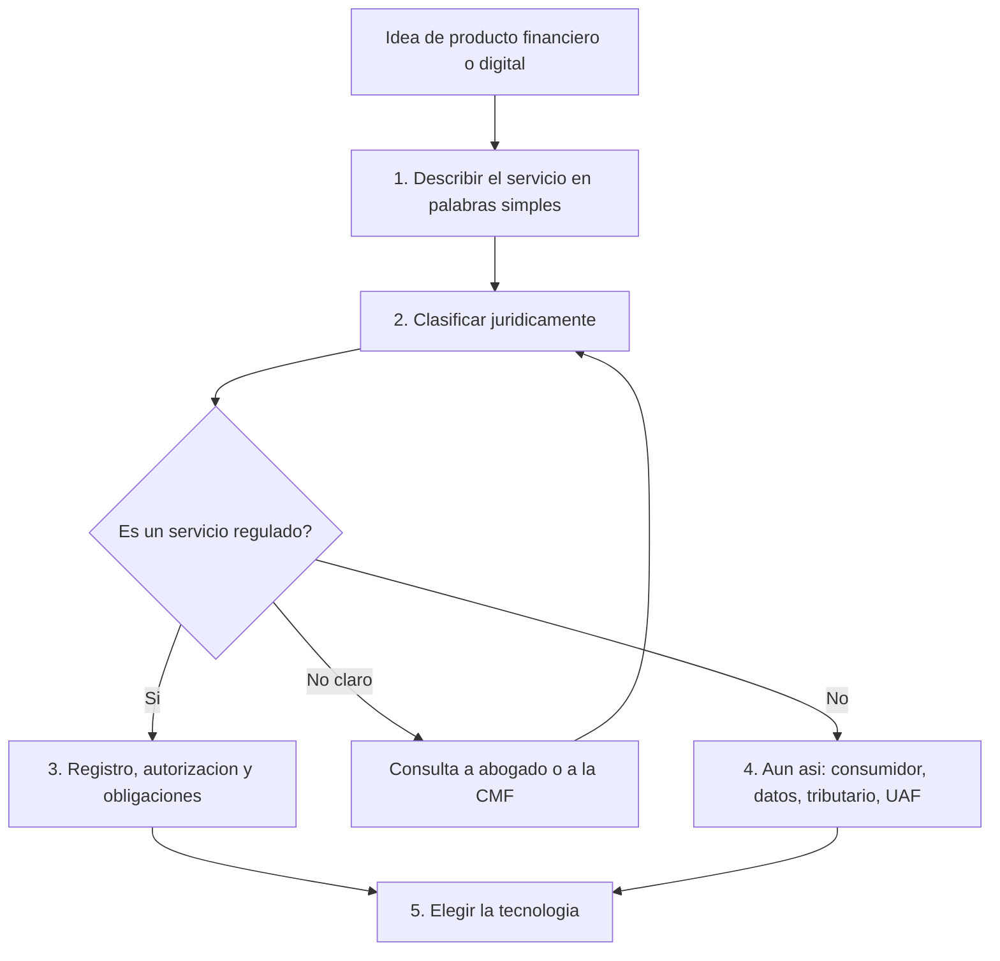
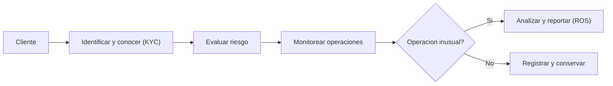
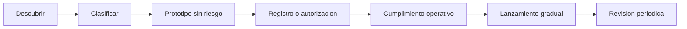
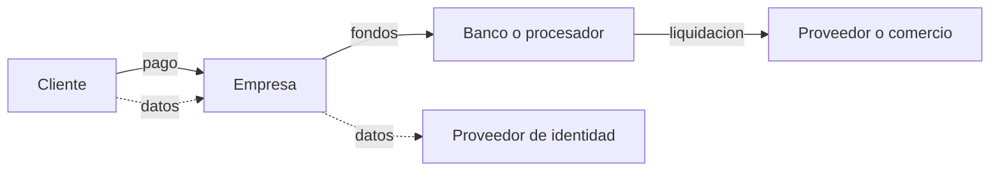

# Fintech, pagos y activos digitales: mapa regulatorio para una empresa

> **En una frase:** en servicios financieros y activos digitales, **primero se clasifica jurídicamente el servicio y
> después se elige la tecnología**. Usar blockchain, una app o una API no elimina la regulación. Este manual te da un
> método para clasificar lo que haces, saber si necesitas registro o autorización y qué obligaciones de prevención de
> lavado de activos pueden aplicarte.

Material educativo, sin revisión legal. Se apoya en la descripción oficial de la **CMF** sobre la Ley Fintec y en las
fuentes de la **UAF**; **no se leyó el texto íntegro** de la Ley 21.521, de la NCG 502, de la NCG 514 ni de la Ley 19.913
para este manual. Las normas fintech cambian con rapidez: verifica siempre en la CMF, la UAF y el Banco Central, y
consulta a un abogado financiero antes de lanzar o modificar cualquier servicio.

---

## 1. La regla: clasificar primero, programar después

| Error habitual | Por qué es peligroso |
|---|---|
| «Es tecnología, no es un servicio financiero» | La regulación mira la **función** que cumples, no el medio |
| «Estamos en blockchain, no aplica» | El soporte no cambia lo que haces con el dinero o el derecho |
| «Ya nos inscribimos, estamos habilitados» | Inscribirse **no siempre basta**: puede requerirse autorización |
| «Somos solo una plataforma» | Quien intermedia, custodia o enruta puede estar regulado |
| «Lanzamos y vemos» | Operar sin la autorización necesaria puede acarrear sanciones y cierre |

---

## 2. Ley Fintec 21.521: qué regula

La Ley 21.521 regula, entre otros, los siguientes servicios:

| Servicio | En palabras simples | Pregunta clave |
|---|---|---|
| **Plataformas de financiamiento colectivo** | Conectan a quienes buscan fondos con quienes quieren aportarlos | ¿Intermedias fondos de terceros hacia un proyecto o empresa? |
| **Sistemas alternativos de transacción** | Espacios donde se negocian instrumentos financieros fuera de bolsas tradicionales | ¿Reúnes órdenes de compra y venta de instrumentos? |
| **Asesoría crediticia** | Recomendar o intermediar productos de crédito | ¿Aconsejas a personas qué crédito tomar? |
| **Asesoría de inversión** | Recomendar inversiones en instrumentos financieros | ¿Recomiendas qué comprar o vender? |
| **Custodia de instrumentos financieros** | Guardar instrumentos por cuenta de otros | ¿Mantienes instrumentos de clientes a tu nombre o bajo tu control? |
| **Enrutamiento de órdenes** | Transmitir órdenes de clientes a donde se ejecutan | ¿Envías órdenes a otros sistemas o intermediarios? |
| **Intermediación de instrumentos financieros** | Comprar o vender instrumentos por cuenta de clientes | ¿Actúas como corredor o agente? |

Fuente de la CMF: [CMF, Ley Fintec](https://www.cmfchile.cl/portal/principal/623/w4-article-60920.html).

### 2.1. Registro, autorización y la trampa de «ya estoy inscrito»

La **CMF mantiene el Registro de Prestadores de Servicios Financieros (RPSF)**. La propia CMF señala que **inscribirse no
siempre basta**: la prestación de ciertos servicios regulados **requiere autorización cuando corresponda**.

| Situación | Qué implica |
|---|---|
| Servicio que exige solo inscripción | Cumples el registro y las obligaciones asociadas |
| Servicio que exige autorización | Debes obtenerla **antes** de operar |
| Dudas sobre cuál aplica | Consultar a la CMF o a un abogado antes de lanzar |

### 2.2. NCG 502

La **Norma de Carácter General N.º 502** de la CMF regula el **registro, la autorización y las obligaciones** de los
prestadores de servicios Fintec. Es la norma operativa que debes leer, junto con su actualización vigente, cuando tu
servicio caiga en esta categoría.

### 2.3. Sistema de Finanzas Abiertas

El sistema de finanzas abiertas permite compartir datos y servicios financieros entre entidades con consentimiento del
cliente. En **junio de 2026**, la CMF modificó la **NCG 514**, incorporó especificaciones técnicas y **postergó su entrada
en vigor hasta julio de 2027**. Fuente:
[CMF, comunicado](https://www.cmfchile.cl/portal/prensa/625/w4-article-110881.html).

> **Qué hacer con eso:** si tu modelo depende de acceder a datos bancarios de clientes por API, planifica con la fecha
> vigente, no con la anterior, y vuelve a verificar antes de comprometer inversiones.

---

## 3. Otros regímenes que se cruzan con un servicio fintech

| Régimen | Cuándo aparece | Qué verificar |
|---|---|---|
| **Medios de pago** | Emitir tarjetas, billeteras o instrumentos con fondos de clientes | Reglas del Banco Central y la CMF; operadores y emisores |
| **Mercado de valores** | Ofrecer valores o instrumentos al público | Normas de la CMF sobre oferta pública |
| **Banca y créditos** | Otorgar créditos de dinero de forma habitual | Normas sobre tasas, información y registro |
| **Protección al consumidor** | Si tus clientes son personas | Ley 19.496: información, contratos, reclamos |
| **Datos personales** | Siempre que trates datos de clientes | Ley 19.628 y Ley 21.719 desde su vigencia |
| **Ciberseguridad** | Siempre; refuerzos según categoría | Ley 21.663 y buenas prácticas |
| **Tributario** | Operaciones, comisiones, intereses, cripto | SII y asesor tributario |
| **UAF** | Si tu actividad es sujeto obligado | Ver sección siguiente |

---

## 4. UAF: prevención de lavado de activos y financiamiento del terrorismo

Si tu actividad está dentro del **artículo 3 de la Ley 19.913**, eres sujeto obligado y debes cumplir un conjunto de
deberes. La UAF informa que existen actividades privadas obligadas (el manual de compliance consigna 55 actividades
informadas por la UAF); verifica la lista vigente en su sitio:
[UAF, quiénes deben reportar](https://www.uaf.cl/es-cl/sujetos-obligados/sector-privado/quienes-deben-reportar).

| Obligación | Qué implica en la práctica |
|---|---|
| **Registro** | Inscribirse ante la UAF como sujeto obligado |
| **Oficial de cumplimiento** | Designar a una persona responsable con independencia |
| **Sistema preventivo** | Políticas y procedimientos de prevención, proporcionales al riesgo |
| **Debida diligencia** | Conocer al cliente (identidad, actividad, beneficiario final, origen de fondos según el riesgo) |
| **Registros** | Conservar la documentación por los plazos legales |
| **ROS y ROE** | Reportes de operaciones sospechosas y de operaciones en efectivo, según corresponda |
| **Capacitación** | Formación periódica del personal |
| **Conservación de evidencia** | Orden y disponibilidad para fiscalizaciones |

> **Importante:** estar o no en la lista de sujetos obligados no depende de lo que tú creas, sino de tu actividad real.
> Revisa la lista con asesoría.

---

## 5. Activos digitales: no asumir que «usar blockchain» elimina la regulación

Antes de lanzar un token, una billetera, un intercambio o una pasarela cripto, analiza estas preguntas:

| N.º | Pregunta | Por qué importa |
|---:|---|---|
| 1 | ¿**Qué derecho** representa el token o activo? | Si representa un crédito, participación o valor, puede ser un instrumento financiero |
| 2 | ¿**Quién custodia**? | Custodiar por cuenta de otros activa obligaciones y riesgos |
| 3 | ¿Hay **instrumento financiero**? | Puede aplicar mercado de valores o la Ley Fintec |
| 4 | ¿Existe un **medio de pago**? | Puede activar reglas de pagos |
| 5 | ¿Se **intermedia**? | Poner en contacto y ejecutar operaciones puede ser intermediación |
| 6 | ¿Hay obligaciones **AML** (lavado de activos)? | Posible sujeto obligado ante la UAF |
| 7 | ¿Cuál es el tratamiento de **impuestos**? | Renta, IVA y registros según la operación |
| 8 | ¿Cómo se **protege al cliente**? | Información, contratos, reclamos |
| 9 | ¿Qué **ciberseguridad** se aplica? | Claves, custodia, respaldo, respuesta a incidentes |
| 10 | ¿Hay **transferencias internacionales**? | Datos, fondos y proveedores en otros países |

### 5.1. Cuatro ejemplos para razonar (ilustrativos)

| Caso | Preguntas clave | Posible lectura |
|---|---|---|
| **Token de acceso a una app** (da derecho a usar un servicio) | ¿Promete rentabilidad? ¿Se puede revender en un mercado? | Si solo da acceso y no hay promesa de retorno, el riesgo regulatorio es menor, pero hay que revisar consumidor y tributario |
| **Token que promete participar en ganancias** | ¿Se ofrece al público? ¿Qué derechos otorga? | Puede asimilarse a un valor o instrumento financiero; consulta a un abogado de mercado de capitales |
| **Billetera que guarda criptoactivos de clientes** | ¿Quién controla las claves? | La custodia por cuenta de terceros exige un análisis serio y controles de seguridad |
| **Pasarela que cobra en cripto y liquida en pesos** | ¿Hay medio de pago? ¿Se cambia moneda? ¿Hay KYC? | Puede tocar medios de pago, UAF y tributario |

### 5.2. Cripto y tributación

El tratamiento tributario de operaciones con activos digitales depende del caso (ganancias, ingresos, IVA en servicios,
registros). **No lo resuelvas por intuición:** consulta a un asesor tributario y revisa las instrucciones vigentes del SII.

---

## 6. Proyecto fintech: cómo avanzar sin quemar la inversión

| Etapa | Qué hacer | Entregable |
|---|---|---|
| 1. Descubrimiento | Describir el servicio, sus flujos de dinero y de datos | Diagrama de flujos |
| 2. Clasificación | Consultar a un abogado financiero sobre el encuadre | Opinión escrita |
| 3. Prototipo sin riesgo | Probar con montos mínimos y sin custodiar fondos de terceros | Prueba controlada |
| 4. Registro o autorización | Cumplir ante la CMF lo que corresponda | Solicitud o inscripción |
| 5. Cumplimiento operativo | Políticas, KYC, seguridad, contratos | Sistema operativo |
| 6. Lanzamiento gradual | Abrir por tramos, monitorear | Informe de lanzamiento |
| 7. Revisión periódica | Actualizar frente a cambios normativos | Plan anual |

---

## 7. Contratos y alianzas en un proyecto fintech

| Con quién | Qué cuidar en el contrato |
|---|---|
| **Banco o procesador de pagos** | Quién custodia los fondos, plazos de liquidación, contracargos, causales de cierre de cuenta, reglas de uso permitido |
| **Proveedor de identidad (KYC)** | Qué datos recibe, dónde los guarda, plazo de conservación, responsabilidad por falsos positivos |
| **Proveedor de nube** | País, seguridad, continuidad, notificación de incidentes, portabilidad de los datos |
| **Socio comercial o marca blanca** | Quién es el prestador regulado, quién responde ante el cliente, cláusulas de cumplimiento |
| **Clientes** | Términos claros, comisiones visibles, reclamos, derechos de retracto y devoluciones según corresponda |
| **Asesores** | Alcance, confidencialidad, entregables |

**Cláusulas que conviene negociar siempre:**

1. Quién es el **prestador regulado** y quién responde frente al cliente.
2. Qué ocurre con los **fondos de clientes** ante insolvencia de cualquiera de las partes.
3. **Cumplimiento y auditoría**: derecho a revisar procesos y a recibir información.
4. **Seguridad y notificación** de incidentes.
5. **Terminación**: transición ordenada y devolución de datos.

---

## 8. Riesgos y controles típicos

| Riesgo | Ejemplo | Control |
|---|---|---|
| **Regulatorio** | Operar sin la autorización necesaria | Clasificación previa y revisión legal periódica |
| **Fraude y suplantación** | Cuentas falsas o robo de identidad | KYC proporcional, monitoreo de patrones |
| **Lavado de activos** | Uso del servicio para mover fondos ilícitos | Sistema preventivo y reportes |
| **Seguridad** | Robo de claves o credenciales | MFA, segregación de funciones, custodia segura |
| **Operacional** | Caída de la plataforma o errores de cálculo | Pruebas, redundancia, conciliaciones |
| **Liquidez y contraparte** | Un socio financiero deja de operar | Diversificación y plan de contingencia |
| **Reputacional** | Un incidente que expone a clientes | Plan de comunicación y respuesta |
| **Tributario** | Registro incorrecto de comisiones o ganancias | Asesoría tributaria y contabilidad al día |

---

## 9. Ocho situaciones para practicar

> Casos ilustrativos, con nombres y cifras inventados. No son asesoría.

### 9.1. La app de «ahorro entre amigos»

**Situación.** Una startup quiere que grupos de personas junten dinero, lo guarden en una cuenta de la empresa y lo
presten entre sí.

**Análisis.** Recibir fondos de terceros, custodiarlos y destinarlos a préstamos puede configurar servicios regulados y
actividades reservadas. Hay que mapear el flujo de dinero antes de programar nada.

**Decisión.** Opinión legal escrita sobre el encuadre y alternativas (por ejemplo, operar a través de una entidad ya
autorizada).

### 9.2. La plataforma que conecta inversionistas con pymes

**Situación.** Una plataforma publica proyectos de pymes y permite que personas aporten dinero a cambio de un retorno.

**Análisis.** Se parece a un financiamiento colectivo, regulado por la Ley Fintec. Corresponde evaluar registro,
autorización y obligaciones de información y de protección al inversionista.

**Decisión.** No lanzar sin el encuadre aprobado; consultar a un abogado de mercado de capitales.

### 9.3. El asesor que recomienda inversiones en redes sociales

**Situación.** Un influencer recomienda activos y cobra por «señales de compra».

**Análisis.** Recomendar inversiones de forma habitual y por una remuneración puede ser asesoría de inversión. Hay que
verificar si aplica el registro y las obligaciones.

**Decisión.** Consultar antes de monetizar; separar contenido educativo de recomendaciones personalizadas.

### 9.4. La billetera con claves compartidas

**Situación.** Una empresa guarda los criptoactivos de sus clientes en una billetera controlada por dos empleados.

**Análisis.** Custodiar por cuenta de terceros exige controles de seguridad, segregación de funciones y un marco legal
claro. Un solo incidente puede ser catastrófico.

**Decisión.** Evaluar custodia con un proveedor especializado y definir políticas de claves, respaldos y firmas múltiples.

### 9.5. El pago de proveedores del exterior con cripto

**Situación.** Una importadora quiere pagar a un proveedor con una criptomoneda para ahorrar comisiones.

**Análisis.** Hay que considerar el tratamiento tributario, el cumplimiento cambiario y bancario, y los riesgos de
volatilidad y de contraparte. Documentar cada operación.

**Decisión.** Consultar al contador y al banco antes de usar este medio de pago.

### 9.6. El sujeto obligado que no lo sabía

**Situación.** Una empresa de compraventa de ciertos bienes de alto valor descubre que su actividad figura entre las que
deben registrarse ante la UAF.

**Análisis.** Si la actividad está en la lista, debe registrarse, designar oficial de cumplimiento y establecer un sistema
preventivo. El desconocimiento no la exime.

**Decisión.** Revisar la lista oficial, registrarse y construir el sistema con asesoría.

### 9.7. El «buy now, pay later» de una tienda

**Situación.** Una tienda ofrece pagar en cuotas sin interés y financia directamente a sus clientes.

**Análisis.** Otorgar crédito habitual a personas puede tener reglas específicas de información, tasas y protección del
consumidor. Los contratos y la publicidad deben ser claros.

**Decisión.** Revisar contratos de crédito y publicidad con un abogado, y definir el procedimiento de cobranza.

### 9.8. La integración con datos bancarios

**Situación.** Una fintech quiere leer los movimientos bancarios de sus clientes para ofrecer un servicio de gestión.

**Análisis.** El sistema de finanzas abiertas entra en vigor más adelante (julio de 2027, según la última modificación de
la CMF) y exige condiciones. Mientras tanto, cualquier acceso a datos debe tener base legal y seguridad adecuada.

**Decisión.** Planificar con el calendario vigente, asegurar consentimientos y consultar a un abogado de datos.

---

## 10. Catálogo de errores frecuentes

| N.º | Error | Consecuencia | Cómo evitarlo |
|---:|---|---|---|
| 1 | Decidir la tecnología antes de clasificar el servicio | Rediseño costoso o prohibición | Clasificación jurídica primero |
| 2 | Creer que inscribirse equivale a estar autorizado | Operar sin autorización | Revisar si se requiere autorización |
| 3 | Mezclar fondos de clientes con los de la empresa | Riesgos de insolvencia y sanciones | Segregación y cuentas separadas |
| 4 | Ignorar la lista de sujetos obligados | Incumplimiento ante la UAF | Verificar con la lista vigente |
| 5 | KYC mínimo o inexistente | Riesgo de lavado y sanciones | Debida diligencia proporcional |
| 6 | No registrar operaciones ni evidencia | Imposibilidad de explicar y defender | Registros ordenados |
| 7 | Prometer rentabilidades | Publicidad engañosa y posible oferta de valores | Lenguaje prudente y revisión legal |
| 8 | Guardar claves en un solo lugar o persona | Pérdida o robo | Firmas múltiples y respaldo |
| 9 | Tributación al final | Sorpresas fiscales | Asesor desde el inicio |
| 10 | Contratos con proveedores sin cláusulas de seguridad | Incidentes sin responsable | Cláusulas y auditoría |
| 11 | Datos personales sin base ni inventario | Riesgo regulatorio | Inventario y contratos |
| 12 | Lanzar a todo público sin piloto | Errores a gran escala | Lanzamiento gradual |
| 13 | No actualizarse ante cambios normativos | Incumplimiento sobrevenido | Revisión periódica |
| 14 | Depender de un único banco | Cierre de cuenta paraliza | Alternativas y plan de contingencia |
| 15 | Confundir educación con asesoría | Posible asesoría no autorizada | Separar contenidos y recomendaciones |

---

## 11. Calendario, listas y plantillas

### 11.1. Calendario de cumplimiento de un proyecto fintech

| Cuándo | Tarea |
|---|---|
| Cada día | Monitoreo de operaciones, conciliaciones y alertas de fraude |
| Cada semana | Revisión de excepciones y reclamos |
| Cada mes | Reporte de cumplimiento; revisión de accesos |
| Cada trimestre | Revisión de proveedores críticos y de riesgos |
| Cada año | Capacitación, revisión del sistema preventivo, evaluación externa, actualización normativa |
| Ante cambios | Nuevo servicio o mercado: nueva clasificación y revisión legal |

### 11.2. Ficha de clasificación del servicio

| Pregunta | Respuesta |
|---|---|
| ¿Qué hace el servicio exactamente? | |
| ¿Quién entrega y quién recibe dinero? | |
| ¿Se custodian fondos o instrumentos de terceros? | |
| ¿Se recomienda, intermedia o ejecuta? | |
| ¿Quién es el cliente (persona o empresa)? | |
| ¿Se ofrece al público? | |
| ¿Se usa cripto o tokens? | |
| ¿Qué régimen podría aplicar? | |
| ¿Quién revisó (abogado) y cuándo? | |

### 11.3. Lista de verificación KYC básica

- [ ] Identidad verificada con documento válido.
- [ ] Actividad y fuente de fondos acordes al riesgo.
- [ ] Beneficiario final identificado en personas jurídicas.
- [ ] Revisión de listas de restricción cuando corresponda.
- [ ] Perfil de riesgo asignado y documentado.
- [ ] Monitoreo continuo y actualización periódica.

### 11.4. Registro de operaciones inusuales

| Fecha | Cliente | Operación | Señal de alerta | Análisis | Decisión | Reporte (sí/no) |
|---|---|---|---|---|---|---|
| | | | | | | |

---

## 12. Herramientas para pensar y preparar tu proyecto

### 12.1. Cómo leer una norma de la CMF sin perderte

Las normas de carácter general (NCG) son largas y técnicas. Una forma ordenada de leerlas:

1. **Busca el ámbito de aplicación:** a quién se dirige y qué servicios cubre. Si no estás en el ámbito, no es tu norma.
2. **Ubica las definiciones:** muchos términos tienen un significado preciso que cambia la lectura.
3. **Identifica los requisitos de ingreso:** registro, autorización, capital, garantías, documentación.
4. **Marca las obligaciones continuas:** información, reportes, controles, auditorías, plazos.
5. **Revisa las fechas de vigencia y de transición:** una norma puede entrar por etapas.
6. **Anota lo que no entiendas** y llévalo a tu abogado como lista de preguntas.
7. **Verifica si fue modificada:** busca la versión vigente y las normas que la complementan.

### 12.2. Los flujos de dinero, dibujados

Antes de cualquier opinión legal, dibuja tres flujos: el **de dinero**, el **de datos** y el **de responsabilidad**.

| Flujo | Pregunta | Ejemplo |
|---|---|---|
| Dinero | ¿Por dónde pasa el dinero y quién lo controla en cada momento? | Cliente → cuenta de la empresa → proveedor |
| Datos | ¿Qué datos se recolectan, dónde se guardan y quién los ve? | Cliente → app → nube → socio de verificación |
| Responsabilidad | ¿Quién responde ante el cliente si algo falla? | La empresa, el banco o el socio |

Si en el dibujo **tu empresa toca fondos de terceros, custodia activos o recomienda decisiones**, es probable que
necesites un análisis regulatorio profundo antes de seguir.

### 12.3. Diez preguntas que te harán un banco, un inversionista o la CMF

1. ¿Qué servicio exacto prestas y a quiénes?
2. ¿Quién tiene el dinero o los activos de los clientes en cada etapa?
3. ¿Qué autorización o registro tienes o has solicitado?
4. ¿Quiénes son los dueños finales y los administradores?
5. ¿Cómo conoces a tus clientes y detectas operaciones inusuales?
6. ¿Qué pasa con los fondos de clientes si tu empresa quiebra?
7. ¿Qué controles de ciberseguridad aplicas?
8. ¿Qué proveedores críticos usas y cómo los controlas?
9. ¿Cómo atiendes reclamos y devuelves dinero?
10. ¿Qué planes de contingencia tienes si pierdes tu banco o tu proveedor principal?

### 12.4. Carpeta mínima para una consulta regulatoria

| Documento | Para qué |
|---|---|
| Descripción del servicio en dos páginas | Que el abogado entienda el modelo |
| Diagrama de flujos de dinero, datos y responsabilidad | Base del análisis |
| Estructura societaria y beneficiarios finales | Requisitos de registro y KYC |
| Términos y condiciones en borrador | Revisión de promesas y derechos |
| Proveedores y contratos relevantes | Detección de riesgos |
| Políticas de seguridad y prevención | Evaluación de controles |
| Proyecciones y plan de lanzamiento | Alcance y volumen |

### 12.5. Señales para detenerse antes de lanzar

- Nadie puede explicar en una frase qué hace el servicio ni quién custodia el dinero.
- La publicidad promete rentabilidad o ausencia de riesgo.
- No existe una opinión escrita sobre el encuadre regulatorio.
- No hay política de prevención de lavado de activos ni responsable.
- La seguridad de claves depende de una sola persona o de un solo dispositivo.
- Se planea operar con clientes antes de tener los contratos y términos revisados.

### 12.6. Un caso completo, paso a paso (ilustrativo)

**Idea.** «Una app donde freelancers reciben pagos de clientes del exterior y los convierten a pesos».

| Paso | Qué se hace | Resultado |
|---:|---|---|
| 1 | Se describe el servicio: el cliente extranjero paga, la app recibe, convierte y entrega al freelancer | Descripción en una página |
| 2 | Se dibujan los flujos: el dinero pasa por la cuenta de la app | La empresa **toca fondos de terceros** |
| 3 | Se hacen las preguntas de clasificación: ¿custodia?, ¿medio de pago?, ¿cambio de moneda?, ¿KYC? | Varias respuestas «posiblemente sí» |
| 4 | Se consulta a un abogado financiero con la carpeta mínima | Opinión sobre registro, autorización y obligaciones |
| 5 | Se evalúan alternativas: operar a través de un banco o procesador autorizado, o limitar el modelo | Un diseño que reduce la exposición regulatoria |
| 6 | Se diseña el KYC, el sistema preventivo y la seguridad | Políticas y responsables |
| 7 | Se prueba con pocos usuarios y montos bajos | Piloto controlado |
| 8 | Se lanza por tramos y se revisa la normativa cada año | Operación con seguimiento |

**Lección.** El paso 2 (dibujar el flujo de dinero) cambió todo el proyecto: sin él, el equipo habría programado durante
seis meses un servicio que quizá no podía operar como lo imaginó.

### 12.7. Otro caso: un token de fidelización

**Idea.** Una cadena de cafeterías quiere emitir un «token» que los clientes acumulen y canjeen por productos.

| Pregunta | Respuesta del caso | Lectura |
|---|---|---|
| ¿Qué derecho representa? | Descuentos y productos de la propia cadena | Es un beneficio comercial, no un derecho financiero |
| ¿Promete rentabilidad? | No | Menor riesgo regulatorio |
| ¿Se puede vender a terceros? | No, solo canjear | Evita que se convierta en un activo de inversión |
| ¿Hay custodia de fondos? | No | No aplica custodia |
| ¿Qué otras normas aplican? | Consumidor, datos personales y tributario | Revisar términos, privacidad e impuestos |

**Lección.** Diseñar el producto para que **no** prometa retorno ni sea transferible reduce el riesgo regulatorio, pero
siempre hay que revisar consumidor, datos y tributario.

### 12.8. Qué conservar para demostrar tu diligencia

Si una autoridad, un banco o un socio te pregunta cómo decidiste lanzar tu servicio, necesitas poder mostrar el camino:

1. La **descripción del servicio** de la fecha en que se evaluó.
2. La **opinión escrita** que clasificó el servicio y sus conclusiones.
3. Los **diagramas de flujos** de dinero, datos y responsabilidad vigentes.
4. Las **actas** de las decisiones de lanzar, ajustar o descartar funcionalidades.
5. El registro de **cambios** del producto que alteraron el encuadre regulatorio.
6. La evidencia de **capacitación** y de revisión periódica del sistema preventivo.

Guardar esta evidencia ordenada es parte del cumplimiento: muestra que decidiste con información y no por improvisación.

---

## 13. Preguntas frecuentes

**1. ¿Una startup fintech necesita autorización antes de lanzar?**
Depende del servicio. La CMF señala que inscribirse no siempre basta; cuando corresponda, se requiere autorización.

**2. ¿Qué es el RPSF?**
El Registro de Prestadores de Servicios Financieros que mantiene la CMF.

**3. ¿Qué norma regula el registro y las obligaciones de los prestadores Fintec?**
La NCG 502 de la CMF, junto con sus modificaciones.

**4. ¿Qué pasa con el Sistema de Finanzas Abiertas?**
En junio de 2026 la CMF modificó la NCG 514 y postergó la entrada en vigor hasta julio de 2027; verifica la fecha vigente.

**5. ¿Soy sujeto obligado ante la UAF?**
Depende de tu actividad según el art. 3 de la Ley 19.913; revisa la lista de la UAF.

**6. ¿Qué es un ROS?**
Un reporte de operación sospechosa que se envía a la UAF.

**7. ¿Usar blockchain me exime de regular?**
No: lo relevante es el servicio que prestas, no la tecnología.

**8. ¿Puedo custodiar criptoactivos de clientes?**
Es una actividad de alto riesgo y puede tener regulación; consulta a un abogado financiero.

**9. ¿Tengo que pagar impuestos por operaciones con cripto?**
Depende del caso; consulta a un asesor tributario y revisa al SII.

**10. ¿Puedo ofrecer rentabilidad garantizada?**
Es muy riesgoso: puede constituir publicidad engañosa u oferta de valores. Consulta antes.

**11. ¿Una tienda puede financiar a sus clientes?**
Puede, pero aplican reglas de información, consumo y, según el caso, de crédito.

**12. ¿Qué diferencia hay entre asesoría de inversión y educación financiera?**
La asesoría recomienda productos o decisiones a una persona; la educación explica conceptos de forma general. Consulta dónde está la frontera en tu caso.

**13. ¿Qué datos puedo pedir a mis clientes?**
Los necesarios para la finalidad y las obligaciones legales (KYC), con base de licitud y seguridad.

**14. ¿Cuánto tiempo debo conservar los registros?**
Los plazos legales aplicables a tu actividad; consulta a la UAF y al contador.

**15. ¿Puedo usar IA para evaluar clientes?**
Puedes apoyarte en modelos, pero debes cuidar sesgos, explicabilidad, datos personales y supervisión humana.

**16. ¿Qué ocurre si me cierran la cuenta bancaria?**
Ten planes alternativos y un diálogo con tu banco; revisa causas y consulta a un abogado.

**17. ¿Debo contratar un oficial de cumplimiento?**
Si eres sujeto obligado, sí. En otros casos, es una buena práctica según el riesgo.

**18. ¿Cómo comunico riesgos a los clientes?**
Con lenguaje claro, visible y sin promesas engañosas.

**19. ¿Puedo probar un servicio con pocos clientes?**
Sí, pero la regulación aplica igual; ten claro el encuadre.

**20. ¿Quién fiscaliza?**
La CMF, la UAF y otras autoridades según el servicio; en datos personales, la autoridad correspondiente.

**21. ¿Se puede operar desde el extranjero hacia Chile?**
Ofrecer servicios a personas en Chile puede activar la regulación local; consulta a un abogado.

**22. ¿Qué hago ante un incidente de seguridad?**
Contener, evaluar, informar a quienes corresponda y mejorar controles; consulta a especialistas.

**23. ¿Cuánto cuesta cumplir?**
Este manual no fija costos; dependen del servicio y del tamaño.

**24. ¿Puedo copiar los términos de otra fintech?**
No sin adaptarlos; cada servicio tiene condiciones y riesgos distintos.

**25. ¿Cuándo llamar a un profesional?**
Antes de lanzar, al clasificar el servicio, al registrarte, al diseñar KYC y ante incidentes. Ver la
[guía de cuándo llamar a un profesional](18_WHEN_TO_CALL_A_PROFESSIONAL.md).

---

## 14. Glosario

| Término | Significado |
|---|---|
| AML | Prevención de lavado de activos |
| Beneficiario final | Persona natural que en último término controla o se beneficia de una entidad |
| Custodia | Guarda de activos por cuenta de otro |
| Debida diligencia | Verificación del cliente y de la operación |
| Enrutamiento de órdenes | Transmitir órdenes de clientes a un lugar de ejecución |
| Financiamiento colectivo | Obtención de fondos de varias personas para un proyecto |
| Finanzas abiertas | Intercambio de datos y servicios financieros con consentimiento del cliente |
| KYC | Conocer al cliente |
| ROE | Reporte de operaciones en efectivo |
| ROS | Reporte de operaciones sospechosas |
| RPSF | Registro de Prestadores de Servicios Financieros |
| Token | Representación digital de un derecho o valor |
| UAF | Unidad de Análisis Financiero |

---

## 15. Fuentes y vigencia

| Fuente | Qué contiene |
|---|---|
| [CMF, Ley Fintec](https://www.cmfchile.cl/portal/principal/623/w4-article-60920.html) | Servicios regulados y registro |
| [CMF, comunicado sobre Finanzas Abiertas](https://www.cmfchile.cl/portal/prensa/625/w4-article-110881.html) | Modificación de la NCG 514 y postergación |
| [UAF, sujetos obligados](https://www.uaf.cl/es-cl/sujetos-obligados/sector-privado/quienes-deben-reportar) | Actividades obligadas y obligaciones |

**Límites:** este manual no es asesoría legal; no se leyó el texto íntegro de las normas citadas; las cifras y los casos
son ilustrativos; la regulación fintech y de activos digitales cambia con rapidez. Para decidir a quién consultar, usa la
[guía de cuándo llamar a un profesional](18_WHEN_TO_CALL_A_PROFESSIONAL.md).
