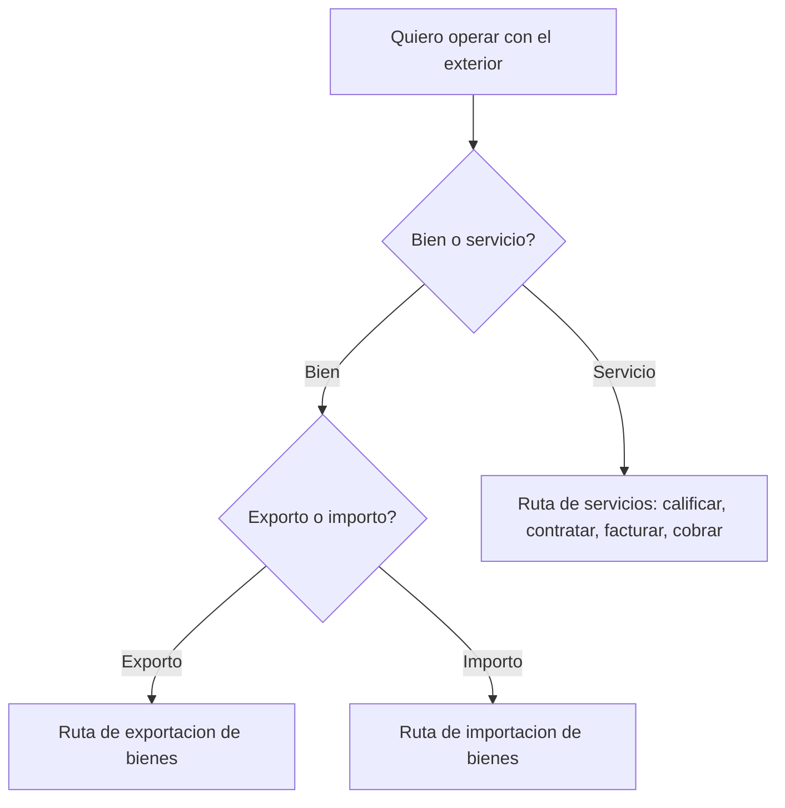
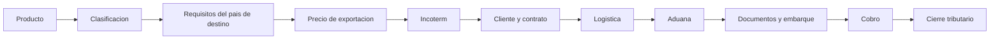

# Importar y exportar desde Chile: el recorrido completo

> **En una frase:** vender o comprar fuera de Chile no es «una venta más»: cambia la clasificación del producto, los
> documentos, los impuestos, el transporte, el cobro y los riesgos. Este manual te da el mapa para no olvidar ninguna
> etapa y saber cuándo necesitas un especialista.

Material educativo, sin revisión legal. Los aranceles, tratados, requisitos y formularios cambian; **verifica siempre
en Aduanas, ProChile y la autoridad sectorial** antes de operar.

---

## 1. Antes de empezar: ¿exportar o importar, bienes o servicios?

| Operación | Qué se mueve | Documentos y actores típicos | Dónde empezar |
|---|---|---|---|
| Exportar **bienes** | Un producto físico sale de Chile | Contrato, factura de exportación, documento de despacho, transporte, agente de aduanas | Aduanas, ProChile, autoridad sectorial del producto |
| Exportar **servicios** | Un servicio prestado a un cliente en el exterior | Contrato, factura, calificación del servicio, cobro desde el exterior | ProChile (guía de servicios) |
| Importar **bienes** | Un producto físico entra a Chile | Proveedor, clasificación arancelaria, visto bueno si aplica, transporte, seguro, agente | Aduanas y el agente de aduanas |
| Importar **servicios** | Contratas un servicio a un proveedor extranjero | Contrato, pagos al exterior, tratamiento tributario | Contador y asesor tributario |

---

## 2. Exportación de servicios

ProChile organiza el proceso en tres fases:

1. **Preparación:** evaluar si tienes capacidad, una oferta diferenciada y un mercado objetivo.
2. **Comercialización internacional:** definir la modalidad de prestación (a distancia, presencial en el exterior, con
   desplazamiento), el contrato y el precio.
3. **Proceso exportador:** clasificar el servicio, emitir la factura de exportación cuando corresponda, tramitar los
   documentos aduaneros de servicios (DUS/DUSS) cuando aplique y cobrar.

Fuente de ProChile (guía de servicios):
[ProChile, qué son los servicios y cómo se realiza su exportación](https://centrodeayuda.prochile.gob.cl/hc/es-419/articles/360048482753--Qu%C3%A9-son-los-servicios-y-c%C3%B3mo-se-realiza-su-exportaci%C3%B3n).

### 2.1. Lista de verificación para vender un servicio al exterior

| Pregunta | Por qué importa |
|---|---|
| ¿Quién es el cliente y dónde está? | Determina contrato, jurisdicción y cobro |
| ¿Dónde se presta el servicio? | Puede cambiar el tratamiento tributario |
| ¿Cómo se califica el servicio ante las autoridades? | Define si corresponde el trato de exportación |
| ¿En qué moneda y cuándo se cobra? | Afecta tipo de cambio y flujo de caja |
| ¿Qué ley rige el contrato y quién resuelve conflictos? | Evita sorpresas si hay disputa |
| ¿Hay datos personales o información confidencial? | Exige cláusulas de privacidad y seguridad |

---

## 3. Exportación de bienes: la ruta general

| Etapa | Qué debes resolver | Error frecuente |
|---|---|---|
| Producto y clasificación | Qué es exactamente y cómo se clasifica | Clasificar «a ojo» y descubrir diferencias en destino |
| Requisitos del destino | Normas técnicas, sanitarias, etiquetado, cuotas, certificados | Producir antes de saber si se puede ingresar |
| Precio de exportación | Costos, margen, tipo de cambio, comisiones | Olvidar flete, seguro y costos bancarios |
| Incoterm | Quién paga y quién asume el riesgo en cada tramo | Elegir sin entender el riesgo que cede |
| Cliente y contrato | Condiciones de pago, plazo, ley aplicable, garantías | Contrato sin mecanismos de cobro |
| Logística | Embalaje, transporte, seguro, plazos | No asegurar la carga |
| Aduana | Declaración, agente de aduanas, documentos | Documentos inconsistentes entre factura y despacho |
| Cobro | Carta de crédito, transferencia, cobranza | Despachar sin garantía de pago |
| Cierre tributario | IVA de exportación y devoluciones cuando correspondan | No conservar la evidencia del embarque |

---

## 4. Importación: la ruta general

```mermaid
flowchart LR
    PV["Proveedor"] --> CL["Clasificacion arancelaria"]
    CL --> VB["Vistos buenos"]
    VB --> IN["Incoterm"]
    IN --> TS["Transporte y seguro"]
    TS --> DC["Documentos"]
    DC --> AD["Aduana"]
    AD --> IM["Impuestos y derechos"]
    IM --> RC["Recepcion e inventario"]
    RC --> PG["Pago y tipo de cambio"]
```

| Etapa | Qué debes resolver | Error frecuente |
|---|---|---|
| Proveedor | Confiabilidad, contrato, condiciones de pago | Pagar por adelantado sin verificar al proveedor |
| Clasificación arancelaria | Código que determina arancel y requisitos | Usar el código del proveedor sin validar |
| Vistos buenos | Autorizaciones sectoriales previas (alimentos, salud, otros) | Comprar y descubrir que no se puede internar |
| Costo puesto en bodega | Flete, seguro, aranceles, impuestos, honorarios | Calcular solo el precio de factura |
| Aduana y agente | Declaración y trámites | Contratar sin definir alcance y costos |
| Recepción | Verificar cantidad y estado, reclamar a tiempo | Recibir sin inspeccionar |
| Pago | Divisas, tipo de cambio, banco | No considerar el riesgo cambiario |

---

## 5. Temas que no se deben omitir

| Tema | Pregunta clave |
|---|---|
| Origen | ¿Qué origen tiene el producto y con qué prueba? |
| Tratados | ¿Existe un acuerdo comercial que reduzca aranceles y qué exige? |
| IVA | ¿Cómo se trata la operación y qué se debe documentar? |
| Aranceles | ¿Cuánto es y sobre qué base se calcula? |
| Retenciones | ¿Hay retenciones por pagos al exterior? |
| Tipo de cambio | ¿Qué riesgo asumes entre venta y cobro? |
| Banco | ¿Cómo se reciben o se envían los fondos y qué antecedentes pide? |
| Cumplimiento de sanciones | ¿El cliente o el proveedor está en listas de restricción? |
| Seguros | ¿Qué cubre la póliza de carga y quién la paga? |
| Propiedad intelectual | ¿Tu marca o diseño están protegidos en el destino? |
| Idioma y jurisdicción | ¿Qué idioma y tribunal rigen el contrato? |
| Protección de datos | ¿Qué datos viajan y bajo qué reglas? |
| Servicio posventa | ¿Quién atiende garantías y devoluciones? |
| Agente de aduanas | ¿Corresponde y qué hará exactamente? |

---

## 6. Seis errores frecuentes

1. **Producir antes de validar requisitos** del mercado de destino.
2. **Fijar el precio sin costos reales** de logística, seguro y cobro.
3. **Elegir un Incoterm sin entender** quién responde si la carga se daña.
4. **Despachar sin forma de cobro asegurada.**
5. **No conservar evidencia** del embarque y de los pagos.
6. **Subestimar el riesgo cambiario** en márgenes estrechos.

---

## 7. ¿Cuándo llamar a un profesional?

| Situación | Profesional |
|---|---|
| Clasificación o valor en aduana dudosos | Agente de aduanas |
| Contratos con cláusulas de arbitraje o jurisdicción extranjera | Abogado |
| Tratamiento de IVA, retenciones o devoluciones | Contador o asesor tributario |
| Producto regulado (alimentos, salud, químicos) | Especialista sectorial |
| Primer envío de alto valor | Revisión previa completa |

Más detalle en la [guía de cuándo llamar a un profesional](18_WHEN_TO_CALL_A_PROFESSIONAL.md).

---

## 8. Fuentes

- [Servicio Nacional de Aduanas](https://www.aduana.cl/)
- [SICEX](https://www.sicexchile.cl/)
- [ProChile](https://www.prochile.gob.cl/)
- [Catálogo de fuentes oficiales del programa](16_OFFICIAL_SOURCE_CATALOG.md)

---

## 9. Seis situaciones para practicar

> Casos ilustrativos, con cifras inventadas. No son asesoría.

### 9.1. Una consultora que vende a un cliente en el extranjero

**Situación.** Una consultora chilena presta análisis a una empresa en otro país, todo a distancia, y cobra 5.000 dólares
mensuales.

**Análisis.** Hay que calificar el servicio, emitir el documento tributario que corresponda y confirmar el tratamiento de
la operación con el contador. El contrato debe fijar la moneda, la fecha de pago, la ley aplicable y la confidencialidad.
Si el pago se retrasa, tener el contrato claro evita pelear sin respaldo.

**Decisión.** Antes del primer cobro, revisar con el contador el tratamiento de la operación y dejar el contrato por escrito.

### 9.2. Un productor de alimentos que quiere exportar

**Situación.** Un productor quiere enviar un lote de producto envasado a un país de otro continente.

**Análisis.** El destino puede exigir registro sanitario, etiquetado propio, certificados y empaques específicos. Producir
antes de verificar eso arriesga un lote que no se puede ingresar. El precio debe incluir flete, seguro y costos de
documentación.

**Decisión.** Consultar a ProChile y a la autoridad sectorial, y pedir cotizaciones de logística antes de fijar el precio.

### 9.3. Una tienda que importa desde un proveedor externo

**Situación.** Una tienda compra 500 unidades a un proveedor extranjero a 8 dólares cada una.

**Análisis.** El costo no es 8 por 500 = 4.000 dólares: se suman flete, seguro, derechos, impuestos, honorarios del
agente y costos bancarios. Si el costo total llega a 5.300 dólares, el costo unitario real es 10,6 dólares, 32,5 % más
que el precio de lista. Ese valor define el precio de venta y el margen.

**Decisión.** Calcular el costo puesto en bodega antes de pagar al proveedor.

### 9.4. El proveedor que no responde

**Situación.** Una empresa pagó por adelantado a un proveedor desconocido, y el producto no llegó.

**Análisis.** Los pagos por adelantado a desconocidos son un riesgo alto. Existen alternativas como pago parcial, uso de
instrumentos bancarios con condiciones de entrega o un intermediario de confianza.

**Decisión.** Verificar al proveedor, pedir referencias y estructurar el pago por hitos.

### 9.5. El tipo de cambio que se come el margen

**Situación.** Una empresa vende en dólares y paga costos en pesos. Entre la venta y el cobro, el dólar baja.

**Análisis.** Si el margen es 8 % y el dólar baja 6 % durante los 60 días de cobro, casi todo el margen se esfuma. Se puede
negociar plazos más cortos, cobrar parte por adelantado o consultar al banco por mecanismos de cobertura.

**Decisión.** Incorporar el riesgo cambiario al precio y evaluar coberturas con el banco.

### 9.6. El contrato con tribunal extranjero

**Situación.** El cliente propone que cualquier disputa se resuelva en los tribunales de su país.

**Análisis.** Eso encarece cualquier cobro: litigar en el extranjero exige abogados locales y tiempo. Se pueden negociar
alternativas, como arbitraje o un lugar neutral.

**Decisión.** Pedir a un abogado que revise la cláusula antes de aceptar.

---

## 10. Calendario de una operación de exportación de bienes

| Cuándo | Tarea | Responsable |
|---|---|---|
| Semanas antes | Verificar requisitos del destino y clasificar el producto | Tú y asesor |
| Semanas antes | Cotizar logística y seguro | Tú |
| Antes de producir | Cerrar contrato y forma de pago | Tú y abogado |
| Antes del embarque | Preparar documentos comerciales y de despacho | Agente de aduanas |
| En el embarque | Coordinar transporte y conservar la evidencia | Tú |
| Tras el embarque | Seguimiento de entrega y cobro | Tú |
| Al cobrar | Registrar ingreso, tipo de cambio y documentos | Contador |
| Cierre | Archivar la carpeta de la operación | Tú |

---

## 11. Plantillas

### 11.1. Cálculo del costo puesto en bodega (importación)

| Concepto | Monto |
|---|---:|
| Precio de la mercadería | |
| Flete internacional | |
| Seguro | |
| Derechos y aranceles | |
| Impuestos aplicables | |
| Honorarios del agente de aduanas | |
| Transporte local y bodegaje | |
| Costos bancarios y cambiarios | |
| **Costo total** | |
| **Costo por unidad** | |

### 11.2. Ficha del cliente o proveedor extranjero

| Dato | Detalle |
|---|---|
| Razón social y país | |
| Contacto verificado | |
| Referencias comerciales | |
| Condición de pago acordada | |
| Moneda | |
| Ley y tribunal del contrato | |
| Verificación de listas de restricción | |

### 11.3. Lista de verificación previa al embarque

- [ ] Producto clasificado y requisitos del destino cumplidos.
- [ ] Contrato firmado y forma de pago asegurada.
- [ ] Incoterm acordado y entendido.
- [ ] Seguro de la carga contratado.
- [ ] Documentos consistentes entre sí (factura, lista de empaque, otros).
- [ ] Agente de aduanas informado.
- [ ] Carpeta de evidencia creada.

---

## 12. Preguntas frecuentes

**1. ¿Necesito un agente de aduanas?**
En muchos casos es obligatorio o muy recomendable; consulta a Aduanas qué operaciones lo exigen.

**2. ¿Qué es un Incoterm?**
Un conjunto de términos que reparte entre vendedor y comprador costos, riesgos y responsabilidades del transporte.

**3. ¿Puedo exportar sin ser una empresa grande?**
Sí, hay exportadores de todos los tamaños; el requisito es cumplir la normativa y tener capacidad de ejecutar.

**4. ¿Qué es una factura de exportación?**
El documento tributario con el que se documenta la venta al exterior, según las reglas del SII.

**5. ¿Cuándo se recupera el IVA de una exportación?**
Existen mecanismos de recuperación para exportadores; los requisitos y plazos los define la normativa vigente. Consulta al contador.

**6. ¿Cómo evito estafas?**
Verifica a la contraparte, no pagues por adelantado a desconocidos, usa instrumentos bancarios y pide referencias.

**7. ¿Qué es un tratado comercial?**
Un acuerdo entre países que puede reducir aranceles si cumples las reglas de origen.

**8. ¿Debo asegurar la carga?**
Es muy recomendable; sin seguro, un daño o pérdida puede significar una pérdida total.

**9. ¿Cómo fijo el precio de exportación?**
Parte de tus costos completos, suma logística, seguro, comisiones y margen, y considera el tipo de cambio.

**10. ¿Qué hago si el cliente no paga?**
Revisa el contrato, reúne la evidencia y consulta a un abogado sobre las opciones disponibles.

**11. ¿Necesito proteger mi marca en el extranjero?**
Si vas a vender de forma sostenida en un país, conviene evaluarlo con un abogado de propiedad intelectual.

**12. ¿Cuándo llamar a un profesional?**
Para clasificación dudosa, contratos internacionales, tratamiento tributario y productos regulados.

---

## 13. Glosario

| Término | Significado |
|---|---|
| Agente de aduanas | Profesional que tramita despachos ante Aduanas |
| Arancel | Impuesto que grava la importación de bienes |
| Clasificación arancelaria | Código que identifica el producto para fines aduaneros |
| DUS / DUSS | Documentos de salida de bienes y de servicios |
| Factura de exportación | Documento tributario de una venta al exterior |
| Incoterm | Término comercial que reparte costos y riesgos del transporte |
| Origen | País donde se produce o transforma el bien |
| Visto bueno | Autorización previa de una autoridad sectorial |
