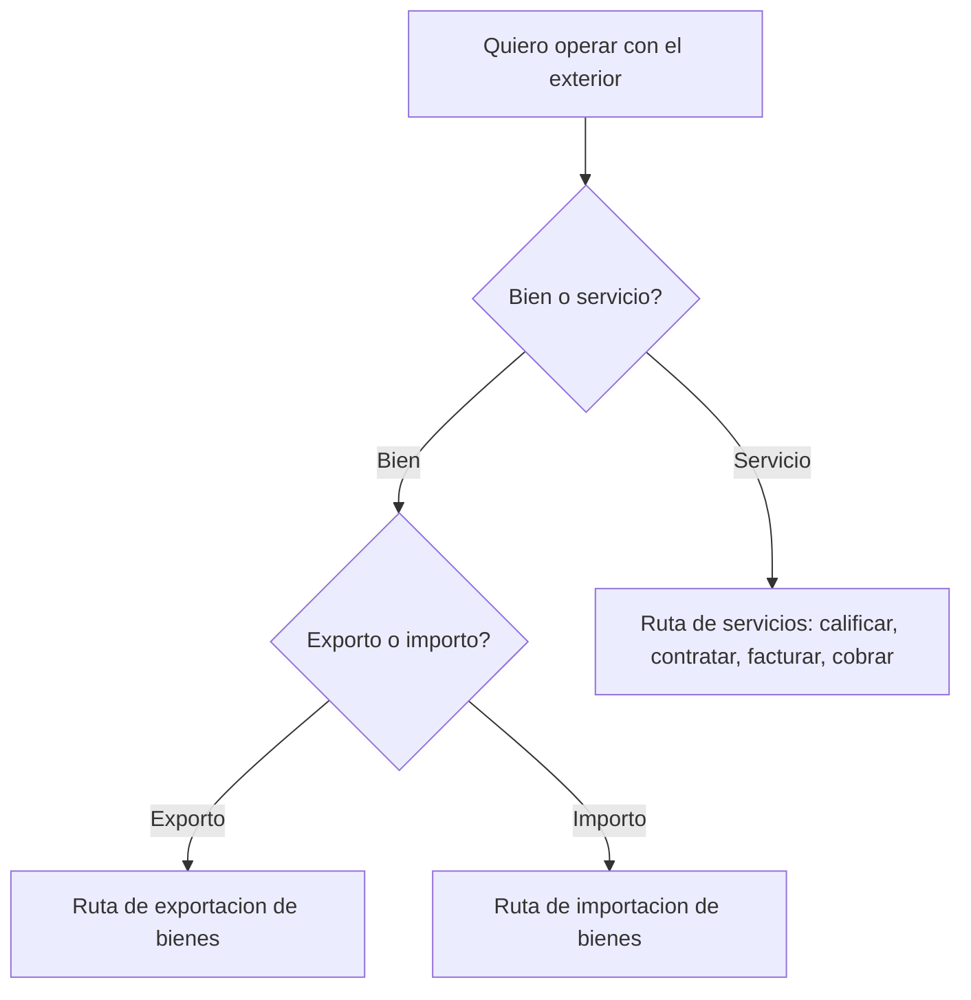
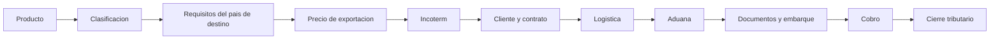
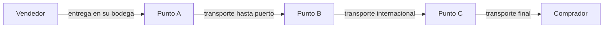

# Importar y exportar desde Chile: el recorrido completo

> **En una frase:** vender o comprar fuera de Chile no es «una venta más»: cambia la clasificación del producto, los
> documentos, los impuestos, el transporte, el cobro y los riesgos. Este manual te da el mapa para no olvidar ninguna
> etapa y saber cuándo necesitas un especialista.

Material educativo, sin revisión legal. Los aranceles, tratados, requisitos y formularios cambian; **verifica siempre
en Aduanas, ProChile y la autoridad sectorial** antes de operar.

---

## 1. Antes de empezar: ¿exportar o importar, bienes o servicios?

| Operación | Qué se mueve | Documentos y actores típicos | Dónde empezar |
|---|---|---|---|
| Exportar **bienes** | Un producto físico sale de Chile | Contrato, factura de exportación, documento de despacho, transporte, agente de aduanas | Aduanas, ProChile, autoridad sectorial del producto |
| Exportar **servicios** | Un servicio prestado a un cliente en el exterior | Contrato, factura, calificación del servicio, cobro desde el exterior | ProChile (guía de servicios) |
| Importar **bienes** | Un producto físico entra a Chile | Proveedor, clasificación arancelaria, visto bueno si aplica, transporte, seguro, agente | Aduanas y el agente de aduanas |
| Importar **servicios** | Contratas un servicio a un proveedor extranjero | Contrato, pagos al exterior, tratamiento tributario | Contador y asesor tributario |

---

## 2. Exportación de servicios

ProChile organiza el proceso en tres fases:

1. **Preparación:** evaluar si tienes capacidad, una oferta diferenciada y un mercado objetivo.
2. **Comercialización internacional:** definir la modalidad de prestación (a distancia, presencial en el exterior, con
   desplazamiento), el contrato y el precio.
3. **Proceso exportador:** clasificar el servicio, emitir la factura de exportación cuando corresponda, tramitar los
   documentos aduaneros de servicios (DUS/DUSS) cuando aplique y cobrar.

Fuente de ProChile (guía de servicios):
[ProChile, qué son los servicios y cómo se realiza su exportación](https://centrodeayuda.prochile.gob.cl/hc/es-419/articles/360048482753--Qu%C3%A9-son-los-servicios-y-c%C3%B3mo-se-realiza-su-exportaci%C3%B3n).

### 2.1. Lista de verificación para vender un servicio al exterior

| Pregunta | Por qué importa |
|---|---|
| ¿Quién es el cliente y dónde está? | Determina contrato, jurisdicción y cobro |
| ¿Dónde se presta el servicio? | Puede cambiar el tratamiento tributario |
| ¿Cómo se califica el servicio ante las autoridades? | Define si corresponde el trato de exportación |
| ¿En qué moneda y cuándo se cobra? | Afecta tipo de cambio y flujo de caja |
| ¿Qué ley rige el contrato y quién resuelve conflictos? | Evita sorpresas si hay disputa |
| ¿Hay datos personales o información confidencial? | Exige cláusulas de privacidad y seguridad |

---

## 3. Exportación de bienes: la ruta general

| Etapa | Qué debes resolver | Error frecuente |
|---|---|---|
| Producto y clasificación | Qué es exactamente y cómo se clasifica | Clasificar «a ojo» y descubrir diferencias en destino |
| Requisitos del destino | Normas técnicas, sanitarias, etiquetado, cuotas, certificados | Producir antes de saber si se puede ingresar |
| Precio de exportación | Costos, margen, tipo de cambio, comisiones | Olvidar flete, seguro y costos bancarios |
| Incoterm | Quién paga y quién asume el riesgo en cada tramo | Elegir sin entender el riesgo que cede |
| Cliente y contrato | Condiciones de pago, plazo, ley aplicable, garantías | Contrato sin mecanismos de cobro |
| Logística | Embalaje, transporte, seguro, plazos | No asegurar la carga |
| Aduana | Declaración, agente de aduanas, documentos | Documentos inconsistentes entre factura y despacho |
| Cobro | Carta de crédito, transferencia, cobranza | Despachar sin garantía de pago |
| Cierre tributario | IVA de exportación y devoluciones cuando correspondan | No conservar la evidencia del embarque |

---

## 4. Importación: la ruta general

```mermaid
flowchart LR
    PV["Proveedor"] --> CL["Clasificacion arancelaria"]
    CL --> VB["Vistos buenos"]
    VB --> IN["Incoterm"]
    IN --> TS["Transporte y seguro"]
    TS --> DC["Documentos"]
    DC --> AD["Aduana"]
    AD --> IM["Impuestos y derechos"]
    IM --> RC["Recepcion e inventario"]
    RC --> PG["Pago y tipo de cambio"]
```

| Etapa | Qué debes resolver | Error frecuente |
|---|---|---|
| Proveedor | Confiabilidad, contrato, condiciones de pago | Pagar por adelantado sin verificar al proveedor |
| Clasificación arancelaria | Código que determina arancel y requisitos | Usar el código del proveedor sin validar |
| Vistos buenos | Autorizaciones sectoriales previas (alimentos, salud, otros) | Comprar y descubrir que no se puede internar |
| Costo puesto en bodega | Flete, seguro, aranceles, impuestos, honorarios | Calcular solo el precio de factura |
| Aduana y agente | Declaración y trámites | Contratar sin definir alcance y costos |
| Recepción | Verificar cantidad y estado, reclamar a tiempo | Recibir sin inspeccionar |
| Pago | Divisas, tipo de cambio, banco | No considerar el riesgo cambiario |

---

## 5. Temas que no se deben omitir

| Tema | Pregunta clave |
|---|---|
| Origen | ¿Qué origen tiene el producto y con qué prueba? |
| Tratados | ¿Existe un acuerdo comercial que reduzca aranceles y qué exige? |
| IVA | ¿Cómo se trata la operación y qué se debe documentar? |
| Aranceles | ¿Cuánto es y sobre qué base se calcula? |
| Retenciones | ¿Hay retenciones por pagos al exterior? |
| Tipo de cambio | ¿Qué riesgo asumes entre venta y cobro? |
| Banco | ¿Cómo se reciben o se envían los fondos y qué antecedentes pide? |
| Cumplimiento de sanciones | ¿El cliente o el proveedor está en listas de restricción? |
| Seguros | ¿Qué cubre la póliza de carga y quién la paga? |
| Propiedad intelectual | ¿Tu marca o diseño están protegidos en el destino? |
| Idioma y jurisdicción | ¿Qué idioma y tribunal rigen el contrato? |
| Protección de datos | ¿Qué datos viajan y bajo qué reglas? |
| Servicio posventa | ¿Quién atiende garantías y devoluciones? |
| Agente de aduanas | ¿Corresponde y qué hará exactamente? |

---

## 6. Seis errores frecuentes

1. **Producir antes de validar requisitos** del mercado de destino.
2. **Fijar el precio sin costos reales** de logística, seguro y cobro.
3. **Elegir un Incoterm sin entender** quién responde si la carga se daña.
4. **Despachar sin forma de cobro asegurada.**
5. **No conservar evidencia** del embarque y de los pagos.
6. **Subestimar el riesgo cambiario** en márgenes estrechos.

---

## 7. ¿Cuándo llamar a un profesional?

| Situación | Profesional |
|---|---|
| Clasificación o valor en aduana dudosos | Agente de aduanas |
| Contratos con cláusulas de arbitraje o jurisdicción extranjera | Abogado |
| Tratamiento de IVA, retenciones o devoluciones | Contador o asesor tributario |
| Producto regulado (alimentos, salud, químicos) | Especialista sectorial |
| Primer envío de alto valor | Revisión previa completa |

Más detalle en la [guía de cuándo llamar a un profesional](18_WHEN_TO_CALL_A_PROFESSIONAL.md).

---

## 8. Fuentes

- [Servicio Nacional de Aduanas](https://www.aduana.cl/)
- [SICEX](https://www.sicexchile.cl/)
- [ProChile](https://www.prochile.gob.cl/)
- [Catálogo de fuentes oficiales del programa](16_OFFICIAL_SOURCE_CATALOG.md)

---

## 9. Seis situaciones para practicar

> Casos ilustrativos, con cifras inventadas. No son asesoría.

### 9.1. Una consultora que vende a un cliente en el extranjero

**Situación.** Una consultora chilena presta análisis a una empresa en otro país, todo a distancia, y cobra 5.000 dólares
mensuales.

**Análisis.** Hay que calificar el servicio, emitir el documento tributario que corresponda y confirmar el tratamiento de
la operación con el contador. El contrato debe fijar la moneda, la fecha de pago, la ley aplicable y la confidencialidad.
Si el pago se retrasa, tener el contrato claro evita pelear sin respaldo.

**Decisión.** Antes del primer cobro, revisar con el contador el tratamiento de la operación y dejar el contrato por escrito.

### 9.2. Un productor de alimentos que quiere exportar

**Situación.** Un productor quiere enviar un lote de producto envasado a un país de otro continente.

**Análisis.** El destino puede exigir registro sanitario, etiquetado propio, certificados y empaques específicos. Producir
antes de verificar eso arriesga un lote que no se puede ingresar. El precio debe incluir flete, seguro y costos de
documentación.

**Decisión.** Consultar a ProChile y a la autoridad sectorial, y pedir cotizaciones de logística antes de fijar el precio.

### 9.3. Una tienda que importa desde un proveedor externo

**Situación.** Una tienda compra 500 unidades a un proveedor extranjero a 8 dólares cada una.

**Análisis.** El costo no es 8 por 500 = 4.000 dólares: se suman flete, seguro, derechos, impuestos, honorarios del
agente y costos bancarios. Si el costo total llega a 5.300 dólares, el costo unitario real es 10,6 dólares, 32,5 % más
que el precio de lista. Ese valor define el precio de venta y el margen.

**Decisión.** Calcular el costo puesto en bodega antes de pagar al proveedor.

### 9.4. El proveedor que no responde

**Situación.** Una empresa pagó por adelantado a un proveedor desconocido, y el producto no llegó.

**Análisis.** Los pagos por adelantado a desconocidos son un riesgo alto. Existen alternativas como pago parcial, uso de
instrumentos bancarios con condiciones de entrega o un intermediario de confianza.

**Decisión.** Verificar al proveedor, pedir referencias y estructurar el pago por hitos.

### 9.5. El tipo de cambio que se come el margen

**Situación.** Una empresa vende en dólares y paga costos en pesos. Entre la venta y el cobro, el dólar baja.

**Análisis.** Si el margen es 8 % y el dólar baja 6 % durante los 60 días de cobro, casi todo el margen se esfuma. Se puede
negociar plazos más cortos, cobrar parte por adelantado o consultar al banco por mecanismos de cobertura.

**Decisión.** Incorporar el riesgo cambiario al precio y evaluar coberturas con el banco.

### 9.6. El contrato con tribunal extranjero

**Situación.** El cliente propone que cualquier disputa se resuelva en los tribunales de su país.

**Análisis.** Eso encarece cualquier cobro: litigar en el extranjero exige abogados locales y tiempo. Se pueden negociar
alternativas, como arbitraje o un lugar neutral.

**Decisión.** Pedir a un abogado que revise la cláusula antes de aceptar.

---

## 10. Calendario de una operación de exportación de bienes

| Cuándo | Tarea | Responsable |
|---|---|---|
| Semanas antes | Verificar requisitos del destino y clasificar el producto | Tú y asesor |
| Semanas antes | Cotizar logística y seguro | Tú |
| Antes de producir | Cerrar contrato y forma de pago | Tú y abogado |
| Antes del embarque | Preparar documentos comerciales y de despacho | Agente de aduanas |
| En el embarque | Coordinar transporte y conservar la evidencia | Tú |
| Tras el embarque | Seguimiento de entrega y cobro | Tú |
| Al cobrar | Registrar ingreso, tipo de cambio y documentos | Contador |
| Cierre | Archivar la carpeta de la operación | Tú |

---

## 11. Plantillas

### 11.1. Cálculo del costo puesto en bodega (importación)

| Concepto | Monto |
|---|---:|
| Precio de la mercadería | |
| Flete internacional | |
| Seguro | |
| Derechos y aranceles | |
| Impuestos aplicables | |
| Honorarios del agente de aduanas | |
| Transporte local y bodegaje | |
| Costos bancarios y cambiarios | |
| **Costo total** | |
| **Costo por unidad** | |

### 11.2. Ficha del cliente o proveedor extranjero

| Dato | Detalle |
|---|---|
| Razón social y país | |
| Contacto verificado | |
| Referencias comerciales | |
| Condición de pago acordada | |
| Moneda | |
| Ley y tribunal del contrato | |
| Verificación de listas de restricción | |

### 11.3. Lista de verificación previa al embarque

- [ ] Producto clasificado y requisitos del destino cumplidos.
- [ ] Contrato firmado y forma de pago asegurada.
- [ ] Incoterm acordado y entendido.
- [ ] Seguro de la carga contratado.
- [ ] Documentos consistentes entre sí (factura, lista de empaque, otros).
- [ ] Agente de aduanas informado.
- [ ] Carpeta de evidencia creada.

---

## 12. Preguntas frecuentes

**1. ¿Necesito un agente de aduanas?**
En muchos casos es obligatorio o muy recomendable; consulta a Aduanas qué operaciones lo exigen.

**2. ¿Qué es un Incoterm?**
Un conjunto de términos que reparte entre vendedor y comprador costos, riesgos y responsabilidades del transporte.

**3. ¿Puedo exportar sin ser una empresa grande?**
Sí, hay exportadores de todos los tamaños; el requisito es cumplir la normativa y tener capacidad de ejecutar.

**4. ¿Qué es una factura de exportación?**
El documento tributario con el que se documenta la venta al exterior, según las reglas del SII.

**5. ¿Cuándo se recupera el IVA de una exportación?**
Existen mecanismos de recuperación para exportadores; los requisitos y plazos los define la normativa vigente. Consulta al contador.

**6. ¿Cómo evito estafas?**
Verifica a la contraparte, no pagues por adelantado a desconocidos, usa instrumentos bancarios y pide referencias.

**7. ¿Qué es un tratado comercial?**
Un acuerdo entre países que puede reducir aranceles si cumples las reglas de origen.

**8. ¿Debo asegurar la carga?**
Es muy recomendable; sin seguro, un daño o pérdida puede significar una pérdida total.

**9. ¿Cómo fijo el precio de exportación?**
Parte de tus costos completos, suma logística, seguro, comisiones y margen, y considera el tipo de cambio.

**10. ¿Qué hago si el cliente no paga?**
Revisa el contrato, reúne la evidencia y consulta a un abogado sobre las opciones disponibles.

**11. ¿Necesito proteger mi marca en el extranjero?**
Si vas a vender de forma sostenida en un país, conviene evaluarlo con un abogado de propiedad intelectual.

**12. ¿Cuándo llamar a un profesional?**
Para clasificación dudosa, contratos internacionales, tratamiento tributario y productos regulados.

---

## 13. Glosario

| Término | Significado |
|---|---|
| Agente de aduanas | Profesional que tramita despachos ante Aduanas |
| Arancel | Impuesto que grava la importación de bienes |
| Clasificación arancelaria | Código que identifica el producto para fines aduaneros |
| DUS / DUSS | Documentos de salida de bienes y de servicios |
| Factura de exportación | Documento tributario de una venta al exterior |
| Incoterm | Término comercial que reparte costos y riesgos del transporte |
| Origen | País donde se produce o transforma el bien |
| Visto bueno | Autorización previa de una autoridad sectorial |

---

## 14. Incoterms: quién paga qué y quién carga el riesgo

Los Incoterms son términos comerciales estandarizados que reparten entre vendedor y comprador **costos, riesgos y
obligaciones de transporte y documentación**. Elegir uno es una decisión comercial y de riesgo, no un detalle.

| Pregunta | Por qué importa |
|---|---|
| ¿Dónde se transfiere el riesgo de pérdida o daño? | Define quién asume el costo si la carga se daña en el camino |
| ¿Quién contrata y paga el transporte principal? | Afecta costos y control de la logística |
| ¿Quién contrata el seguro? | Sin seguro, un daño puede ser una pérdida total |
| ¿Quién hace el despacho de exportación e importación? | Define quién responde ante Aduanas en cada país |
| ¿Quién paga derechos e impuestos en destino? | Cambia el precio final para el comprador |

> Cada Incoterm fija en cuál de esos puntos se transfiere el riesgo y quién paga cada tramo. Lee la versión vigente de
> las reglas de la Cámara de Comercio Internacional (ICC) y pide a tu agente o abogado que valide el término elegido para
> tu producto y tu medio de transporte (marítimo, aéreo o terrestre), porque algunos términos solo son adecuados para
> ciertos medios.

**Regla práctica:** si eres exportador y no controlas la logística en destino, evita asumir riesgos y costos que no puedes
gestionar. Si eres importador, calcula siempre el **costo puesto en tu bodega**.

---

## 15. Medios de pago internacionales

| Medio | Cómo funciona (visión general) | Riesgo para el vendedor | Riesgo para el comprador |
|---|---|---|---|
| **Pago anticipado** | El comprador paga antes del envío | Bajo | Alto: puede no recibir lo comprado |
| **Carta de crédito** | Un banco se compromete a pagar si se presentan documentos conformes | Bajo si los documentos son correctos | Medio: costo y exigencia documental |
| **Cobranza documentaria** | Los bancos gestionan la entrega de documentos contra pago o aceptación | Medio | Medio |
| **Cuenta abierta (crédito del vendedor)** | Se envía y se paga después | Alto: riesgo de impago | Bajo |
| **Seguro de crédito a la exportación** | Una aseguradora cubre el impago del comprador | Reduce el riesgo | No aplica |

**Lista de decisión.**

1. ¿Conoces a tu contraparte y su historial de pagos?
2. ¿El monto justifica el costo de una carta de crédito o de un seguro?
3. ¿Qué plazo de cobro es normal en ese mercado?
4. ¿Qué pasa con el tipo de cambio entre venta y cobro?
5. ¿Qué documentos exige cada medio y puedes entregarlos sin errores?

> Un error de forma en un documento (un nombre mal escrito, una fecha distinta) puede hacer que un banco rechace el pago
> en una carta de crédito. Revisa cada documento dos veces.

---

## 16. Documentos de una operación: el expediente

| Documento | Para qué sirve |
|---|---|
| **Contrato o confirmación de pedido** | Define condiciones y responsabilidades |
| **Factura comercial / de exportación** | Documenta la venta y el precio |
| **Lista de empaque** | Detalla el contenido y el embalaje |
| **Documento de transporte** | Acredita el contrato de transporte y la entrega |
| **Póliza de seguro** | Prueba la cobertura |
| **Certificados** (origen, sanitarios, calidad) | Exigidos por la aduana o el destino |
| **Documento de despacho aduanero** | Declaración ante Aduanas |
| **Comprobantes de pago y de cambio** | Evidencian el cobro y la conversión |
| **Correspondencia relevante** | Respalda acuerdos y reclamos |

**Reglas de orden:**

1. Una carpeta por operación, con un número único.
2. Que los datos coincidan en todos los documentos (nombres, cantidades, valores, fechas).
3. Copia de respaldo digital.
4. Conservación por los plazos legales; consulta a tu contador.

---

## 17. Origen, tratados y aranceles

| Concepto | Qué es | Por qué importa |
|---|---|---|
| **Origen** | País donde un bien se produce o se transforma lo suficiente | Determina si accedes a preferencias |
| **Regla de origen** | Condiciones para considerar un bien originario | Sin cumplirla no hay preferencia |
| **Tratado o acuerdo comercial** | Acuerdo que reduce aranceles entre países | Puede mejorar tu precio |
| **Certificado de origen** | Documento que acredita el origen | Se exige para usar la preferencia |
| **Arancel** | Impuesto a la importación | Eleva el costo en destino |

**Pasos para evaluar una preferencia arancelaria:**

1. Clasificar el producto correctamente.
2. Identificar si existe un acuerdo entre Chile y el país de destino.
3. Revisar la regla de origen de tu producto.
4. Verificar la documentación que se exige.
5. Calcular el ahorro y compararlo con el costo de cumplir.

---

## 18. Catálogo de errores frecuentes

| N.º | Error | Consecuencia | Cómo evitarlo |
|---:|---|---|---|
| 1 | Clasificar mal el producto | Aranceles incorrectos, retrasos o multas | Validar con agente de aduanas |
| 2 | Producir sin validar requisitos del destino | Lote inutilizable | Verificar normas antes |
| 3 | Elegir un Incoterm sin entenderlo | Costos y riesgos inesperados | Revisar con asesor |
| 4 | Despachar sin forma de cobro | Impago | Carta de crédito, pago anticipado o seguro |
| 5 | Documentos inconsistentes | Retrasos y rechazos | Revisión cruzada |
| 6 | Sin seguro de carga | Pérdida total | Contratar seguro |
| 7 | Subestimar costos de logística | Margen negativo | Costear todo el recorrido |
| 8 | Ignorar el tipo de cambio | Pérdida de margen | Incluirlo en el precio y evaluar coberturas |
| 9 | No usar tratados cuando corresponde | Pagar aranceles de más | Evaluar origen y preferencias |
| 10 | No conservar evidencia del embarque | Problemas tributarios | Carpeta de operación |
| 11 | Contratar proveedores sin verificar | Fraude o incumplimiento | Referencias y contratos |
| 12 | Olvidar propiedad intelectual y datos | Conflictos posteriores | Cláusulas y registros |
| 13 | Tratar el trámite como puntual | Fallas recurrentes | Procedimiento escrito |
| 14 | No definir tribunal ni ley aplicable | Disputas costosas | Cláusulas claras |
| 15 | No planificar la devolución o el reclamo | Pérdidas por defectos | Política de reclamos |

---

## 19. Más preguntas frecuentes

**13. ¿Cómo sé qué requisitos exige el país de destino?**
Consulta a ProChile, a la autoridad sectorial del producto y al comprador; pide los requisitos por escrito.

**14. ¿Puedo exportar servicios a través de internet?**
Sí; sigue la guía de ProChile y consulta a tu contador por el tratamiento tributario de la operación.

**15. ¿Qué es un agente de aduanas?**
Un profesional autorizado para tramitar despachos ante Aduanas en representación del importador o exportador.

**16. ¿Debo pagar impuestos al importar?**
Sí, según el tipo de bien: pueden aplicar aranceles, IVA y otros; consulta a tu agente y contador.

**17. ¿Qué diferencia hay entre factura comercial y de exportación?**
La de exportación es el documento tributario chileno de una venta al exterior; la comercial puede ser el documento que
usa el comprador. Consulta al SII y a tu agente.

**18. ¿Qué es un seguro de crédito a la exportación?**
Un seguro que cubre el riesgo de impago del comprador; consulta a un corredor.

**19. ¿Cómo evito fraudes por correo falso?**
Verifica los cambios de cuenta bancaria por otro medio, desconfía de urgencias y usa canales oficiales.

**20. ¿Cuándo debo contratar a un especialista?**
Para clasificación, contratos internacionales, tributación y productos regulados.

---

## 20. Cómo fijar el precio de exportación, paso a paso

El precio de exportación no es el precio local con otra moneda. Se construye sumando todo lo que cuesta llegar al cliente y
dejando un margen que sobreviva a los imprevistos.

### 20.1. Ejemplo ilustrativo

Un productor vende 1.000 unidades de un producto. Costos ilustrativos (todos en dólares):

| Concepto | Monto total (USD) | Por unidad (USD) |
|---|---:|---:|
| Costo de producción | 6.000 | 6,00 |
| Embalaje de exportación | 500 | 0,50 |
| Transporte local hasta el puerto | 300 | 0,30 |
| Gastos de despacho y documentación | 400 | 0,40 |
| Flete internacional | 1.200 | 1,20 |
| Seguro de la carga | 100 | 0,10 |
| Costos bancarios y de cobro | 150 | 0,15 |
| Imprevistos (3 % de lo anterior) | 260 | 0,26 |
| **Costo total** | **8.910** | **8,91** |
| Margen deseado (20 % sobre el precio) | | |

Para lograr un margen de 20 % **sobre el precio de venta**, el precio unitario debe ser costo / (1 − 0,20):
8,91 / 0,80 = **11,14 USD** por unidad (redondeado). Si hubieras sumado el 20 % al costo (8,91 × 1,20 = 10,69), el margen
real sería menor (16,7 % sobre el precio). Es un error común.

**Sensibilidad al tipo de cambio.** Si los costos de producción son en pesos y el dólar baja 6 %, tu costo en dólares
sube. Calcula cuánto margen te queda en un escenario adverso antes de cerrar el precio.

### 20.2. Lista para cotizar

- [ ] Costos completos de producción, embalaje y logística.
- [ ] Incoterm definido y sus costos asociados.
- [ ] Costos bancarios y de cobro.
- [ ] Margen deseado y mínimo aceptable.
- [ ] Escenario de tipo de cambio adverso.
- [ ] Validez de la cotización y condiciones de pago.

---

## 21. Elegir el medio de transporte

| Medio | Cuándo suele convenir | Cuidados |
|---|---|---|
| **Marítimo** | Cargas grandes o pesadas, plazos largos tolerables | Tiempos, consolidación de carga, riesgo de demoras en puertos |
| **Aéreo** | Productos de alto valor, perecibles o urgentes | Costo por kilo, restricciones de peso y de mercancías peligrosas |
| **Terrestre** | Mercados vecinos y rutas regionales | Trámites fronterizos y seguros específicos |
| **Courier o envíos pequeños** | Muestras y pedidos de bajo volumen | Límites de valor y peso, impuestos en destino |

**Preguntas para tu operador logístico:**

1. ¿Cuál es el tiempo total puerta a puerta y qué lo puede alargar?
2. ¿Qué costos no están incluidos en la cotización (almacenaje, demoras, recargos)?
3. ¿Qué cobertura de seguro ofrece y cuáles son las exclusiones?
4. ¿Cómo se manejan los reclamos por daños o pérdidas?
5. ¿Qué documentos necesita de mi parte y con cuánta anticipación?

---

## 22. Importación: ejemplo de costo puesto en bodega

> Ejemplo ilustrativo; los porcentajes de aranceles e impuestos se deben verificar con el agente de aduanas.

| Concepto | Monto (USD) | Observación |
|---|---:|---|
| Mercadería (500 unidades a 8,00) | 4.000 | Precio del proveedor |
| Flete y seguro internacional | 600 | Según Incoterm |
| **Base para aduana** (supuesto) | **4.600** | Puede variar según reglas de valoración |
| Arancel (supuesto de 6 %) | 276 | Verificar según clasificación y tratados |
| IVA de importación (supuesto de 19 %) | 926 | Sobre la base y el arancel; consulta tratamiento como crédito |
| Honorarios del agente y gastos portuarios | 350 | Cotización |
| Transporte local y bodegaje | 180 | |
| Costos bancarios y cambiarios | 90 | |

**Costo sin IVA recuperable** (suponiendo que el IVA es crédito fiscal recuperable): 4.600 + 276 + 350 + 180 + 90 =
**5.496 USD**, es decir 10,99 USD por unidad (frente a los 8,00 del precio de lista: **37 % más**).

Si el IVA **no** fuera recuperable en tu caso, el costo sería mayor. Consulta a tu contador cómo se trata el IVA en tu
régimen antes de fijar precios.

---

## 23. Checklist por rol

| Rol | Qué debe revisar |
|---|---|
| **Dueño o gerente** | Estrategia de mercado, riesgo aceptable, forma de pago, contratos |
| **Finanzas** | Precio, costos totales, tipo de cambio, cobro, conciliación |
| **Operaciones** | Producción, calidad, embalaje, plazos, inventario |
| **Comercial** | Cliente, contrato, condiciones, comunicación |
| **Logística** | Transporte, seguro, documentos, seguimiento |
| **Legal y cumplimiento** | Contratos, sanciones, propiedad intelectual, datos |
| **Contador** | Documentos tributarios, IVA, registros y respaldo |
| **Agente de aduanas** | Clasificación, declaración y trámites |

### 23.1. Matriz de riesgos de una operación

| Riesgo | Señal | Mitigación |
|---|---|---|
| Impago del cliente | Cliente nuevo y sin referencias | Pago anticipado, carta de crédito o seguro |
| Daño en tránsito | Carga frágil o larga distancia | Embalaje adecuado y seguro |
| Rechazo en destino | Producto sin cumplir normas | Validar requisitos antes de producir |
| Variación cambiaria | Margen estrecho | Precios en la moneda correcta, coberturas |
| Retrasos | Dependencia de un solo transportista | Plan alternativo y holgura en plazos |
| Fraude | Cambio de cuenta por correo | Verificación por otro canal |
| Incumplimiento contractual | Contrato incompleto | Cláusulas y asesoría legal |

### 23.2. Plan de 90 días para tu primera exportación

| Período | Objetivo | Tareas | Resultado |
|---|---|---|---|
| Días 1 a 30 | Validar | Elegir producto y mercado; reunir requisitos del destino; hablar con ProChile y la autoridad sectorial; costear una operación completa | Decisión informada de seguir o ajustar |
| Días 31 a 60 | Preparar | Definir precio, Incoterm y forma de cobro; elegir agente de aduanas y operador logístico; revisar el contrato modelo con un abogado; preparar certificaciones | Oferta lista para enviar |
| Días 61 a 90 | Ejecutar | Cerrar con un primer cliente, producir, embarcar, seguir el envío y gestionar el cobro | Primera operación completa y carpeta de evidencia |

**Indicadores de la primera operación:**

1. Tiempo total desde el pedido hasta el cobro.
2. Margen real frente al margen cotizado.
3. Incidencias de documentos, transporte y pago.
4. Lecciones y ajustes para la siguiente operación.

Documenta cada diferencia entre lo planificado y lo ocurrido: la segunda exportación debería ser notablemente más simple
y más barata que la primera.

---

## 24. Límites de este manual

Este manual no es asesoría legal, tributaria ni aduanera; no fija aranceles ni plazos vigentes; las cifras de los ejemplos
son ilustrativas. Verifica siempre en Aduanas, ProChile y las autoridades sectoriales. Para decidir a quién consultar,
usa la [guía de cuándo llamar a un profesional](18_WHEN_TO_CALL_A_PROFESSIONAL.md) y el
[catálogo de fuentes oficiales](16_OFFICIAL_SOURCE_CATALOG.md).

Antes de tu primera operación, guarda tres cosas: la **opinión escrita** de tu agente sobre la clasificación, la
**cotización** completa de logística y la **carpeta** con todos los documentos. Esa evidencia te protege ante reclamos,
fiscalizaciones y cobros, y vuelve más rápida y barata la segunda operación.

Si algo sale distinto de lo planificado (un retraso, un daño, un rechazo documental, un cambio del tipo de cambio),
registra qué pasó, cuánto costó y qué cambiarías. Con tres o cuatro operaciones documentadas tendrás datos propios para
fijar precios, elegir transportistas y negociar con clientes y bancos, y dejarás de depender de estimaciones ajenas.
