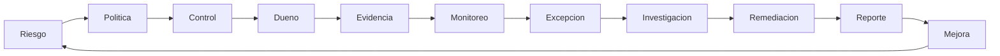

# Compliance y riesgo empresarial: construir un sistema, no una carpeta

> **En una frase:** el cumplimiento no se demuestra con un archivador de políticas, sino con un sistema que identifica
> riesgos, asigna responsables, deja evidencia y mejora. Este manual explica ese sistema paso a paso, qué dice la
> Ley 20.393 sobre responsabilidad penal de las personas jurídicas, y cómo adaptarlo al tamaño de tu empresa.

Material educativo, sin revisión legal. La Ley 20.393 se leyó del texto en Ley Chile (BCN); la Ley de Delitos
Económicos (Ley 21.595), la Ley 19.913 (UAF) y la Ley 21.663 (ciberseguridad) **no se leyeron íntegramente** para este
manual y se mencionan a nivel general. Las **cifras de los ejemplos son ilustrativas**. Consulta a un abogado de
cumplimiento para diseñar tu modelo.

---

## 1. Sistema, no carpeta

Un programa de compliance real recorre esta cadena:

| Eslabón | Pregunta que responde | Señal de que falta |
|---|---|---|
| Riesgo | ¿Qué puede salir mal y con qué impacto? | No hay lista de riesgos |
| Política | ¿Qué regla decidimos? | Reglas verbales |
| Control | ¿Cómo evitamos o detectamos el problema? | Políticas sin controles |
| Dueño | ¿Quién responde por el control? | «Es de todos» |
| Evidencia | ¿Cómo demostramos que se hizo? | No hay registros |
| Monitoreo | ¿Cómo sabemos que sigue funcionando? | Se revisa «cuando hay problemas» |
| Excepción | ¿Qué pasa cuando alguien se salta la regla? | Excepciones sin registro |
| Investigación | ¿Cómo averiguamos lo ocurrido? | Investigaciones informales |
| Remediación | ¿Cómo corregimos y sancionamos? | No hay consecuencias |
| Reporte | ¿Quién se entera y cuándo? | El directorio no recibe información |
| Mejora | ¿Qué cambiamos para que no se repita? | Cada incidente se trata como nuevo |

> **Principio de proporcionalidad:** no necesitas el sistema de una multinacional. La ley mide el modelo «en la medida
> exigible a su objeto social, giro, tamaño, complejidad, recursos y a las actividades que desarrolle» (Ley 20.393,
> art. 4). Una empresa de cinco personas tiene un sistema más simple que una de quinientas, pero ambos deben existir.

---

## 2. Ley 20.393: responsabilidad penal de las personas jurídicas

### 2.1. Qué regula

La Ley 20.393 regula la **responsabilidad penal de las personas jurídicas** por ciertos delitos, el procedimiento para
establecerla, las sanciones y su ejecución (art. 1). Los delitos por los que responde la persona jurídica incluyen:

| Grupo | Detalle según el art. 1 |
|---|---|
| Delitos de la Ley de Delitos Económicos | Los de los arts. 1, 2, 3 y 4 de esa ley, sean o no considerados delitos económicos |
| Otros | Los del art. 8 de la Ley 18.314 (conductas terroristas), los del Título II de la Ley 17.798 (control de armas) y los arts. 411 quáter, 448 septies y 448 octies del Código Penal |

### 2.2. A quién se aplica (art. 2)

Responden las personas jurídicas de derecho privado, las empresas públicas creadas por ley, las empresas, sociedades y
universidades del Estado, los partidos políticos y las personas jurídicas religiosas de derecho público.

### 2.3. Cuándo responde la empresa (art. 3)

Una persona jurídica es penalmente responsable cuando se cumplen **todas** estas condiciones:

1. Se comete alguno de los delitos del art. 1.
2. Lo comete **en el marco de su actividad**.
3. Lo comete, o interviene, una persona natural que **ocupa un cargo, función o posición** en ella, o le **presta
   servicios gestionando asuntos suyos ante terceros**, con o sin representación.
4. El hecho se ve **favorecido o facilitado por la falta de implementación efectiva de un modelo adecuado de prevención**.

También puede responder por hechos de una persona relacionada con **otra persona jurídica** cuando esta le presta
servicios gestionando asuntos suyos ante terceros o carece de autonomía operativa respecto de ella, existiendo relaciones
de propiedad o participación. No se aplica cuando el hecho se perpetra **exclusivamente en contra de la propia persona
jurídica**.

> **Autonomía (art. 5):** la responsabilidad de la empresa no depende de que se condene a la persona natural, ni siquiera
> de que se la identifique, siempre que conste que el hecho no pudo sino haber sido perpetrado por alguien en esas
> circunstancias.

### 2.4. El modelo de prevención (art. 4)

La ley dice que un modelo de prevención de delitos **efectivamente implementado** es adecuado para eximir de
responsabilidad cuando considera, seria y razonablemente, estos cuatro aspectos:

| N.º | Elemento del art. 4 | Qué significa en la práctica |
|---:|---|---|
| 1 | **Identificación de actividades o procesos** que impliquen riesgo de conducta delictiva | Matriz de riesgos por proceso |
| 2 | **Protocolos y procedimientos** para prevenir y detectar, con **canales seguros de denuncia** y **sanciones internas**; deben comunicarse a todos y **incorporarse expresamente a los contratos de trabajo y de prestación de servicios**, incluidos los máximos ejecutivos | Políticas, canal de denuncia, régimen sancionatorio y cláusulas contractuales |
| 3 | **Uno o más responsables** con adecuada independencia, facultades efectivas de dirección y supervisión, acceso directo a la administración y los recursos necesarios | Encargado de prevención con autonomía y presupuesto |
| 4 | **Evaluaciones periódicas por terceros independientes** y mecanismos de perfeccionamiento | Revisiones externas y plan de mejora |

### 2.5. Circunstancias que atenúan la responsabilidad (art. 6)

Entre otras, la ley considera atenuantes:

- **Colaborar sustancialmente** con la investigación; se entiende especialmente cuando los representantes legales ponen el
  hecho en conocimiento de las autoridades o aportan antecedentes **antes de saber que el procedimiento se dirige
  contra la empresa**;
- **Adoptar, antes de la formalización de la investigación, medidas eficaces para prevenir la reiteración** de la misma
  clase de delitos; se entiende por tales la autonomía acreditada del encargado de prevención y las medidas de
  prevención y supervisión idóneas según situación, tamaño, giro, ingresos y complejidad.

### 2.6. Penas posibles (art. 8)

| Pena | Efecto |
|---|---|
| Extinción de la persona jurídica | Pérdida definitiva de la personalidad jurídica (art. 9); solo en casos graves, y no aplica a ciertas empresas públicas ni a servicios de utilidad pública cuya interrupción cause graves consecuencias |
| Inhabilitación para contratar con el Estado | Según las reglas del Párrafo 5 del Título II de la Ley de Delitos Económicos (art. 10) |
| Pérdida de beneficios fiscales y prohibición de recibirlos | Pérdida de subsidios, créditos fiscales y otros beneficios sin prestación recíproca (art. 11) |
| Supervisión de la persona jurídica | Intervención de su gestión |
| Multa | Sanción pecuniaria |
| Comiso | Según el art. 14 |
| Publicación de un extracto de la sentencia condenatoria | Consecuencia reputacional |

> **Qué significa para una pyme:** la pérdida de beneficios fiscales y la inhabilitación para contratar con el Estado
> pueden ser tan graves como una multa si tu negocio depende de licitaciones o subsidios.

---

## 3. Cómo construir el sistema, paso a paso

### 3.1. Etapa 1: entender el negocio y sus procesos

| Actividad | Producto |
|---|---|
| Mapear procesos (ventas, compras, pagos, contratación, relación con autoridades, importaciones, uso de datos) | Mapa de procesos |
| Identificar cargos con poder de decisión o contacto con terceros | Lista de cargos críticos |
| Reunir información sobre incidentes y reclamos anteriores | Historial |

### 3.2. Etapa 2: evaluar riesgos

Para cada proceso, pregúntate qué conductas indebidas podrían ocurrir, con qué probabilidad y con qué impacto.

| Escala | Probabilidad | Impacto |
|---:|---|---|
| 1 | Muy baja | Menor, corregible sin costo |
| 2 | Baja | Moderado |
| 3 | Media | Importante (multas, pérdida de clientes) |
| 4 | Alta | Grave (sanciones relevantes, reputación) |
| 5 | Muy alta | Crítico (cierre, responsabilidad penal) |

**Ejemplo ilustrativo de matriz:**

| Proceso | Riesgo | Probab. | Impacto | Puntaje (P × I) | Prioridad |
|---|---|---:|---:|---:|---|
| Relación con autoridades y permisos | Entrega de beneficios indebidos a funcionarios | 2 | 5 | 10 | Alta |
| Pagos a proveedores | Pagos sin respaldo o a terceros no identificados | 3 | 4 | 12 | Alta |
| Compras e intermediarios | Intermediarios sin diligencia | 3 | 3 | 9 | Media |
| Ventas | Descuentos sin trazabilidad | 3 | 2 | 6 | Media |
| Contratación | Beneficios a familiares sin transparencia | 2 | 3 | 6 | Media |
| Tecnología | Uso indebido de información confidencial | 3 | 4 | 12 | Alta |

Los puntajes de 10 o más pasan a controles prioritarios; los de 5 a 9, a controles estándar; los menores, a monitoreo.

### 3.3. Etapa 3: diseñar controles

| Tipo de control | Ejemplos |
|---|---|
| **Preventivos** | Segregación de funciones; doble firma sobre cierto monto; lista de proveedores aprobados; límites de gasto |
| **Detectivos** | Conciliaciones; revisión de excepciones; alertas por pagos inusuales; auditorías selectivas |
| **Correctivos** | Sanciones; revisión de procesos; capacitación dirigida |
| **Disuasivos** | Políticas claras, capacitación, cláusulas contractuales, consecuencias conocidas |

### 3.4. Etapa 4: asignar responsables

| Rol | Función |
|---|---|
| **Dirección o directorio** | Aprueba el sistema, recibe reportes, provee recursos |
| **Encargado de prevención** | Aplica el sistema con independencia y acceso directo a la administración (art. 4) |
| **Dueños de procesos** | Ejecutan los controles y reportan excepciones |
| **Todos los trabajadores** | Cumplen las políticas, usan el canal de denuncia |
| **Asesor externo** | Revisión independiente periódica |

En empresas pequeñas, una persona puede cumplir varios roles, pero la ley exige que quien aplica el sistema tenga
**independencia, facultades y acceso directo** a la administración y que se le provean recursos proporcionales.

### 3.5. Etapa 5: documentar y comunicar

Las políticas y sanciones deben comunicarse a todos y **incorporarse a los contratos de trabajo y de prestación de
servicios**, incluidos los máximos ejecutivos (art. 4 N.º 2). Esto significa, en la práctica:

1. un anexo o cláusula en cada contrato de trabajo que remita al reglamento de cumplimiento;
2. una cláusula en los contratos con proveedores y asesores;
3. constancia de entrega y capacitación.

### 3.6. Etapa 6: capacitar

| Audiencia | Contenido | Frecuencia sugerida |
|---|---|---|
| Alta dirección | Responsabilidad, delitos, supervisión | Anual |
| Personas en cargos de riesgo (ventas, compras, finanzas, relación con autoridades) | Casos prácticos de su proceso | Semestral o anual |
| Todo el personal | Política, canal de denuncia, consecuencias | Al ingreso y anual |
| Proveedores críticos | Reglas aplicables y canal | Al contratar y al renovar |

---

## 4. El canal de denuncias

La ley exige **canales seguros de denuncia** (art. 4 N.º 2). Para que funcione:

| Característica | Qué significa |
|---|---|
| Accesible | Fácil de encontrar y usar por trabajadores y terceros |
| Confidencial | Protege la identidad de quien denuncia |
| Sin represalias | Prohibición escrita y consecuencias para quien la quebrante |
| Imparcial | Quien recibe no está involucrado |
| Con plazos | Acuse de recibo, investigación y respuesta con fechas |
| Registrado | Cada denuncia queda en un registro con su resultado |

**Etapas de una investigación interna:**

1. **Recepción y registro.**
2. **Evaluación preliminar:** ¿es verosímil?, ¿qué riesgo hay?, ¿requiere medidas inmediatas?
3. **Medidas de resguardo** cuando corresponda.
4. **Investigación:** recopilar documentos, entrevistas, derecho a ser oído.
5. **Conclusión por escrito** con hechos acreditados.
6. **Decisión:** sanciones, correcciones y, si corresponde, denuncia a las autoridades.
7. **Seguimiento:** cierre, comunicación y mejora del control.

> **Cuidado con los plazos y derechos:** una investigación mal conducida puede vulnerar derechos y debilitarla.
> Si hay indicios de delito, consulta de inmediato a un abogado penalista antes de actuar.

---

## 5. Terceros: proveedores, intermediarios y socios

Muchos riesgos entran por terceros. La Ley 20.393 considera también a quienes **prestan servicios gestionando asuntos de
la empresa ante terceros** (art. 3), de modo que no basta con vigilar a tus trabajadores.

| Tipo de tercero | Riesgo típico | Control mínimo |
|---|---|---|
| Gestores y tramitadores ante autoridades | Pagos indebidos a funcionarios | Contrato con cláusula de cumplimiento, pago contra evidencia, prohibición de entregar beneficios |
| Intermediarios comerciales | Comisiones sin justificación | Verificar identidad y tarifa de mercado |
| Proveedores críticos | Prácticas ilícitas o incumplimientos laborales | Evaluación inicial y revisión periódica |
| Distribuidores y agentes | Uso de tu marca para prácticas indebidas | Contrato y supervisión |
| Socios en proyectos conjuntos | Conductas del socio que te alcanzan | Diligencia previa y cláusulas de salida |

**Lista de diligencia previa a un tercero:**

- [ ] Identidad legal, beneficiarios finales y domicilio verificados.
- [ ] Antecedentes públicos relevantes revisados.
- [ ] Referencias comerciales.
- [ ] Cláusula de cumplimiento y derecho de terminación.
- [ ] Forma de pago trazable, a nombre del contratante.
- [ ] Responsable interno de la relación.

---

## 6. Otras áreas de cumplimiento

### 6.1. UAF: prevención de lavado de activos y financiamiento del terrorismo

No todas las empresas son sujetos obligados. La UAF informa actualmente **55 actividades privadas obligadas**. Si tu
actividad está en la lista, la obligación incluye registro y **oficial de cumplimiento**, además de sistema preventivo,
debida diligencia, registros y reportes. Detalle en la sección de fintech y en las fuentes de la UAF.

### 6.2. Cumplimiento tributario

| Elemento | Qué cuidar |
|---|---|
| Datos maestros | RUT, razón social, giros y domicilios correctos |
| Documentos tributarios electrónicos | Emisión y recepción oportunas y consistentes |
| Registro de compras y ventas | Conciliado con la contabilidad |
| Conciliaciones | Banco, clientes, proveedores |
| Cierres mensuales | Calendario con responsables |
| Respaldos | Documentos disponibles por el plazo legal |
| Declaraciones | Formularios y plazos |
| Diferencias | Explicarlas y corregirlas |
| Requerimientos | Respuesta dentro de plazo y con asesoría |

### 6.3. Ciberseguridad

La **Ley 21.663** crea un marco nacional con obligaciones más intensas para categorías determinadas de entidades. Aun fuera
de esos casos, toda empresa digital necesita un **baseline**:

| Control | Descripción |
|---|---|
| MFA | Segundo factor en cuentas críticas |
| Mínimo privilegio | Accesos según necesidad |
| Backups | Copias probadas y aisladas |
| Parches | Actualizaciones oportunas |
| Registros | Logs de accesos y cambios |
| Respuesta a incidentes | Plan con roles y contactos |
| Gestión de terceros | Evaluación y contrato de seguridad |

### 6.4. Seguros

Los seguros no reemplazan el cumplimiento, pero reducen el impacto financiero de ciertos riesgos. Evalúa:

| Seguro | Cubre típicamente |
|---|---|
| Incendio y robo | Daños y pérdida de bienes |
| Responsabilidad civil | Daños causados a terceros |
| Transporte | Mercaderías en tránsito |
| Ciber | Incidentes informáticos y sus costos |
| D&O | Responsabilidad de directores y administradores |
| Accidentes | Personas |
| Equipos | Daño de equipos |
| Interrupción del negocio | Pérdida de ingresos tras un siniestro |
| Crédito | Impago de clientes, según el caso |

Revisa siempre exclusiones, deducibles y límites antes de contratar.

---

## 7. Indicadores para el directorio o la gerencia

| Indicador | Qué muestra |
|---|---|
| % de riesgos con control asignado y evidencia | Madurez del sistema |
| Número de denuncias recibidas y plazo medio de cierre | Funcionamiento del canal |
| % del personal capacitado | Alcance de la capacitación |
| Excepciones registradas y resueltas | Disciplina del sistema |
| Hallazgos de revisiones externas y su estado | Mejora continua |
| Terceros críticos evaluados | Control de la cadena |
| Incidentes y acciones correctivas | Aprendizaje |

---

## 8. Ocho situaciones para practicar

> Casos ilustrativos, con nombres y cifras inventados. No son asesoría.

### 8.1. El gestor que «agiliza» un permiso

**Situación.** Un gestor externo ofrece obtener un permiso en una semana a cambio de un pago alto «para gastos».

**Análisis.** Un pago sin justificación a un gestor puede ocultar beneficios indebidos a funcionarios, delito que la
empresa puede responder si el modelo de prevención no es efectivo (art. 3 de la Ley 20.393).

**Decisión.** Exigir contrato, detalle de servicios, pago contra evidencia y cláusula de cumplimiento; ante dudas,
consultar a un abogado.

### 8.2. El director que se entera de una irregularidad

**Situación.** Un gerente detecta que un jefe de compras facturó servicios inexistentes por 3.000.000 de pesos.

**Análisis.** Poner el hecho en conocimiento de las autoridades antes de saber que el procedimiento se dirige contra la
empresa y colaborar sustancialmente es una atenuante (art. 6). Además, hay que corregir el control que falló.

**Decisión.** Activar el canal de denuncias, preservar evidencia, consultar a un abogado penalista y reforzar controles.

### 8.3. El contrato sin cláusula de cumplimiento

**Situación.** Una empresa tiene un modelo de prevención, pero sus contratos con proveedores y trabajadores no lo
incorporan.

**Análisis.** La ley exige que la normativa interna se incorpore expresamente a los contratos de trabajo y de prestación
de servicios (art. 4 N.º 2); sin eso, el modelo tiene una brecha.

**Decisión.** Agregar anexos y cláusulas y registrar la entrega.

### 8.4. El encargado de prevención sin acceso a la gerencia

**Situación.** El responsable del sistema reporta a un jefe que no quiere conocer los hallazgos.

**Análisis.** La ley exige independencia, facultades efectivas y acceso directo a la administración (art. 4 N.º 3).

**Decisión.** Establecer la línea de reporte directa y entregar recursos.

### 8.5. La capacitación única

**Situación.** Se hizo una charla hace tres años y no se ha vuelto a hacer.

**Análisis.** El modelo debe estar efectivamente implementado y actualizado, con evaluaciones periódicas (art. 4 N.º 4).

**Decisión.** Plan anual de capacitación con registro.

### 8.6. La empresa que depende de licitaciones

**Situación.** Una pyme vende al Estado casi todo lo que produce.

**Análisis.** La pena de inhabilitación para contratar con el Estado (art. 10) puede afectar el corazón del negocio.

**Decisión.** Priorizar el sistema de prevención y las revisiones independientes.

### 8.7. El filtro de proveedores que nunca se aplica

**Situación.** Existe una política de evaluar proveedores, pero nadie la usa por «falta de tiempo».

**Análisis.** Una política sin ejecución ni evidencia no es un control.

**Decisión.** Definir un umbral simple (por monto o tipo) y exigir evidencia mínima.

### 8.8. El incidente de ciberseguridad

**Situación.** Se pierde el acceso al sistema por un ataque; no hay respaldos recientes.

**Análisis.** Un baseline básico (respaldos, MFA, parches) habría reducido el impacto. Además hay obligaciones de
reporte según el caso.

**Decisión.** Plan de respuesta, restauración y mejora de controles; consultar al especialista.

---

## 9. Catálogo de errores frecuentes

| N.º | Error | Consecuencia | Cómo evitarlo |
|---:|---|---|---|
| 1 | Políticas sin controles | Sistema solo en papel | Asociar cada política a un control |
| 2 | Controles sin dueño | Nadie los ejecuta | Nombrar responsables |
| 3 | Ejecutar sin evidencia | No se puede demostrar | Registro simple y consistente |
| 4 | Encargado sin independencia | Modelo cuestionable | Línea directa a la administración |
| 5 | No incorporar las normas a los contratos | Brecha frente al art. 4 | Anexos y cláusulas |
| 6 | Canal de denuncias inexistente o inseguro | Denuncias que no llegan | Canal confidencial y con plazos |
| 7 | Investigaciones informales | Prueba débil y derechos vulnerados | Procedimiento escrito |
| 8 | No sancionar | Mensaje de impunidad | Régimen disciplinario coherente |
| 9 | Ignorar a los terceros | Riesgo que entra por proveedores | Diligencia previa |
| 10 | Capacitar una sola vez | Sistema desactualizado | Plan anual |
| 11 | No reportar al directorio | Falta de supervisión | Reporte periódico |
| 12 | Copiar modelos de otra empresa | Controles inadecuados | Adaptar a tu realidad |
| 13 | Excepciones sin registro | Pérdida de control | Registro y aprobación |
| 14 | No revisar el modelo | Se vuelve obsoleto | Revisión periódica y externa |
| 15 | Creer que el seguro reemplaza el cumplimiento | Falsa seguridad | Ambos son necesarios |

---

## 10. Calendario, listas y plantillas

### 10.1. Calendario del sistema de cumplimiento

| Cuándo | Tarea |
|---|---|
| Cada mes | Revisar excepciones, denuncias y conciliaciones; informar al responsable |
| Cada trimestre | Reporte a la gerencia o directorio; actualizar la matriz de riesgos si hubo cambios |
| Cada semestre | Capacitación de cargos críticos; revisión de terceros críticos |
| Cada año | Capacitación general; revisión integral del modelo; evaluación por terceros independientes; renovación de seguros |
| Ante cambios | Nuevo proceso, producto, mercado o proveedor: actualizar riesgos y controles |

### 10.2. Matriz de riesgos y controles (plantilla)

| Proceso | Riesgo | Probab. | Impacto | Puntaje | Control | Dueño | Evidencia | Frecuencia |
|---|---|---:|---:|---:|---|---|---|---|
| | | | | | | | | |

### 10.3. Registro de excepciones

| Fecha | Regla | Quién solicitó | Motivo | Quién aprobó | Riesgo asumido | Cierre |
|---|---|---|---|---|---|---|
| | | | | | | |

### 10.4. Cláusula tipo de cumplimiento (idea para llevar a un abogado)

1. «El contratista declara conocer y cumplir la política de cumplimiento de [empresa], y se obliga a no ofrecer, entregar ni
   aceptar beneficios indebidos.»
2. «El incumplimiento grave de esta cláusula faculta a [empresa] a terminar el contrato.»
3. «El contratista informará a [empresa] cualquier hecho relevante a través del canal [dirección].»

### 10.5. Lista de verificación del modelo de prevención

- [ ] Procesos y riesgos identificados y priorizados.
- [ ] Protocolos escritos y canal de denuncias.
- [ ] Sanciones internas definidas y comunicadas.
- [ ] Normas incorporadas a contratos de trabajo y de servicios.
- [ ] Responsable independiente, con acceso directo y recursos.
- [ ] Capacitación registrada.
- [ ] Evaluación periódica por tercero independiente.
- [ ] Reportes a la administración.
- [ ] Evidencia organizada.

---

## 11. Cómo adaptar el sistema al tamaño de tu empresa

| Tamaño | Qué suele ser razonable | Qué no puede faltar |
|---|---|---|
| Microempresa (1 a 5 personas) | Política breve, matriz de diez riesgos, canal de denuncias por correo con un tercero de confianza, anexos en contratos | Responsable definido, evidencia mínima, cláusulas con proveedores clave |
| Pequeña empresa (6 a 50) | Matriz por proceso, encargado con tiempo asignado, capacitación anual, registro de excepciones | Independencia del responsable y reporte a la gerencia |
| Mediana (51 a 200) | Encargado dedicado o externo, canal formal, evaluación independiente anual, due diligence de terceros | Revisión externa y plan de mejora |
| Grande | Estructura de cumplimiento con líneas de defensa, auditoría interna, indicadores al directorio | Todo lo anterior con recursos acordes |

> Los tramos son una referencia didáctica; la ley mide el modelo «en la medida exigible» a cada empresa (art. 4), no por un
> número de trabajadores.

### 11.1. Plan de implementación en doce meses

| Mes | Hito | Entregable |
|---:|---|---|
| 1 | Compromiso de la dirección y designación del responsable | Acta de dirección y carta de nombramiento |
| 2 | Mapa de procesos y cargos críticos | Mapa y lista |
| 3 | Evaluación de riesgos | Matriz priorizada |
| 4 | Diseño de políticas y canal de denuncias | Políticas y procedimiento |
| 5 | Controles y dueños | Matriz de controles |
| 6 | Cláusulas en contratos y entrega de políticas | Anexos firmados |
| 7 | Capacitación inicial | Registro de asistencia |
| 8 | Diligencia de terceros críticos | Fichas de proveedores |
| 9 | Primer ciclo de monitoreo | Informe de excepciones |
| 10 | Simulacro de denuncia e investigación | Informe de simulacro |
| 11 | Evaluación por tercero independiente | Informe externo |
| 12 | Revisión y plan del año siguiente | Plan de mejora aprobado |

### 11.2. Cinco señales de que tu sistema solo existe en papel

1. Nadie puede decir quién es el responsable ni a quién reportar.
2. No hay una sola denuncia ni consulta en un año.
3. Los contratos con proveedores no mencionan cumplimiento.
4. No hay registros de capacitación ni de controles ejecutados.
5. La dirección no ha recibido ningún informe de cumplimiento.

### 11.3. Qué debería recibir la dirección cada trimestre

Un reporte de una o dos páginas basta si responde estas preguntas con datos:

1. ¿Qué riesgos nuevos aparecieron y cuáles bajaron de nivel?
2. ¿Cuántas denuncias o consultas hubo, cuántas se cerraron y en cuántos días?
3. ¿Qué excepciones se aprobaron y por qué?
4. ¿Qué terceros críticos se evaluaron o están pendientes?
5. ¿Qué capacitaciones se hicieron y a cuántas personas alcanzaron?
6. ¿Qué hallazgos de revisiones externas siguen abiertos y con qué fecha de cierre?
7. ¿Qué recursos necesita el responsable para el próximo trimestre?

Guarda cada reporte con la fecha en que se entregó: es parte de la evidencia de que el sistema se supervisa.

---

## 12. Preguntas frecuentes

**1. ¿Mi empresa necesita un modelo de prevención aunque sea pequeña?**
La ley mide el modelo según tamaño, giro, complejidad y recursos (art. 4). Siempre conviene tener uno proporcional.

**2. ¿Es obligatorio por ley tener el modelo?**
La ley lo configura como el elemento que permite eximir de responsabilidad; la falta de implementación efectiva es un
presupuesto de la responsabilidad (art. 3).

**3. ¿Basta con una política firmada?**
No: debe estar efectivamente implementada, con responsables, controles, evidencia y evaluación.

**4. ¿Puede la empresa responder aunque no se condene a la persona que cometió el delito?**
Sí: la responsabilidad es autónoma (art. 5).

**5. ¿Responde la empresa por actos de proveedores?**
Puede responder por quienes le prestan servicios gestionando asuntos suyos ante terceros (art. 3).

**6. ¿Qué penas existen?**
Extinción, inhabilitación para contratar con el Estado, pérdida de beneficios fiscales, supervisión, multa, comiso y
publicación de la sentencia (art. 8).

**7. ¿Quién puede ser encargado de prevención?**
Una o más personas con independencia, facultades y acceso directo a la administración (art. 4). Puede ser interno o
externo según el tamaño; consulta a un abogado.

**8. ¿Qué es la evaluación independiente?**
Una revisión periódica por un tercero que verifica el diseño y la implementación del modelo (art. 4 N.º 4).

**9. ¿Qué es una atenuante?**
Una circunstancia que reduce la sanción, como colaborar sustancialmente o adoptar medidas eficaces antes de la
formalización (art. 6).

**10. ¿Debo denunciar si descubro un delito?**
Depende del caso; consulta a un abogado penalista de inmediato. Denunciar a tiempo puede ser una atenuante.

**11. ¿El canal de denuncias debe ser externo?**
No necesariamente, pero debe ser seguro, confidencial e imparcial.

**12. ¿Qué incluye una investigación interna?**
Registro, evaluación, resguardo, recopilación de pruebas, derecho a ser oído, conclusión escrita y decisión.

**13. ¿Cómo me protejo de los sobornos?**
Con políticas claras, controles de pagos, diligencia de terceros, capacitación y canal de denuncias.

**14. ¿Qué es la UAF?**
La Unidad de Análisis Financiero, que supervisa a los sujetos obligados a prevenir lavado de activos y financiamiento del
terrorismo.

**15. ¿Soy sujeto obligado ante la UAF?**
Depende de tu actividad; revisa la lista oficial de la UAF y consulta a un especialista.

**16. ¿La Ley 21.663 me aplica?**
Depende de si calificas en las categorías de la ley; aun si no, aplica un baseline de ciberseguridad.

**17. ¿Qué seguro es obligatorio?**
Depende de la actividad y de los contratos; consulta a un corredor de seguros.

**18. ¿Cuánto cuesta un sistema de cumplimiento?**
Este manual no fija costos; depende del tamaño y riesgo. Parte por lo esencial y escala.

**19. ¿Puedo usar plantillas?**
Como punto de partida, sí; pero deben adaptarse a tu operación.

**20. ¿Cómo demuestro que mi modelo funciona?**
Con evidencia: registros de capacitación, denuncias, controles ejecutados, informes y evaluaciones.

**21. ¿Qué papel tiene el directorio?**
Aprobar el sistema, proveer recursos y supervisar los reportes.

**22. ¿Qué hago ante una fiscalización?**
Entregar lo solicitado en plazo, con asesoría, y preservar evidencia.

**23. ¿La IA puede ayudar?**
Para ordenar documentos y preparar borradores sí; las decisiones, la responsabilidad y la verificación son humanas.

**24. ¿Los trabajadores tienen deberes de cumplimiento?**
Sí: las normas deben incorporarse a sus contratos (art. 4 N.º 2).

**25. ¿Cuándo llamar a un profesional?**
Al diseñar el modelo, ante indicios de delito, en investigaciones internas y fiscalizaciones. Ver la
[guía de cuándo llamar a un profesional](18_WHEN_TO_CALL_A_PROFESSIONAL.md).

---

## 13. Glosario

| Término | Significado |
|---|---|
| Atenuante | Circunstancia que reduce la sanción |
| Canal de denuncias | Medio seguro para reportar conductas indebidas |
| Compliance | Sistema para cumplir normas y gestionar riesgos |
| Control | Medida que previene, detecta o corrige un riesgo |
| Debida diligencia | Verificación previa de un tercero o de una operación |
| Encargado de prevención | Responsable de aplicar el modelo con independencia |
| Evidencia | Registro que demuestra que algo se hizo |
| Matriz de riesgos | Tabla que prioriza riesgos por probabilidad e impacto |
| Modelo de prevención de delitos | Conjunto de elementos del art. 4 de la Ley 20.393 |
| Sujeto obligado (UAF) | Entidad que debe cumplir normas de prevención de lavado |
| Tercero | Proveedor, gestor o socio que actúa con la empresa |

---

## 14. Fuentes y vigencia

| Fuente | Qué contiene |
|---|---|
| [Ley 20.393 (BCN)](https://www.bcn.cl/leychile/) | Responsabilidad penal de las personas jurídicas |
| [UAF, sujetos obligados](https://www.uaf.cl/es-cl/sujetos-obligados/sector-privado/quienes-deben-reportar) | Actividades obligadas a reportar |
| [Ley Chile (BCN)](https://www.bcn.cl/leychile/) | Ley 21.595, Ley 19.913 y Ley 21.663 |

**Límites:** este manual no es asesoría legal; se leyó la Ley 20.393 pero no la Ley 21.595 ni la Ley 21.663 en su
totalidad; las cifras de los ejemplos son ilustrativas. Para saber a quién consultar, usa la
[guía de cuándo llamar a un profesional](18_WHEN_TO_CALL_A_PROFESSIONAL.md).
