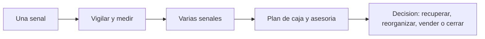
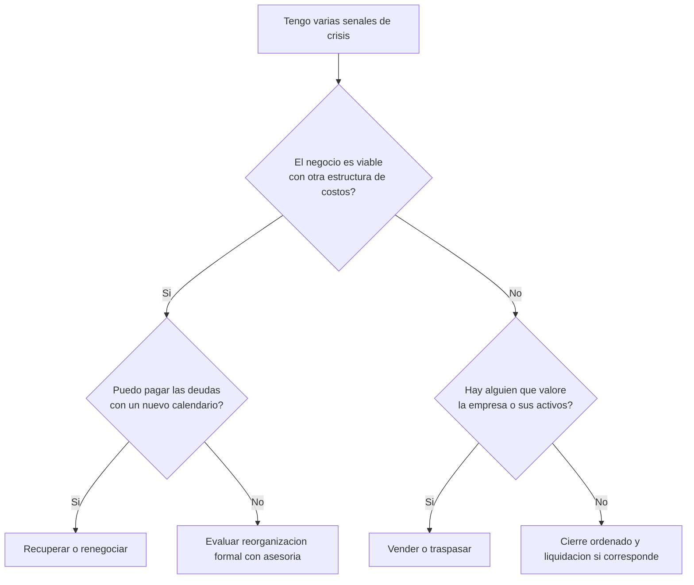

# Crisis, insolvencia, reorganización y cierre: decidir a tiempo

> **En una frase:** la mayoría de las empresas no mueren por una sola mala noticia, sino por decisiones tardías mientras
> las señales se acumulaban. Este manual te ayuda a detectar el deterioro, ordenar las primeras semanas y distinguir
> entre recuperar, reorganizar, vender o cerrar bien.

Material educativo, sin revisión legal. Los procedimientos concursales tienen plazos y requisitos que exigen
asesoría profesional; aquí se explican para que sepas cuándo y a quién acudir.

---

## 1. Señales tempranas (el tablero de alerta)

| Señal | Qué mide | Por qué preocupa |
|---|---|---|
| Caja proyectada menor a 13 semanas sin plan | Liquidez | No hay margen para reaccionar |
| Impuestos o cotizaciones postergados | Cumplimiento | Genera deudas privilegiadas y riesgos legales |
| Días de cobranza (DSO) creciente | Calidad de ventas | Vendes pero no cobras |
| Dependencia de un solo cliente | Concentración | Perderlo puede ser fatal |
| Margen negativo persistente | Modelo de negocio | Vender más pierde más |
| Inventario inmóvil | Capital atrapado | Caja congelada en bodega |
| Deuda para financiar pérdidas estructurales | Solvencia | Posterga el problema y lo agranda |
| Rotación crítica | Capacidad operativa | Pierdes conocimiento clave |
| Incumplimientos regulatorios | Riesgo legal | Puede derivar en sanciones o clausura |

---

## 2. Flujo de crisis: las primeras semanas

| Paso | Qué hacer | Para qué |
|---:|---|---|
| 1 | **Congelar decisiones irreversibles** (nuevas deudas, ventas de activos, pagos preferentes) | Evitar empeorar el panorama |
| 2 | **Conocer la caja diaria** | Decidir con datos y no con intuición |
| 3 | **Priorizar obligaciones críticas** (sueldos, cotizaciones, impuestos, insumos esenciales) | Proteger a las personas y la continuidad |
| 4 | **Preservar evidencia** (contratos, correos, registros contables) | Poder explicar y defender tus decisiones |
| 5 | **Mapear a los acreedores** (quién, cuánto, con qué garantía y vencimiento) | Base de cualquier negociación |
| 6 | **Negociar** plazos y condiciones antes del incumplimiento | Es más fácil antes que después |
| 7 | **Revisar la continuidad operativa** (qué se puede mantener) | Evitar paralizar lo valioso |
| 8 | **Comunicar por audiencias** (trabajadores, clientes, proveedores, bancos) | Sin rumores ni mensajes contradictorios |
| 9 | **Evaluar asesoría legal y de insolvencia** | Conocer las herramientas disponibles |
| 10 | **Decidir:** recuperar, reorganizar, vender o cerrar | Con alternativas comparadas por escrito |

---

## 3. Las cuatro salidas posibles

| Salida | Qué implica | Cuándo se considera |
|---|---|---|
| **Recuperar** | Corregir el modelo y estabilizar la caja | El negocio es viable y el problema es corregible |
| **Reorganizar** | Renegociar deudas dentro o fuera de un procedimiento formal | Hay negocio viable pero con deudas inmanejables |
| **Vender** | Traspasar la empresa o sus activos | Hay valor que otros pueden aprovechar |
| **Cerrar** | Término ordenado y, si corresponde, liquidación | No hay viabilidad o ya no se quiere continuar |

---

## 4. Ley 20.720 (reorganización y liquidación)

La Ley 20.720 regula los procedimientos concursales de reorganización y liquidación de empresas y de personas. Revisa
el texto actualizado y sus reformas vigentes en [Ley Chile (BCN)](https://www.bcn.cl/leychile/) y consulta a un abogado
de insolvencia antes de decidir: las consecuencias para la empresa, los socios y los administradores dependen del caso.

| Pregunta | Para qué sirve |
|---|---|
| ¿Qué procedimiento corresponde a mi situación? | Evita elegir una vía equivocada |
| ¿Qué plazos corren y qué efectos tiene iniciar uno? | Protege decisiones y responsabilidades |
| ¿Qué pasa con las garantías y los avales personales? | Evita sorpresas patrimoniales |
| ¿Qué obligaciones tienen los administradores? | Reduce el riesgo de responsabilidades |

---

## 5. Cierre ordenado: lista de verificación

| Área | Qué resolver |
|---|---|
| Contratos | Revisar plazos de término, multas y notificaciones |
| Clientes | Informar, cumplir o traspasar compromisos, devolver anticipos |
| Proveedores | Conciliar saldos y acordar pagos |
| Trabajadores | Término de contratos con la forma, plazos y pagos que exige la ley |
| Activos e inventario | Inventariar, valorar y decidir su destino |
| Datos | Conservar lo que la ley exige y eliminar o resguardar el resto |
| Licencias y suscripciones | Cancelar o traspasar |
| Permisos y patentes | Dar de baja según corresponda |
| Banco | Cerrar líneas y cuentas; revisar garantías |
| SII | Declaraciones pendientes y término de giro |
| Disolución societaria | Cumplir la forma que corresponda al tipo de empresa |
| Archivo | Conservar documentos contables y tributarios por el plazo legal |

Para el detalle de disolución y término de cada tipo de empresa, revisa el anexo correspondiente en el
[índice de anexos](../annexes/README.md).

---

## 6. Errores frecuentes

1. **Esperar demasiado:** pedir ayuda cuando ya no hay caja ni margen de negociación.
2. **Pagar a unos acreedores en perjuicio de otros** sin asesoría.
3. **Seguir endeudándose** para tapar pérdidas estructurales.
4. **Ocultar información** a socios, trabajadores o acreedores.
5. **Cerrar de hecho** sin hacer los trámites de término y quedar con obligaciones vigentes.
6. **No separar el patrimonio personal** del de la empresa y exponerlo a garantías que no se entendieron.

---

## 7. ¿Cuándo llamar a un profesional?

| Situación | Profesional |
|---|---|
| Hay deudas que no puedes pagar a su vencimiento | Abogado de insolvencia |
| Hay impuestos o cotizaciones pendientes | Contador y abogado tributario o laboral |
| Vas a despedir a varios trabajadores | Abogado laboral |
| Un acreedor te demandó o notificó | Abogado de inmediato |
| Quieres vender la empresa | Abogado corporativo y tributario |

Más detalle en la [guía de cuándo llamar a un profesional](18_WHEN_TO_CALL_A_PROFESSIONAL.md).

---

## 8. Regla final

**Cerrar bien también es una competencia empresarial.** Un cierre ordenado protege a las personas, a tu reputación y a
tu patrimonio personal, y te deja en mejor posición para tu próximo proyecto.

---

## 9. Seis situaciones para practicar

> Casos ilustrativos, con cifras inventadas. No son asesoría.

### 9.1. La caja que alcanza para seis semanas

**Situación.** Un taller tiene 6.000.000 de pesos en caja y gastos de 4.000.000 al mes, con ventas que bajaron.

**Análisis.** Seis millones cubren un mes y medio de gastos, unas seis semanas. El umbral de 13 semanas del tablero de
alerta se supera hacia abajo. Hay que construir un flujo semanal, ver qué costos pueden postergarse o reducirse sin dañar
la operación y hablar con acreedores antes del primer incumplimiento.

**Decisión.** Elaborar el flujo de caja de 13 semanas y reunirse con los acreedores principales.

### 9.2. La deuda de cotizaciones

**Situación.** Una empresa dejó de pagar cotizaciones para pagar proveedores.

**Análisis.** Las cotizaciones previsionales son una obligación que protege a los trabajadores y su no pago puede tener
consecuencias especialmente serias para la empresa y sus administradores. No es una deuda que convenga postergar sin
asesoría.

**Decisión.** Consultar de inmediato a un abogado laboral y priorizar la regularización.

### 9.3. El cliente que concentra el 70 % de las ventas

**Situación.** Un solo cliente representa el 70 % de los ingresos y avisa que reducirá sus compras.

**Análisis.** Si el cliente reduce a la mitad, la empresa pierde 35 % de sus ingresos. Hay que estimar el impacto en el
flujo, buscar nuevos clientes, negociar plazos con proveedores y ajustar costos. Conviene decidir el plan antes de que la
caída se materialice.

**Decisión.** Simular el escenario y preparar un plan de diversificación y recorte.

### 9.4. El inventario que no se vende

**Situación.** Una tienda tiene 12.000.000 de pesos en inventario que rota una vez al año.

**Análisis.** Es caja inmovilizada. Liquidar con descuento puede ser mejor que pagar intereses por mantenerlo. Se puede
priorizar la liquidación de lo más lento y reinvertir en lo que rota.

**Decisión.** Definir un plan de liquidación por etapas y medir su efecto en la caja.

### 9.5. Los socios en desacuerdo

**Situación.** Dos socios no se ponen de acuerdo entre seguir, vender o cerrar.

**Análisis.** La falta de decisión también es una decisión: la caja sigue bajando. Hay que ordenar las alternativas, sus
costos y plazos, y si es necesario recurrir a un mediador o a un abogado para definir la salida.

**Decisión.** Fijar un plazo para decidir y comparar por escrito las tres alternativas.

### 9.6. El cierre de un negocio sin trabajadores

**Situación.** Un emprendedor individual decide cerrar su negocio.

**Análisis.** Aunque no haya trabajadores, quedan trámites: término de giro, declaraciones, patentes, contratos de
arriendo, cuentas bancarias y suscripciones. Cerrar «de hecho» sin esos pasos puede dejar obligaciones vigentes.

**Decisión.** Hacer una lista de cierre y recorrerla con el contador.

---

## 10. Ruta de decisión: recuperar, reorganizar, vender o cerrar

---

## 11. Calendario de las primeras ocho semanas

| Semana | Tarea | Resultado esperado |
|---:|---|---|
| 1 | Congelar decisiones irreversibles y levantar la caja diaria | Foto real de la liquidez |
| 1 | Reunir contratos, deudas y documentos clave | Carpeta de crisis |
| 2 | Mapear acreedores y priorizar obligaciones críticas | Lista ordenada por riesgo |
| 2 | Primera consulta con abogado y contador | Alternativas por escrito |
| 3 | Construir el flujo de caja de 13 semanas | Escenarios base y malo |
| 3 a 4 | Negociar con acreedores principales | Propuestas de calendario |
| 4 | Comunicar a trabajadores, clientes y proveedores | Mensajes consistentes |
| 5 a 6 | Evaluar venta, reorganización o cierre | Decisión documentada |
| 7 a 8 | Ejecutar el plan elegido | Hitos con responsable y fecha |

---

## 12. Plantillas

### 12.1. Mapa de acreedores

| Acreedor | Monto | Vencimiento | Garantía | Prioridad | Estado de la negociación |
|---|---:|---|---|---|---|
| | | | | | |

### 12.2. Flujo de caja semanal (13 semanas)

| Semana | Saldo inicial | Ingresos | Egresos críticos | Otros egresos | Saldo final |
|---:|---:|---:|---:|---:|---:|
| 1 | | | | | |
| 2 | | | | | |
| … | | | | | |
| 13 | | | | | |

### 12.3. Registro de decisiones de crisis

| Fecha | Decisión | Quién | Alternativas consideradas | Razón | Evidencia |
|---|---|---|---|---|---|
| | | | | | |

### 12.4. Lista de comunicación

| Audiencia | Mensaje clave | Quién lo comunica | Cuándo |
|---|---|---|---|
| Trabajadores | | | |
| Clientes | | | |
| Proveedores | | | |
| Bancos | | | |
| Socios | | | |

---

## 13. Preguntas frecuentes

**1. ¿Cuándo es demasiado tarde?**
No hay una fecha única, pero cuanto antes se pida ayuda más herramientas hay. Esperar a quedarse sin caja reduce las opciones.

**2. ¿Puedo cerrar la empresa y desentenderme de las deudas?**
No automáticamente: depende del tipo de empresa, de las garantías y de si hay avales personales. Consulta a un abogado.

**3. ¿Qué diferencia hay entre reorganización y liquidación?**
La reorganización busca un acuerdo para seguir operando; la liquidación vende los bienes para pagar a los acreedores.
Revisa la Ley 20.720 y consulta a un abogado.

**4. ¿Debo seguir pagando a todos?**
Priorizar sin asesoría puede generar problemas. Pide orientación antes de pagar a unos acreedores sobre otros.

**5. ¿Qué pasa con mis avales personales?**
Subsisten mientras la deuda garantizada subsista; revisa los contratos con un abogado.

**6. ¿Qué hago con los trabajadores?**
Mantén el cumplimiento de remuneraciones y cotizaciones, y consulta a un abogado laboral antes de cualquier término de contratos.

**7. ¿Puedo vender la empresa en crisis?**
Sí, pero hay que cuidar la transparencia, las deudas y la responsabilidad de los administradores. Consulta a un abogado.

**8. ¿Cómo comunico una crisis?**
De forma clara, honesta y coordinada, con mensajes distintos según cada audiencia pero consistentes entre sí.

**9. ¿Qué papel tiene el contador?**
Entregar cifras confiables, preparar el flujo y los estados, y ayudar con los trámites tributarios.

**10. ¿Qué es el término de giro?**
El trámite ante el SII para informar que la actividad terminó. Consulta el procedimiento vigente en el SII.

**11. ¿Se puede evitar la crisis?**
Muchas veces se puede anticipar con flujo de caja, indicadores y decisiones oportunas.

**12. ¿Cuándo llamar a un profesional?**
En cuanto aparezcan varias señales o un acreedor reclame; no esperes al incumplimiento.

---

## 14. Glosario

| Término | Significado |
|---|---|
| Acreedor | Persona o empresa a la que se le debe dinero |
| Convenio | Acuerdo con los acreedores sobre cómo pagar |
| DSO | Días promedio que tarda la empresa en cobrar |
| Flujo de caja | Entradas y salidas de dinero en el tiempo |
| Insolvencia | Imposibilidad de pagar las deudas a su vencimiento |
| Liquidación | Venta de bienes para pagar a los acreedores |
| Reorganización | Procedimiento para renegociar y seguir operando |
| Término de giro | Aviso al SII de que la actividad terminó |
