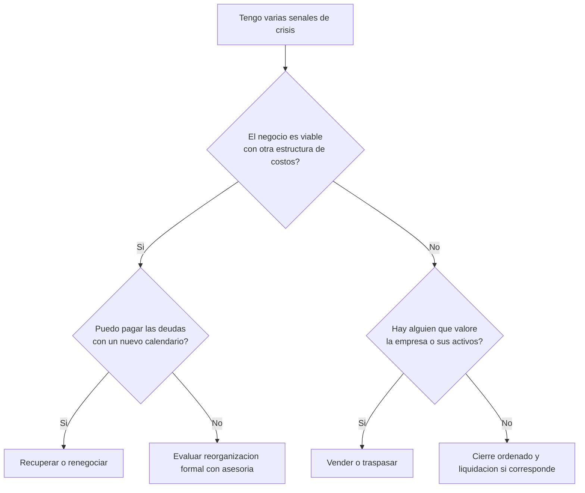
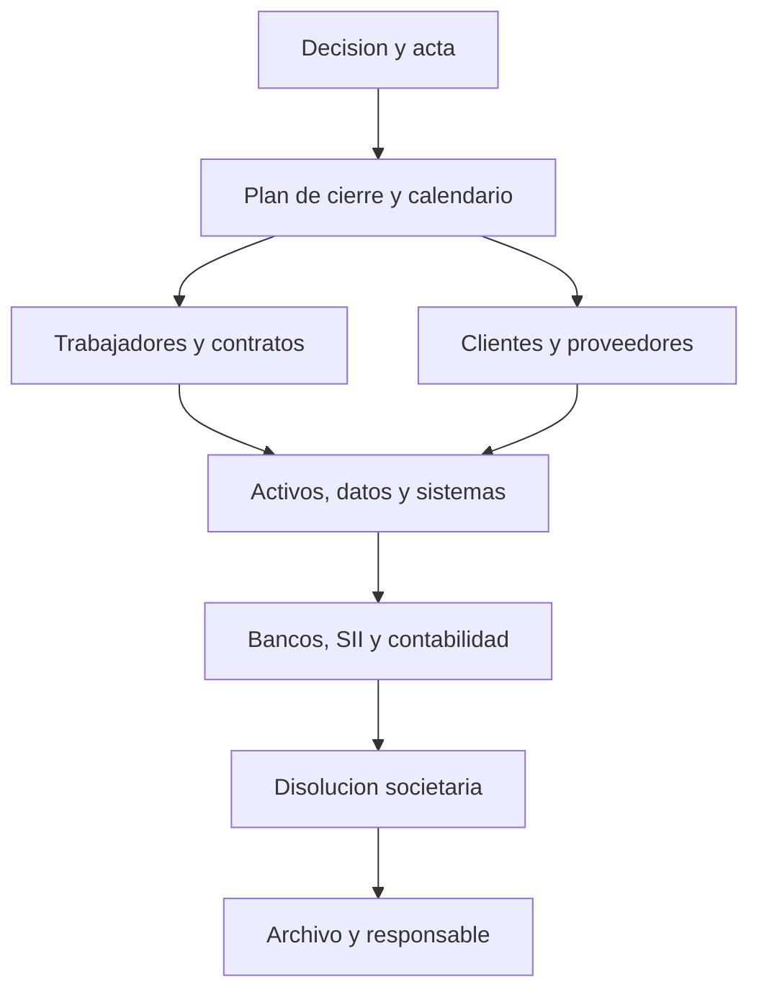

# Crisis, insolvencia, reorganización y cierre: decidir a tiempo

> **En una frase:** la mayoría de las empresas no mueren por una sola mala noticia, sino por decisiones tardías mientras
> las señales se acumulaban. Este manual te ayuda a detectar el deterioro, ordenar las primeras semanas y distinguir
> entre recuperar, reorganizar, vender o cerrar bien.

Material educativo, sin revisión legal. Los procedimientos concursales tienen plazos y requisitos que exigen
asesoría profesional; aquí se explican para que sepas cuándo y a quién acudir.

---

## 1. Señales tempranas (el tablero de alerta)

| Señal | Qué mide | Por qué preocupa |
|---|---|---|
| Caja proyectada menor a 13 semanas sin plan | Liquidez | No hay margen para reaccionar |
| Impuestos o cotizaciones postergados | Cumplimiento | Genera deudas privilegiadas y riesgos legales |
| Días de cobranza (DSO) creciente | Calidad de ventas | Vendes pero no cobras |
| Dependencia de un solo cliente | Concentración | Perderlo puede ser fatal |
| Margen negativo persistente | Modelo de negocio | Vender más pierde más |
| Inventario inmóvil | Capital atrapado | Caja congelada en bodega |
| Deuda para financiar pérdidas estructurales | Solvencia | Posterga el problema y lo agranda |
| Rotación crítica | Capacidad operativa | Pierdes conocimiento clave |
| Incumplimientos regulatorios | Riesgo legal | Puede derivar en sanciones o clausura |

---

## 2. Flujo de crisis: las primeras semanas

| Paso | Qué hacer | Para qué |
|---:|---|---|
| 1 | **Congelar decisiones irreversibles** (nuevas deudas, ventas de activos, pagos preferentes) | Evitar empeorar el panorama |
| 2 | **Conocer la caja diaria** | Decidir con datos y no con intuición |
| 3 | **Priorizar obligaciones críticas** (sueldos, cotizaciones, impuestos, insumos esenciales) | Proteger a las personas y la continuidad |
| 4 | **Preservar evidencia** (contratos, correos, registros contables) | Poder explicar y defender tus decisiones |
| 5 | **Mapear a los acreedores** (quién, cuánto, con qué garantía y vencimiento) | Base de cualquier negociación |
| 6 | **Negociar** plazos y condiciones antes del incumplimiento | Es más fácil antes que después |
| 7 | **Revisar la continuidad operativa** (qué se puede mantener) | Evitar paralizar lo valioso |
| 8 | **Comunicar por audiencias** (trabajadores, clientes, proveedores, bancos) | Sin rumores ni mensajes contradictorios |
| 9 | **Evaluar asesoría legal y de insolvencia** | Conocer las herramientas disponibles |
| 10 | **Decidir:** recuperar, reorganizar, vender o cerrar | Con alternativas comparadas por escrito |

---

## 3. Las cuatro salidas posibles

| Salida | Qué implica | Cuándo se considera |
|---|---|---|
| **Recuperar** | Corregir el modelo y estabilizar la caja | El negocio es viable y el problema es corregible |
| **Reorganizar** | Renegociar deudas dentro o fuera de un procedimiento formal | Hay negocio viable pero con deudas inmanejables |
| **Vender** | Traspasar la empresa o sus activos | Hay valor que otros pueden aprovechar |
| **Cerrar** | Término ordenado y, si corresponde, liquidación | No hay viabilidad o ya no se quiere continuar |

---

## 4. Ley 20.720 (reorganización y liquidación)

La Ley 20.720 regula los procedimientos concursales de reorganización y liquidación de empresas y de personas. Revisa
el texto actualizado y sus reformas vigentes en [Ley Chile (BCN)](https://www.bcn.cl/leychile/) y consulta a un abogado
de insolvencia antes de decidir: las consecuencias para la empresa, los socios y los administradores dependen del caso.

| Pregunta | Para qué sirve |
|---|---|
| ¿Qué procedimiento corresponde a mi situación? | Evita elegir una vía equivocada |
| ¿Qué plazos corren y qué efectos tiene iniciar uno? | Protege decisiones y responsabilidades |
| ¿Qué pasa con las garantías y los avales personales? | Evita sorpresas patrimoniales |
| ¿Qué obligaciones tienen los administradores? | Reduce el riesgo de responsabilidades |

---

## 5. Cierre ordenado: lista de verificación

| Área | Qué resolver |
|---|---|
| Contratos | Revisar plazos de término, multas y notificaciones |
| Clientes | Informar, cumplir o traspasar compromisos, devolver anticipos |
| Proveedores | Conciliar saldos y acordar pagos |
| Trabajadores | Término de contratos con la forma, plazos y pagos que exige la ley |
| Activos e inventario | Inventariar, valorar y decidir su destino |
| Datos | Conservar lo que la ley exige y eliminar o resguardar el resto |
| Licencias y suscripciones | Cancelar o traspasar |
| Permisos y patentes | Dar de baja según corresponda |
| Banco | Cerrar líneas y cuentas; revisar garantías |
| SII | Declaraciones pendientes y término de giro |
| Disolución societaria | Cumplir la forma que corresponda al tipo de empresa |
| Archivo | Conservar documentos contables y tributarios por el plazo legal |

Para el detalle de disolución y término de cada tipo de empresa, revisa el anexo correspondiente en el
[índice de anexos](../annexes/README.md).

---

## 6. Errores frecuentes

1. **Esperar demasiado:** pedir ayuda cuando ya no hay caja ni margen de negociación.
2. **Pagar a unos acreedores en perjuicio de otros** sin asesoría.
3. **Seguir endeudándose** para tapar pérdidas estructurales.
4. **Ocultar información** a socios, trabajadores o acreedores.
5. **Cerrar de hecho** sin hacer los trámites de término y quedar con obligaciones vigentes.
6. **No separar el patrimonio personal** del de la empresa y exponerlo a garantías que no se entendieron.

---

## 7. ¿Cuándo llamar a un profesional?

| Situación | Profesional |
|---|---|
| Hay deudas que no puedes pagar a su vencimiento | Abogado de insolvencia |
| Hay impuestos o cotizaciones pendientes | Contador y abogado tributario o laboral |
| Vas a despedir a varios trabajadores | Abogado laboral |
| Un acreedor te demandó o notificó | Abogado de inmediato |
| Quieres vender la empresa | Abogado corporativo y tributario |

Más detalle en la [guía de cuándo llamar a un profesional](18_WHEN_TO_CALL_A_PROFESSIONAL.md).

---

## 8. Regla final

**Cerrar bien también es una competencia empresarial.** Un cierre ordenado protege a las personas, a tu reputación y a
tu patrimonio personal, y te deja en mejor posición para tu próximo proyecto.

---

## 9. Seis situaciones para practicar

> Casos ilustrativos, con cifras inventadas. No son asesoría.

### 9.1. La caja que alcanza para seis semanas

**Situación.** Un taller tiene 6.000.000 de pesos en caja y gastos de 4.000.000 al mes, con ventas que bajaron.

**Análisis.** Seis millones cubren un mes y medio de gastos, unas seis semanas. El umbral de 13 semanas del tablero de
alerta se supera hacia abajo. Hay que construir un flujo semanal, ver qué costos pueden postergarse o reducirse sin dañar
la operación y hablar con acreedores antes del primer incumplimiento.

**Decisión.** Elaborar el flujo de caja de 13 semanas y reunirse con los acreedores principales.

### 9.2. La deuda de cotizaciones

**Situación.** Una empresa dejó de pagar cotizaciones para pagar proveedores.

**Análisis.** Las cotizaciones previsionales son una obligación que protege a los trabajadores y su no pago puede tener
consecuencias especialmente serias para la empresa y sus administradores. No es una deuda que convenga postergar sin
asesoría.

**Decisión.** Consultar de inmediato a un abogado laboral y priorizar la regularización.

### 9.3. El cliente que concentra el 70 % de las ventas

**Situación.** Un solo cliente representa el 70 % de los ingresos y avisa que reducirá sus compras.

**Análisis.** Si el cliente reduce a la mitad, la empresa pierde 35 % de sus ingresos. Hay que estimar el impacto en el
flujo, buscar nuevos clientes, negociar plazos con proveedores y ajustar costos. Conviene decidir el plan antes de que la
caída se materialice.

**Decisión.** Simular el escenario y preparar un plan de diversificación y recorte.

### 9.4. El inventario que no se vende

**Situación.** Una tienda tiene 12.000.000 de pesos en inventario que rota una vez al año.

**Análisis.** Es caja inmovilizada. Liquidar con descuento puede ser mejor que pagar intereses por mantenerlo. Se puede
priorizar la liquidación de lo más lento y reinvertir en lo que rota.

**Decisión.** Definir un plan de liquidación por etapas y medir su efecto en la caja.

### 9.5. Los socios en desacuerdo

**Situación.** Dos socios no se ponen de acuerdo entre seguir, vender o cerrar.

**Análisis.** La falta de decisión también es una decisión: la caja sigue bajando. Hay que ordenar las alternativas, sus
costos y plazos, y si es necesario recurrir a un mediador o a un abogado para definir la salida.

**Decisión.** Fijar un plazo para decidir y comparar por escrito las tres alternativas.

### 9.6. El cierre de un negocio sin trabajadores

**Situación.** Un emprendedor individual decide cerrar su negocio.

**Análisis.** Aunque no haya trabajadores, quedan trámites: término de giro, declaraciones, patentes, contratos de
arriendo, cuentas bancarias y suscripciones. Cerrar «de hecho» sin esos pasos puede dejar obligaciones vigentes.

**Decisión.** Hacer una lista de cierre y recorrerla con el contador.

---

## 10. Ruta de decisión: recuperar, reorganizar, vender o cerrar

---

## 11. Calendario de las primeras ocho semanas

| Semana | Tarea | Resultado esperado |
|---:|---|---|
| 1 | Congelar decisiones irreversibles y levantar la caja diaria | Foto real de la liquidez |
| 1 | Reunir contratos, deudas y documentos clave | Carpeta de crisis |
| 2 | Mapear acreedores y priorizar obligaciones críticas | Lista ordenada por riesgo |
| 2 | Primera consulta con abogado y contador | Alternativas por escrito |
| 3 | Construir el flujo de caja de 13 semanas | Escenarios base y malo |
| 3 a 4 | Negociar con acreedores principales | Propuestas de calendario |
| 4 | Comunicar a trabajadores, clientes y proveedores | Mensajes consistentes |
| 5 a 6 | Evaluar venta, reorganización o cierre | Decisión documentada |
| 7 a 8 | Ejecutar el plan elegido | Hitos con responsable y fecha |

---

## 12. Plantillas

### 12.1. Mapa de acreedores

| Acreedor | Monto | Vencimiento | Garantía | Prioridad | Estado de la negociación |
|---|---:|---|---|---|---|
| | | | | | |

### 12.2. Flujo de caja semanal (13 semanas)

| Semana | Saldo inicial | Ingresos | Egresos críticos | Otros egresos | Saldo final |
|---:|---:|---:|---:|---:|---:|
| 1 | | | | | |
| 2 | | | | | |
| … | | | | | |
| 13 | | | | | |

### 12.3. Registro de decisiones de crisis

| Fecha | Decisión | Quién | Alternativas consideradas | Razón | Evidencia |
|---|---|---|---|---|---|
| | | | | | |

### 12.4. Lista de comunicación

| Audiencia | Mensaje clave | Quién lo comunica | Cuándo |
|---|---|---|---|
| Trabajadores | | | |
| Clientes | | | |
| Proveedores | | | |
| Bancos | | | |
| Socios | | | |

---

## 13. Preguntas frecuentes

**1. ¿Cuándo es demasiado tarde?**
No hay una fecha única, pero cuanto antes se pida ayuda más herramientas hay. Esperar a quedarse sin caja reduce las opciones.

**2. ¿Puedo cerrar la empresa y desentenderme de las deudas?**
No automáticamente: depende del tipo de empresa, de las garantías y de si hay avales personales. Consulta a un abogado.

**3. ¿Qué diferencia hay entre reorganización y liquidación?**
La reorganización busca un acuerdo para seguir operando; la liquidación vende los bienes para pagar a los acreedores.
Revisa la Ley 20.720 y consulta a un abogado.

**4. ¿Debo seguir pagando a todos?**
Priorizar sin asesoría puede generar problemas. Pide orientación antes de pagar a unos acreedores sobre otros.

**5. ¿Qué pasa con mis avales personales?**
Subsisten mientras la deuda garantizada subsista; revisa los contratos con un abogado.

**6. ¿Qué hago con los trabajadores?**
Mantén el cumplimiento de remuneraciones y cotizaciones, y consulta a un abogado laboral antes de cualquier término de contratos.

**7. ¿Puedo vender la empresa en crisis?**
Sí, pero hay que cuidar la transparencia, las deudas y la responsabilidad de los administradores. Consulta a un abogado.

**8. ¿Cómo comunico una crisis?**
De forma clara, honesta y coordinada, con mensajes distintos según cada audiencia pero consistentes entre sí.

**9. ¿Qué papel tiene el contador?**
Entregar cifras confiables, preparar el flujo y los estados, y ayudar con los trámites tributarios.

**10. ¿Qué es el término de giro?**
El trámite ante el SII para informar que la actividad terminó. Consulta el procedimiento vigente en el SII.

**11. ¿Se puede evitar la crisis?**
Muchas veces se puede anticipar con flujo de caja, indicadores y decisiones oportunas.

**12. ¿Cuándo llamar a un profesional?**
En cuanto aparezcan varias señales o un acreedor reclame; no esperes al incumplimiento.

---

## 14. Glosario

| Término | Significado |
|---|---|
| Acreedor | Persona o empresa a la que se le debe dinero |
| Convenio | Acuerdo con los acreedores sobre cómo pagar |
| DSO | Días promedio que tarda la empresa en cobrar |
| Flujo de caja | Entradas y salidas de dinero en el tiempo |
| Insolvencia | Imposibilidad de pagar las deudas a su vencimiento |
| Liquidación | Venta de bienes para pagar a los acreedores |
| Reorganización | Procedimiento para renegociar y seguir operando |
| Término de giro | Aviso al SII de que la actividad terminó |

---

## 15. Entender el diagnóstico: de dónde viene la crisis

Antes de decidir cómo salir, hay que entender **por qué** estás ahí. Las crisis suelen tener una de estas causas (o varias):

| Causa raíz | Cómo se ve | Pregunta clave | Camino habitual |
|---|---|---|---|
| **Modelo de negocio débil** | Márgenes bajos o negativos sin mejora | ¿Cada venta adicional nos hace perder dinero? | Rediseñar precios, costos o producto; si no es viable, cerrar |
| **Problema de caja, no de rentabilidad** | Hay ganancia contable pero falta liquidez | ¿Cobramos más lento de lo que pagamos? | Ajustar plazos, financiar capital de trabajo |
| **Exceso de deuda** | La cuota consume el flujo operativo | ¿Podemos pagar la deuda con el flujo actual? | Renegociar, reestructurar, vender activos |
| **Pérdida de un cliente clave** | Caída brusca de ingresos | ¿Qué parte de la venta dependía de él? | Diversificar, recortar costos |
| **Shock externo** | Cambio regulatorio, de mercado o evento extraordinario | ¿Es temporal o estructural? | Adaptar o redefinir el negocio |
| **Problemas de gobierno o de socios** | Conflicto, decisiones paralizadas | ¿Quién decide y con qué información? | Acuerdos de socios, mediación, salida ordenada |
| **Fraude o errores graves** | Pérdidas inexplicables | ¿Hay controles y evidencia? | Investigación, asesoría legal y de cumplimiento |

### 15.1. El diagnóstico en cinco preguntas

1. ¿Estamos perdiendo dinero **en cada venta** o solo por costos fijos altos?
2. ¿El problema es **de caja** (momento de los pagos) o **de resultado** (ganamos menos de lo que gastamos)?
3. ¿Qué parte de la deuda vence en los próximos 90 días y cuánto se puede renegociar?
4. ¿Qué activos o contratos tienen valor para terceros?
5. ¿Qué pasaría si **no hiciéramos nada** durante tres meses?

Responde cada pregunta con cifras. Si no puedes, el primer proyecto es **construir la información**.

---

## 16. Priorizar pagos: orden de prudencia

Cuando no alcanza para todo, pagar sin criterio puede agravar el problema. Esta guía es **orientativa** y debe validarse con
tu abogado, porque las reglas de prelación y de responsabilidad son técnicas:

| Prioridad | Obligación | Por qué suele ser crítica |
|---:|---|---|
| 1 | **Remuneraciones y cotizaciones** | Protegen a las personas y su incumplimiento tiene consecuencias legales graves (en un despido, las cotizaciones impagas pueden impedir que el término del contrato produzca efectos; ver el [manual laboral](08_EMPLOYMENT_FLOW_CHILE.md)) |
| 2 | **Impuestos retenidos y declarados** | Su no pago agrava sanciones y puede generar responsabilidades |
| 3 | **Insumos y servicios esenciales para operar** | Sin ellos, no hay ingresos |
| 4 | **Obligaciones con garantías y avales personales** | Pueden comprometer a los socios |
| 5 | **Otros acreedores** | Se negocian con calendario |

> **Advertencia:** pagar a unos acreedores en detrimento de otros, o transferir bienes de la empresa en una situación de
> insolvencia, puede tener consecuencias legales. **No lo hagas sin asesoría de un abogado de insolvencia.**

### 16.1. Cómo negociar con acreedores

| Paso | Qué hacer |
|---:|---|
| 1 | Reunir cifras reales: deuda, flujo y capacidad de pago |
| 2 | Proponer un calendario realista y comprobable, no uno optimista |
| 3 | Hablar **antes** del incumplimiento, con transparencia |
| 4 | Ofrecer información y seguimiento periódico |
| 5 | Documentar los acuerdos por escrito |
| 6 | Cumplir lo pactado, aunque sea poco: la confianza se reconstruye con cumplimiento |

**Lo que suele funcionar mejor:** una propuesta con una fecha de inicio cercana, montos pequeños pero ciertos y una
cláusula clara de qué pasa si falla. **Lo que suele fallar:** prometer más de lo que puedes pagar solo para ganar tiempo.

---

## 17. Reorganización y liquidación: cómo pensarlas

Estas son herramientas formales reguladas por la Ley 20.720. **Los detalles (requisitos, plazos, efectos) deben verificarse
en el texto vigente y con un abogado de insolvencia.** Lo que sigue es un marco para hacer preguntas, no una guía legal.

| Pregunta | Reorganización | Liquidación |
|---|---|---|
| ¿Qué busca? | Un acuerdo con acreedores para seguir operando | Vender bienes y pagar a los acreedores |
| ¿Cuándo se piensa? | Hay negocio viable con deudas que no puedes atender | El negocio no es viable o no hay cómo pagar |
| ¿Qué pasa con la operación? | Puede continuar | Normalmente termina |
| ¿Qué pasa con los socios y administradores? | Depende de cada caso | Depende de cada caso y de su conducta |
| ¿Quién decide? | Tú y tus acreedores, con control del procedimiento | Un procedimiento con liquidador |

### 17.1. Preguntas para tu abogado de insolvencia

1. ¿Qué procedimiento se ajusta a mi caso y qué requisitos debo cumplir?
2. ¿Qué plazos corren y qué efectos tiene iniciarlo?
3. ¿Qué pasa con mis garantías y avales personales?
4. ¿Qué responsabilidades tienen los administradores y qué conductas debo evitar?
5. ¿Cómo se tratan los trabajadores y sus créditos?
6. ¿Qué costos tiene cada vía y quién los paga?
7. ¿Qué alternativas fuera de un procedimiento formal tengo?

### 17.2. Lo que debes tener listo antes de la primera reunión

| Documento | Para qué |
|---|---|
| Listado de deudas con acreedor, monto, vencimiento y garantía | Base de cualquier estrategia |
| Listado de activos con valor estimado y gravámenes | Capacidad de pago |
| Estados financieros y flujo de caja proyectado | Viabilidad |
| Contratos relevantes (arriendos, clientes, proveedores) | Riesgos y oportunidades |
| Lista de trabajadores, contratos y deudas laborales | Obligaciones prioritarias |
| Declaraciones y deudas tributarias | Situación fiscal |
| Garantías y avales otorgados por socios | Exposición personal |
| Litigios y cobranzas en curso | Contingencias |

---

## 18. Vender la empresa o sus activos en crisis

| Opción | Qué es | Ventaja | Riesgo |
|---|---|---|---|
| **Venta de la empresa** | Un tercero compra las acciones o derechos | Continuidad y pago a acreedores | Responsabilidades y cláusulas de garantía |
| **Venta de activos o de una línea de negocio** | Se vende parte del negocio | Liquidez rápida | Pérdida de capacidad y efectos sobre trabajadores |
| **Fusión o integración con otro actor** | Se unen operaciones | Sinergias | Complejidad y negociación |
| **Traspaso de contratos** | Un tercero asume contratos con clientes | Continuidad para clientes | Requiere consentimientos |

**Reglas de prudencia:**

1. **Transparencia:** informa a los compradores de la situación real.
2. **Valoración independiente** cuando sea posible.
3. **Evitar ventas a relacionados** sin asesoría, porque pueden ser cuestionadas.
4. **Registrar** cada decisión y su fundamento.
5. **Proteger a los trabajadores** y cumplir las obligaciones laborales.

---

## 19. Gobierno y responsabilidad de los administradores

En una crisis, las decisiones de directores, gerentes y socios administradores se observan con mayor atención.

| Práctica | Para qué |
|---|---|
| **Reunirse con frecuencia** y dejar actas | Evidenciar decisiones informadas |
| **Informarse con datos** (caja, deudas, proyecciones) | Evitar decisiones a ciegas |
| **Asesorarse** por escrito | Respaldar la prudencia |
| **Tratar a los acreedores con criterio** | Evitar beneficios indebidos |
| **No ocultar información** | Evitar responsabilidades |
| **Evitar operaciones con relacionados sin respaldo** | Prevenir cuestionamientos |
| **Preservar los libros y la contabilidad** | Permitir revisión |

> Las responsabilidades de los administradores dependen del tipo de sociedad y de las normas aplicables. Consulta los
> anexos del tipo de empresa correspondiente y a un abogado.

---

## 20. Comunicación en la crisis

| Audiencia | Qué necesita saber | Cómo decirlo |
|---|---|---|
| **Trabajadores** | Su situación, qué se hace para proteger sus pagos, qué viene | Con claridad, cuanto antes y en persona cuando sea posible |
| **Clientes** | Continuidad del servicio, plazos, alternativas | Mensajes concretos y cumplibles |
| **Proveedores** | Calendario de pagos y condiciones | Reunión y propuesta escrita |
| **Bancos** | Plan de pagos y garantías | Información completa y propuesta realista |
| **Socios** | Diagnóstico, alternativas y decisiones requeridas | Informe con cifras |
| **Medios o público** | Solo si es necesario y con asesoría | Mensaje breve, veraz y coordinado |

**Principios:** decir lo que sabes y lo que no sabes; no prometer lo que no puedes cumplir; coordinar los mensajes para
que no se contradigan; y registrar lo comunicado.

---

## 21. Catálogo de errores frecuentes

| N.º | Error | Consecuencia | Cómo evitarlo |
|---:|---|---|---|
| 1 | Esperar a quedarse sin caja | Menos opciones | Alertas tempranas |
| 2 | No conocer la caja diaria | Decisiones a ciegas | Flujo semanal |
| 3 | Pagar con criterio de presión | Acreedores en desigualdad | Prioridad con asesoría |
| 4 | Seguir endeudándose para cubrir pérdidas | Deuda mayor | Corregir el modelo |
| 5 | Ocultar información a socios o acreedores | Pérdida de confianza y responsabilidad | Transparencia |
| 6 | No registrar las decisiones | Indefensión | Actas y registro |
| 7 | Vender activos a relacionados sin respaldo | Cuestionamientos legales | Valoración y asesoría |
| 8 | Dejar atrasar cotizaciones o impuestos | Sanciones y efectos graves | Priorizarlos |
| 9 | Cerrar de hecho sin trámites | Obligaciones vigentes | Cierre ordenado |
| 10 | No separar patrimonio personal | Exposición por avales | Revisar garantías |
| 11 | Decidir sin asesoría especializada | Errores irreversibles | Abogado de insolvencia |
| 12 | Comunicar tarde o con contradicciones | Rumores y desconfianza | Plan de comunicación |
| 13 | No cuidar a las personas clave | Pérdida de capacidad | Retención y claridad |
| 14 | No guardar documentos | No poder explicar lo ocurrido | Carpeta de crisis |
| 15 | Creer que cerrar elimina todo | Sorpresas posteriores | Asesoría sobre efectos |

---

## 22. Más preguntas frecuentes

**13. ¿Puedo seguir operando si debo impuestos?**
Es riesgoso y conviene negociar con asesoría; hay herramientas de regularización, pero requieren análisis de tu caso.

**14. ¿Qué pasa con los trabajadores si cierro?**
Deben terminarse los contratos cumpliendo las reglas y pagos que exige la ley; consulta a un abogado laboral.

**15. ¿Puedo vender mis bienes personales para pagar deudas de la empresa?**
Es una decisión grave; evalúa si existe obligación legal o garantía, y consulta antes de comprometer tu patrimonio.

**16. ¿Qué es un «cierre de hecho»?**
Dejar de operar sin hacer los trámites de término; mantiene obligaciones y puede generar sanciones.

**17. ¿Es posible reorganizarse sin ir a un procedimiento formal?**
Sí, con acuerdos privados con acreedores; un abogado puede ayudarte a estructurarlos.

**18. ¿Cuándo es mejor liquidar que reorganizar?**
Cuando el negocio no es viable o no hay forma realista de pagar; esa decisión requiere asesoría.

**19. ¿Qué responsabilidad tengo como socio?**
Depende del tipo de sociedad y de tus actos; revisa los anexos y consulta a un abogado.

**20. ¿Cómo evito que un acreedor me embargue?**
Una negociación temprana y, si corresponde, un procedimiento formal pueden ayudar; no ocultes ni transfieras bienes sin
asesoría.

**21. ¿Debo informar a mi banco?**
Conviene hacerlo con una propuesta concreta, antes de incumplir.

**22. ¿Qué papel tiene el contador?**
Entregar cifras confiables y ayudar a construir el flujo, el balance y los trámites de término.

**23. ¿Puedo empezar de nuevo con otra empresa?**
En muchos casos sí, pero conviene verificar con un abogado cómo afectan las deudas, avales y responsabilidades.

**24. ¿Cuánto cuesta un procedimiento formal?**
Este manual no fija costos: dependen del procedimiento y de la complejidad; pide una estimación por escrito.

**25. ¿Cuándo llamar a un profesional?**
En cuanto aparezcan varias señales o un acreedor reclame. Ver la
[guía de cuándo llamar a un profesional](18_WHEN_TO_CALL_A_PROFESSIONAL.md).

---

## 23. Plan de recuperación de 90 días (cuando el negocio es viable)

Si el diagnóstico indica que el negocio puede recuperarse, un plan por fases ordena el esfuerzo.

| Período | Objetivo | Acciones | Indicador |
|---|---|---|---|
| Días 1 a 15 | **Estabilizar** | Flujo semanal, congelar gastos no esenciales, priorizar pagos críticos, hablar con acreedores principales | Caja proyectada a 13 semanas |
| Días 16 a 45 | **Corregir** | Revisar precios y márgenes, cortar productos o clientes que pierden dinero, renegociar contratos y arriendos, ajustar estructura | Margen por producto y cliente |
| Días 46 a 75 | **Reactivar** | Reforzar lo que sí funciona, campañas hacia clientes rentables, mejorar cobranza | Ventas rentables y días de cobranza |
| Días 76 a 90 | **Consolidar** | Revisar resultados, definir presupuesto y reglas de control, comunicar avances | Plan del siguiente trimestre |

### 23.1. Palancas para mejorar la caja, de menor a mayor impacto en el negocio

| Palanca | Ejemplo | Cuidado |
|---|---|---|
| Cobrar mejor | Cobranza activa, anticipos, pago a plazos más cortos | No dañar relaciones con clientes clave |
| Negociar plazos | Alargar pagos con proveedores a cambio de compromisos | Cumplir lo pactado |
| Reducir costos no esenciales | Suscripciones, arriendos, gastos discrecionales | No eliminar lo que genera ingresos |
| Ajustar precios | Subir o segmentar precios | Medir el efecto sobre la demanda |
| Liquidar inventario lento | Descuentos por etapas | Evitar canibalizar ventas normales |
| Vender activos no esenciales | Equipos o bienes sin uso | Verificar gravámenes y efectos tributarios |
| Nuevo financiamiento | Crédito, aporte de socios | Solo si el negocio es viable; evitar financiar pérdidas |
| Reducir la jornada o la dotación | Ajustes laborales | Cumplir estrictamente la ley; consultar a un abogado laboral |

### 23.2. Tablero semanal de crisis (plantilla)

| Indicador | Semana 1 | Semana 2 | Semana 3 | Semana 4 |
|---|---:|---:|---:|---:|
| Caja al inicio | | | | |
| Cobros esperados / reales | | | | |
| Pagos críticos programados / reales | | | | |
| Ventas | | | | |
| Deuda vencida | | | | |
| Acuerdos logrados con acreedores | | | | |
| Riesgos nuevos | | | | |

---

## 24. Cierre ordenado: detalle por área

El cierre bien hecho protege a las personas, a la reputación y a tu patrimonio. Esta guía amplía la lista de la sección 5.

| Área | Qué hacer | Evidencia |
|---|---|---|
| **Decisión y gobierno** | Acordar el cierre según el tipo de empresa y dejar acta | Acta de socios o directorio |
| **Trabajadores** | Terminar contratos con las causales, plazos, cartas, pagos y finiquitos que exige la ley (ver [manual laboral](08_EMPLOYMENT_FLOW_CHILE.md)) | Cartas, comprobantes y finiquitos |
| **Clientes** | Cumplir o traspasar encargos, devolver anticipos, informar fechas | Comunicaciones y reembolsos |
| **Proveedores y acreedores** | Conciliar saldos, acordar pagos, comunicar el cierre | Cartolas y acuerdos |
| **Contratos de arriendo y servicios** | Notificar el término y negociar salidas | Cartas y finiquitos de arriendo |
| **Activos e inventario** | Inventariar, vender o dar de baja con acta (ver [manual de activos](05_ASSETS_AND_RECORDS.md)) | Actas y comprobantes |
| **Datos personales y sistemas** | Decidir qué se conserva por obligación legal y eliminar o resguardar el resto; entregar cuentas y credenciales | Registros de borrado y entrega |
| **Licencias y suscripciones** | Cancelar o traspasar | Confirmaciones |
| **Permisos y patentes** | Dar de baja según corresponda | Comprobantes |
| **Banco** | Cerrar líneas y cuentas; revisar garantías y avales | Certificados bancarios |
| **SII y contabilidad** | Declaraciones pendientes, término de giro y respaldo contable | Comprobantes y libros |
| **Disolución y liquidación societaria** | Cumplir la forma que corresponda al tipo de empresa (ver los [anexos](../annexes/README.md)) | Escrituras, inscripciones y publicaciones |
| **Archivo** | Conservar documentos por los plazos legales y dejar un responsable | Índice del archivo |

### 24.1. Orden recomendado del cierre

### 24.2. Calendario de un cierre de 60 días (ilustrativo)

| Días | Tareas |
|---|---|
| 1 a 7 | Decisión, acta, asesoría legal y contable, plan y comunicación interna |
| 8 a 20 | Comunicación a clientes y proveedores; cierre de proyectos pendientes; negociación de arriendos |
| 21 a 35 | Término de contratos de trabajo con sus plazos y pagos; inventario y venta de activos |
| 36 a 50 | Conciliaciones, pagos a acreedores según el plan, entrega de sistemas y datos |
| 51 a 60 | Declaraciones y término de giro, cierre de cuentas, disolución societaria y archivo |

Los plazos reales dependen de cada obligación; usa este calendario como estructura y ajústalo con tu contador y abogado.

---

## 25. Cinco historias breves para pensar

> Casos ilustrativos, con cifras inventadas. No son asesoría.

### 25.1. La pastelería que alargó el cierre

Una pastelería perdía 800.000 pesos al mes durante un año. Los dueños esperaban «una buena temporada». Cuando decidieron
cerrar, habían acumulado deudas por 9.600.000 pesos que podrían haberse evitado con una decisión a los tres meses.
**Lección:** fijar un plazo y un criterio de decisión (por ejemplo, «si en tres meses no llegamos al punto de equilibrio,
cerramos o cambiamos el modelo»).

### 25.2. El consultor que negoció a tiempo

Un consultor con un cliente que concentraba el 80 % de sus ingresos supo que perdería ese contrato en 90 días. Recortó
costos, buscó dos clientes nuevos y negoció con su arrendador antes de incumplir. Pasó el trimestre con caja ajustada pero
positiva. **Lección:** actuar con anticipación aumenta las opciones.

### 25.3. La tienda con deuda y buen negocio

Una tienda vendía bien pero pagaba cuotas muy altas por un crédito tomado en un mal momento. Con ayuda de un abogado y un
contador, propuso a sus acreedores un calendario más largo a cambio de información mensual. Siguió operando.
**Lección:** a veces el problema es la estructura de la deuda, no el negocio.

### 25.4. El socio que se fue sin avisar

Un socio dejó de participar y no respondía. La empresa no podía tomar decisiones y se atrasó en pagos. Si el pacto de socios
hubiera previsto una salida y un mecanismo de decisión, el bloqueo se habría resuelto. **Lección:** los acuerdos entre socios
también son una herramienta de gestión de crisis.

### 25.5. El cierre que dejó deudas pendientes

Un emprendedor dejó de operar sin hacer el término de giro ni pagar patentes. Meses después recibió cobros y multas por
obligaciones que seguían vigentes. **Lección:** cerrar de hecho no cierra obligaciones; hay que hacerlo con los trámites.

---

## 26. Límites de este manual

Este manual no es asesoría legal ni financiera; **no se leyó el texto íntegro de la Ley 20.720** y solo se la menciona
como marco; las cifras de los ejemplos son ilustrativas. Las reglas concursales, laborales y tributarias son técnicas y
cambian: verifica en las fuentes oficiales y consulta a un abogado de insolvencia antes de decidir.
