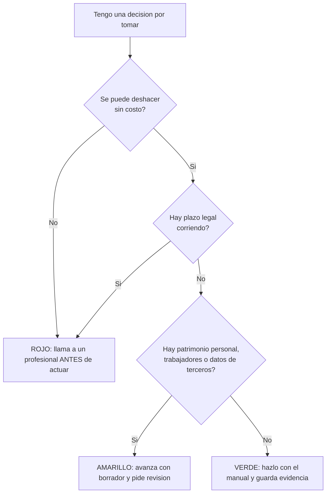

# Cuándo dejar de hacerlo solo: guía para decidir a qué profesional llamar

> **En una frase:** puedes aprender, ordenar y preparar casi todo por tu cuenta, pero hay decisiones donde un error
> cuesta más que la asesoría. Esta guía te ayuda a reconocer esas decisiones **antes** de firmar, pagar o declarar,
> a elegir al profesional correcto y a llegar a la reunión con lo necesario para que te rinda.

Este material es educativo: no reemplaza a un abogado, contador ni especialista, y no tiene revisión legal. Las cifras
y plazos concretos de cada tema están en los anexos y manuales enlazados al final; aquí no se repiten para no
desactualizarse.

---

## 1. La regla de oro: costo de equivocarse frente a costo de preguntar

Antes de decidir si llamas a alguien, responde tres preguntas:

| Pregunta | Si la respuesta es «sí» |
|---|---|
| ¿El error sería **difícil o imposible de deshacer** (firma, escritura, pago, despido, declaración, venta)? | Llama **antes** de actuar |
| ¿Hay **dinero, patrimonio personal o libertad de terceros** en juego (deudas, garantías, trabajadores, datos)? | Llama |
| ¿Hay un **plazo legal corriendo** (fiscalización, notificación, vencimiento)? | Llama **hoy** |

Si las tres son «no», probablemente puedes avanzar solo, con los manuales de este programa, y consultar después.

---

## 2. Semáforo rápido

| Color | Qué significa | Ejemplos típicos | Qué hacer |
|---|---|---|---|
| 🟢 **Verde** | Trámite estándar, reversible, de bajo monto | Consultar tipos de empresa, usar un modelo oficial de estatuto, revisar la ficha de un trámite | Hazlo tú, guarda comprobantes |
| 🟡 **Amarillo** | Estándar pero con consecuencias si sale mal | Elegir la forma societaria, redactar el primer contrato de trabajo, definir tu régimen tributario | Prepara un borrador y pide una **revisión puntual** |
| 🔴 **Rojo** | Irreversible, de alto monto o con plazo en curso | Pacto con inversionista, fiscalización, despido conflictivo, incidente de datos, deudas que no puedes pagar | Asesoría **antes** de actuar y por escrito |

---

## 3. Mapa de profesionales: a quién llamar y para qué

### 3.1. Abogado corporativo

| Qué resuelve | Señales de que lo necesitas | Qué llevarle |
|---|---|---|
| Estatutos, pactos de socios, gobierno, contratos complejos | Entra o sale un socio; llega un inversionista; hay conflicto entre socios; quieres poderes amplios; compras o vendes una empresa; el estatuto estándar no te sirve | Borrador de estatuto, lista de socios y aportes, objetivo comercial de cada uno, quién manda en qué |

### 3.2. Abogado o asesor tributario

| Qué resuelve | Señales de que lo necesitas | Qué llevarle |
|---|---|---|
| Estructura tributaria, reorganizaciones, contingencias | Reorganización de sociedades; operaciones con el exterior; fiscalización o notificación del SII; instrumentos financieros; partes relacionadas; varias sociedades que se facturan entre sí | Balances, declaraciones, contratos entre relacionadas, notificaciones recibidas |

### 3.3. Contador

| Qué resuelve | Señales de que lo necesitas | Qué llevarle |
|---|---|---|
| Contabilidad, libros, IVA mensual, renta anual, remuneraciones | **Desde antes de la primera venta** si habrá actividad empresarial formal. No esperes al primer F29 | Facturas y boletas, extractos bancarios, contratos, lista de trabajadores |

### 3.4. Abogado laboral

| Qué resuelve | Señales de que lo necesitas | Qué llevarle |
|---|---|---|
| Contratos, despidos, acoso y relaciones colectivas | Despido conflictivo; denuncia o investigación de la Ley Karin; subcontratación intensiva; jornadas especiales; sindicato o negociación; accidente grave | Contrato, anexos, liquidaciones, registro de asistencia, comunicaciones relevantes |

### 3.5. Especialista en privacidad y ciberseguridad

| Qué resuelve | Señales de que lo necesitas | Qué llevarle |
|---|---|---|
| Tratamiento de datos personales, incidentes, contratos con proveedores | Datos sensibles; gran escala; perfilamiento; salud o fintech; transferencia internacional compleja; **incidente de seguridad** | Inventario de datos, contratos con proveedores, políticas, bitácora del incidente |

### 3.6. Prevencionista de riesgos

| Qué resuelve | Señales de que lo necesitas | Qué llevarle |
|---|---|---|
| Seguridad y salud laboral | Al contratar y según actividad o riesgo; especialmente operación física, construcción, logística, alimentos, energía y faenas | Descripción de tareas, lugar de trabajo, número de trabajadores |

### 3.7. Especialista sectorial

| Qué resuelve | Señales de que lo necesitas | Qué llevarle |
|---|---|---|
| Permisos que pueden cerrar la operación | Actividad regulada (alimentos, salud, transporte, finanzas, educación, alcoholes, construcción, energía) | Descripción del servicio, local, equipos, flujo de clientes |

> **Regla práctica:** si un permiso puede cerrar la operación, valídalo **antes** de firmar el arriendo, comprar
> equipos o lanzar el servicio. Un contrato firmado primero te deja con deuda y sin autorización.

### 3.8. Otros perfiles que aparecen en el camino

| Perfil | Cuándo |
|---|---|
| Abogado de propiedad intelectual | Marca, software, licencias, contratos de desarrollo |
| Asesor financiero o de financiamiento | Crédito, garantías, fondos de apoyo; revisa el contrato antes de endeudarte |
| Notario y conservador | Cuando el acto exige escritura, inscripción o autorización de firma |
| Perito o auditor | Valoraciones, auditoría externa o disputas con cifras |
| Mediador | Conflicto entre socios antes de llegar a juicio |

Para el detalle de funciones y entregables de cada cargo, consulta [04. Roles y profesionales](04_ROLES_AND_PROFESSIONALS.md).

---

## 4. Qué profesional según la etapa del negocio

| Etapa | Decisión crítica | Profesional | Qué pedirle |
|---|---|---|---|
| 1. Idea y forma jurídica | Qué tipo de empresa y quién responde por qué | Abogado corporativo y contador | Comparación por escrito de al menos dos alternativas |
| 2. Constitución y SII | Estatuto, inicio de actividades, régimen tributario | Contador (y abogado si el estatuto no es estándar) | Revisión del borrador antes de firmar |
| 3. Primeras ventas | Facturación, IVA, boletas, patentes | Contador y especialista sectorial | Calendario de obligaciones mensuales y anuales |
| 4. Contratar personas | Contrato, jornada, cotizaciones, seguridad | Abogado laboral, contador, prevencionista | Modelo de contrato y checklist de alta |
| 5. Crecer, socios, inversión | Pacto de socios, ronda, venta de la empresa | Abogado corporativo y tributario | Revisión del pacto y estructura antes de firmar |
| 6. Crisis o cierre | Deudas, convenio, liquidación, término ordenado | Abogado de insolvencia y contador | Plan por escrito y orden de pagos |

---

## 5. Señales rojas: no esperes

| Señal | Por qué no admite espera | A quién |
|---|---|---|
| Recibiste una **notificación o citación** de una autoridad | Hay plazos para responder; el silencio suele perjudicar | Abogado tributario o del área |
| Un trabajador **denuncia acoso o violencia** | La ley impone medidas y plazos de investigación | Abogado laboral |
| **Filtración o pérdida de datos** personales | Obligaciones de reacción y comunicación | Privacidad y ciberseguridad |
| Un inversionista o comprador te envía un **borrador de contrato** | Las cláusulas de control, salida y garantías son difíciles de revertir | Abogado corporativo |
| **No puedes pagar** a proveedores, trabajadores o impuestos | Hay herramientas legales que solo sirven si se usan a tiempo | Abogado de insolvencia |
| Te piden **firmar como aval o fiador** | Compromete tu patrimonio personal | Abogado |
| Un socio quiere **salir, ingresar o cambiar el control** | Afecta capital, poderes y responsabilidad | Abogado corporativo |
| Una autoridad sectorial **clausura o advierte** | Puede detener la operación | Especialista sectorial |

---

## 6. Cómo preparar la primera consulta (para que te rinda)

Una reunión mal preparada consume horas pagadas en ordenar lo que tú podrías haber ordenado.

### 6.1. Lista de preparación

- [ ] **Una página** con: qué haces, quiénes son los socios, desde cuándo, cuánto facturas aproximadamente.
- [ ] **La pregunta exacta** que quieres resolver y la decisión que depende de ella.
- [ ] **Documentos** relevantes en una sola carpeta: estatutos, contratos, actas, declaraciones, notificaciones.
- [ ] **Cronología** de lo ocurrido, con fechas.
- [ ] **Lo que ya probaste** o ya firmaste.
- [ ] **Tu límite**: cuánto estás dispuesto a pagar y cuándo necesitas la respuesta.

### 6.2. Estructura sugerida de una consulta

---

## 7. Cómo elegir y contratar bien

| Paso | Qué hacer |
|---|---|
| Verifica | Comprueba el título y la trayectoria; pide referencias de casos similares |
| Define el alcance | Escribe qué incluye y qué no: revisar, redactar, representar, seguimiento |
| Acuerda cómo cobra | Monto fijo por tarea o por horas con tope; pide estimación antes |
| Pregunta por conflictos de interés | Si asesora a la otra parte, a un socio o a un competidor |
| Pide confidencialidad | Especialmente si compartes datos de clientes o información comercial |
| Pide entregables | Informe o correo con la recomendación, no solo una conversación |
| Define tiempos | Cuándo responderá y qué hará si surge una urgencia |

### 7.1. Preguntas que conviene hacer en la primera reunión

1. ¿Qué opciones ves y cuál recomiendas? ¿Por qué?
2. ¿Cuál es el peor escenario y cuánto cuesta?
3. ¿Qué documentos o pasos puedo hacer yo para ahorrar tiempo?
4. ¿Qué plazos legales corren y qué pasa si no los cumplo?
5. ¿Qué parte de esto es criterio profesional y cuál es ley expresa?
6. ¿Qué no sabes o debes consultar con otro especialista?

---

## 8. Qué sí puedes hacer tú y qué no conviene delegar

| Puedes hacer tú | No delegues a ciegas |
|---|---|
| Informarte con los anexos y manuales | La **decisión** final: el profesional recomienda, tú decides |
| Reunir documentos y ordenar fechas | Firmar sin leer: la responsabilidad es tuya |
| Usar modelos oficiales para trámites estándar | Entregar claves personales a terceros sin acuerdo escrito |
| Preparar borradores y listas de preguntas | Aceptar plazos o montos sin entenderlos |
| Llevar tu carpeta de evidencia al día | Dejar que nadie «arregle» un problema sin que lo sepas |

### 8.1. ¿Puedo hacerlo yo mismo o con una IA? Sí, con límites

Es válido y es habitual: muchas personas redactan sus borradores, completan trámites en línea y se apoyan en una IA para
entender textos legales. Lo que importa es **qué uso le das al resultado**, porque la responsabilidad por lo que firmas,
declaras o presentas sigue siendo tuya, lo haya escrito una persona, una plantilla o una IA.

| Tarea | ¿Puedo hacerla solo o con IA? | Condición |
|---|---|---|
| Entender un tema, comparar tipos de empresa, preparar preguntas | Sí, es el mejor uso | Contrasta con la fuente oficial |
| Redactar un **borrador** de contrato, política o acta | Sí | Revísalo con un profesional si el riesgo es medio o alto |
| Constituir una sociedad en línea con modelos oficiales | Sí, el trámite lo permite sin intermediarios | Usa los modelos oficiales y lee el estatuto completo |
| Iniciar actividades y declarar impuestos simples | Sí, puedes hacerlo tú mismo en el SII | Con un contador conviene desde que hay ventas regulares |
| Resumir una ley o una notificación | Sí | Verifica el texto vigente; la IA puede citar mal o desactualizado |
| Preparar tu carpeta, cronología y lista de documentos | Sí | Ayuda mucho a abaratar la consulta |
| **Firmar** escrituras que exigen notario o ministro de fe | No se reemplaza | Lo exige el acto, no tú ni la IA |
| **Representarte en un juicio** o ante ciertos tribunales | Normalmente requiere abogado | Consulta cada caso con un abogado |
| Decidir una estrategia tributaria compleja o una defensa ante fiscalización | No conviene sin un especialista | El costo del error es alto y los criterios cambian |
| Asumir responsabilidad legal por un dictamen o una opinión | Solo un profesional que firma y responde | La IA no responde por sus errores |

**Riesgos reales al usar IA para temas legales o tributarios**

1. **Respuestas seguras pero erróneas:** puede inventar artículos, plazos o requisitos que suenan correctos.
2. **Información desactualizada:** las leyes y los criterios cambian; el modelo puede no conocer el cambio.
3. **Falta de contexto:** no conoce tus documentos ni tu situación, y responde sobre lo que le cuentas.
4. **Confidencialidad:** lo que pegas en una herramienta externa puede quedar fuera de tu control. No cargues datos
   personales de terceros, claves, contratos confidenciales ni información de clientes sin revisar las condiciones del
   servicio.
5. **Falsa sensación de respaldo:** un texto bien escrito no es una asesoría ni te protege si resulta equivocado.

**Una forma prudente de usar IA y profesionales juntos**

1. Usa la IA para **entender y preparar**: glosario, preguntas, cronología, borrador.
2. Verifica cada dato importante en la **fuente oficial** (el catálogo de fuentes está enlazado abajo).
3. Lleva el borrador y tus preguntas a un profesional para una **revisión puntual**: es más rápido y barato que partir de cero.
4. Guarda la recomendación **por escrito**.
5. Decide tú.

Los estándares de este programa siguen esa lógica: aprender y ordenar por tu cuenta, y reservar la asesoría para lo
irreversible.

---

## 9. Cómo controlar el costo de la asesoría

- Pide una **estimación por escrito** antes de empezar.
- Divide el trabajo: lo estándar con un contador o plataforma; lo crítico con el especialista.
- Llega con **todo ordenado**: documentos, fechas y pregunta exacta.
- Prioriza por riesgo: revisa primero lo irreversible.
- Pide **revisión puntual** de un borrador tuyo en lugar de redacción completa cuando el riesgo sea bajo.
- Conserva todos los correos y entregables: te servirán después.

Este material no entrega tarifas porque varían por profesional, ciudad y complejidad; compara al menos dos cotizaciones
por escrito.

---

## 10. Diez casos breves

> Casos ilustrativos; no son asesoría.

| N.º | Situación | Color | Qué haría una persona prudente |
|---:|---|:---:|---|
| 1 | Quiero abrir un emprendimiento unipersonal sencillo | 🟢 | Informarme con los anexos y consultar al contador sobre el régimen |
| 2 | Dos amigos quieren una sociedad con aportes distintos | 🟡 | Redactar un borrador de pacto y pedir revisión a un abogado corporativo |
| 3 | Un inversionista ofrece dinero a cambio de participación | 🔴 | Abogado corporativo y tributario antes de firmar el term sheet |
| 4 | Recibo una citación del SII | 🔴 | Abogado o asesor tributario de inmediato |
| 5 | Voy a contratar a mi primer trabajador | 🟡 | Modelo de contrato revisado por un abogado laboral y alta con contador |
| 6 | Un trabajador denuncia acoso | 🔴 | Abogado laboral: activar el protocolo y los plazos |
| 7 | Vendo online y guardo datos de clientes | 🟡 | Revisar privacidad y términos; consultar si hay datos sensibles |
| 8 | Voy a arrendar un local para un negocio de alimentos | 🔴 | Validar permisos sectoriales **antes** de firmar el arriendo |
| 9 | No alcanzo a pagar las deudas de este trimestre | 🔴 | Abogado de insolvencia y contador para evaluar opciones |
| 10 | Mi socio quiere irse y llevarse parte del negocio | 🔴 | Abogado corporativo; evitar acuerdos verbales; considerar mediación |

---

## 11. Errores comunes

1. **Llamar tarde:** pedir ayuda cuando el plazo ya venció o la firma ya se hizo.
2. **No definir el alcance** y descubrir al final que «eso no estaba incluido».
3. **Consultar solo verbalmente** y no guardar la recomendación.
4. **Elegir por precio** sin mirar experiencia en tu tipo de caso.
5. **Delegar la decisión** y no entender lo que firmas.
6. **Mezclar roles:** que el contador redacte pactos o el abogado lleve la contabilidad sin ser su especialidad.
7. **No compartir toda la información:** el profesional solo puede asesorar sobre lo que conoce.
8. **No revisar permisos sectoriales** hasta tener el local arrendado.
9. **Ignorar el calendario** de obligaciones y descubrir las multas después.
10. **Pensar que si es en línea, es sin riesgo:** un trámite rápido sigue teniendo consecuencias.

---

## 12. Dónde seguir leyendo

| Necesidad | Material |
|---|---|
| Qué hace cada cargo y profesional | [04. Roles y profesionales](04_ROLES_AND_PROFESSIONALS.md) |
| Elegir forma jurídica | [Anexos, índice y rutas](../annexes/README.md) |
| Trámites tributarios y SII | [Anexo 16: SII](../annexes/16-servicio-de-impuestos-internos-sii.md) |
| Constitución rápida en línea | [Anexo 15: empresa en un día](../annexes/15-empresa-en-un-dia-registro-de-empresas-y-sociedades.md) |
| Patentes y permisos locales | [Anexo 17: municipalidades](../annexes/17-municipalidades-patentes-y-permisos-locales.md) |
| Domicilio y oficina | [Anexo 18: domicilio y oficinas virtuales](../annexes/18-domicilio-oficinas-virtuales-y-coworking.md) |
| Contratar personas | [08. Flujo laboral](08_EMPLOYMENT_FLOW_CHILE.md) |
| Consumidor, comercio electrónico y datos | [09. Consumidor y privacidad](09_CONSUMER_ECOMMERCE_PRIVACY.md) |
| Crisis, insolvencia y cierre | [14. Crisis, insolvencia y cierre](14_CRISIS_INSOLVENCY_CLOSURE.md) |
| Cumplimiento y riesgo | [13. Compliance y riesgo](13_COMPLIANCE_RISK.md) |
| Permisos por actividad | [06. Matriz de permisos](06_PERMITS_MATRIX.md) |
| Fuentes oficiales | [16. Catálogo de fuentes oficiales](16_OFFICIAL_SOURCE_CATALOG.md) |

---

## 13. Límite de esta guía

Esta guía orienta cuándo y a quién consultar. **No entrega asesoría jurídica, tributaria ni contable**, no fija
honorarios y no sustituye la verificación en las fuentes oficiales vigentes. Las leyes, plazos y criterios cambian: antes
de actuar, confirma en la fuente primaria y con un profesional que pueda asumir responsabilidad por su recomendación.
