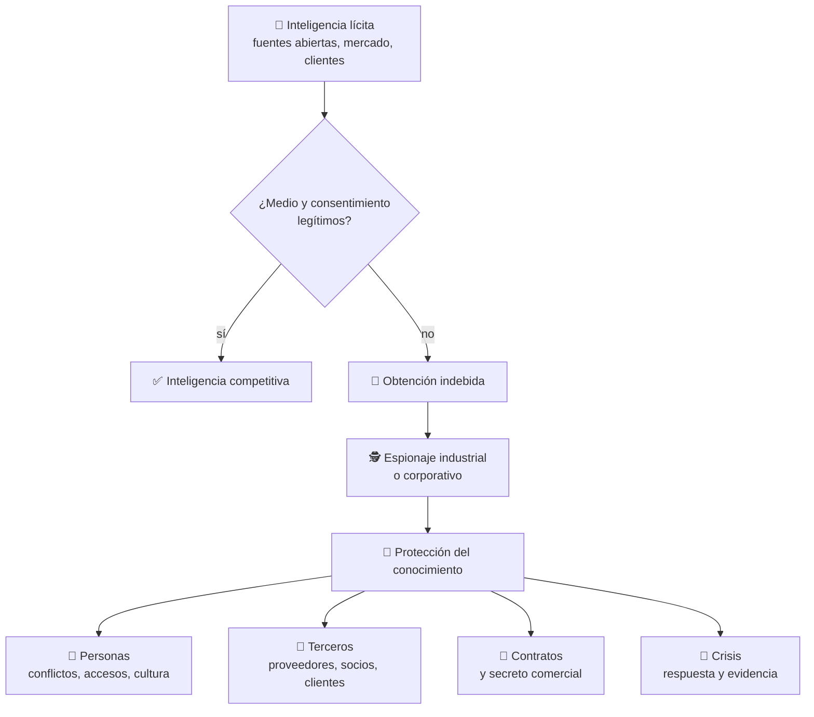

# 🛡️ Inteligencia económica y protección del conocimiento

**Cómo reconocer y prevenir el espionaje empresarial, desde crear la empresa hasta internacionalizarla.**

Esta guía amplía el programa **sin crear clases ni alterar la numeración**. Treinta y ocho clases
existentes enlazan sus secciones desde un bloque «Protección del conocimiento» que el generador
renderiza desde `manifests/`. El caso de referencia es
[NVIDIA](../case-studies/22-nvidia-sospecha-de-espionaje-y-proteccion-del-conocimiento.md), tratado
como investigación **no concluida**.

> [!IMPORTANT]
> **Enfoque defensivo.** Todo lo que sigue enseña a reconocer, prevenir, documentar y escalar. No
> enseña a obtener información de forma indebida, a manipular personas ni a vulnerar sistemas. Las
> técnicas de ataque se describen solo al nivel que permite identificarlas y responder. No
> reemplaza asesoría jurídica: la calificación penal o civil de un hecho concreto corresponde a un
> abogado y a los tribunales.

**Fecha de verificación de la base legal:** 2026-11-12, contra el texto consolidado de la
Biblioteca del Congreso Nacional. **Fecha de corte del caso NVIDIA:** 2026-11-12.

## 🗺️ Mapa de la guía

## 1. Alcance, enfoque defensivo y límites

**Qué cubre.** Los conceptos que una persona fundadora, gerente o directora necesita para saber
qué información de su empresa vale, quién podría quererla, por qué canales podría salir y qué
medidas son proporcionadas a su tamaño.

**Qué no cubre.** Operaciones de inteligencia, vigilancia de personas, contramedidas técnicas
avanzadas ni asesoría penal. Tampoco construye ni propone sistemas informáticos nuevos: todas las
medidas de ejemplo se resuelven con acuerdos, políticas, contratos, registros y hábitos.

**Tres reglas de lectura.**

1. Una **sospecha** no es una prueba. Se escribe como hipótesis, con fuente y fecha.
2. Una **medida de protección** debe ser proporcionada al valor del activo y al recurso de la empresa.
3. La **dignidad y la privacidad de las personas** limitan lo que la empresa puede vigilar. Proteger conocimiento no autoriza a espiar a trabajadores.

## 2. Auditoría del repositorio y matriz de contenidos

### 2.1 Qué se revisó

Se revisaron `README.md`, `CURRICULUM.md`, `STATUS.md`, `CONTRIBUTING.md`, los manifiestos
(`curriculum`, `classes`, `part_packs`, `pedagogia`, `legal_sources`), el registro de fuentes, el
glosario, los casos y los generadores. El repositorio **no tiene `AGENTS.md`**; la regla operativa
vive en `CONTRIBUTING.md`: el contenido se edita en `manifests/` y los README se generan.

### 2.2 Hallazgos de la auditoría

Búsqueda de términos sobre manifiestos de clases, packs y pedagogía (estado previo a esta ampliación):

| Término | Manifiestos | Guías (`docs/`) | Casos |
|---|---:|---:|---:|
| espionaje, contrainteligencia, HUMINT, insider, phishing, chantaje | 0 | 0 | 0 |
| inteligencia competitiva / de mercado | 0 | 0 | 0 |
| ingeniería social | 2 (concientización en ciberseguridad) | 1 | 0 |
| competencia desleal / Ley 20.169 | 1 (mención en el marco de la parte 3) | 0 | 0 |
| secreto empresarial | 3 | 1 | 0 |

**Conclusiones.**

1. El programa ya enseña bien los **contenedores jurídicos** del problema: NDA (131), propiedad intelectual en contratos (132), secretos (151), ciberhigiene (153, 202), identidad y accesos (199), privilegios (203), proveedores críticos (138, 171, 179, 209), conflictos de interés (68, 261), fraude interno (262), delitos económicos (256), modelo de prevención (257), canal de denuncias (258), crisis (281–284, 290) y dependencia del fundador (296).
2. **No** enseñaba el hilo que los une: quién quiere la información, cómo la obtiene sin romper un sistema (relaciones, conversaciones, confianza), cómo se distingue la inteligencia competitiva lícita de la desleal y cómo se organiza una defensa proporcionada.
3. El programa usaba **«secreto empresarial»**; la ley vigente (texto refundido de la Ley 19.039, DFL 4 de 2022, y Código Penal) dice **«secreto comercial»**. Se corrige en las clases 131 y 151.
4. La competencia desleal (Ley 20.169) aparecía solo como mención de marco, sin tratar qué conductas cubre ni cuáles no.

### 2.3 Matriz de contenidos: qué existía, qué se amplió y dónde

| Disciplina | Estado previo | Tratamiento ahora | Sección | Clases que la integran |
|---|---|---|---|---|
| Inteligencia económica, competitiva y de mercado | Ausente | Nuevo | 3 | 16 |
| Competencia lícita frente a inteligencia desleal | Mención de marco | Ampliado | 4 | 21 |
| Espionaje industrial y antecedentes | Ausente | Nuevo | 5 | 293 |
| Ingeniería social empresarial | Concientización técnica | Ampliado | 6 | 199, 202 |
| HUMINT, elicitación y manipulación en negociaciones | Ausente | Nuevo | 7 | 188, 190 |
| Protección de secretos comerciales | NDA y secreto (terminología antigua) | Ampliado y corregido | 8 | 49, 131, 151, 156 |
| Riesgos de terceros | Proveedores y SaaS | Ampliado a socios, clientes e inversionistas | 9 | 138, 171, 209, 223, 252, 275 |
| Contrainteligencia empresarial e insider threat | Fraude interno parcial | Ampliado | 10 | 168, 203, 253, 258, 262 |
| Protección de fundadores y ejecutivos | Ausente | Nuevo | 11 | 68, 261, 296 |
| Ética, legislación y responsabilidad | Parcial (ética, Ley 21.595) | Ampliado | 12 | 9, 256 |
| Prevención y gestión de crisis | Crisis reputacional y evidencia | Ampliado a incidentes de fuga | 13 | 154, 281, 284, 290 |
| Aplicación a sectores | Ausente | Nuevo | 15 | 38, 128, 217, 239, 309, 312, 316 |

## 3. Fundamentos de inteligencia económica

**Inteligencia** es información convertida en decisión: se recoge, se evalúa por su fiabilidad, se
interpreta y se usa para decidir. La palabra cubre disciplinas distintas que conviene no mezclar.

| Disciplina | Pregunta que responde | Quién la usa | Naturaleza |
|---|---|---|---|
| **Business Intelligence** (inteligencia de negocios) | ¿Qué pasó en mi propia empresa? | Gerencia, finanzas, ventas | Interna; usa datos propios |
| **Market Intelligence** (inteligencia de mercado) | ¿Qué hacen los clientes y el mercado? | Marketing, producto | Externa; encuestas, datos públicos |
| **Competitive Intelligence** (inteligencia competitiva) | ¿Qué hacen y qué harán mis competidores? | Estrategia | Externa; **lícita** si usa fuentes abiertas y medios legítimos |
| **Economic Intelligence** (inteligencia económica) | ¿Cómo afectan el entorno económico, la regulación y la geopolítica a mi competitividad? | Dirección, gremios, Estado | Estratégica; análisis de tendencias y señales |
| **Corporate Intelligence** (inteligencia corporativa) | ¿Quién es mi contraparte y qué riesgos trae? | Compliance, legal, inversionistas | Debida diligencia sobre terceros |

**Ciclo de inteligencia aplicado a una pyme:** definir la decisión que se quiere informar →
recoger solo desde fuentes legítimas → evaluar la fiabilidad (¿quién lo dice y con qué interés?) →
analizar → comunicar al que decide → revisar si la decisión salió bien.

**Fuentes lícitas típicas:** informes públicos de competidores, registros oficiales, avisos de
empleo, publicaciones técnicas, ferias abiertas, lo que los propios clientes cuentan
voluntariamente, estadísticas del INE y del Banco Central. La clase 16 enseña a evaluar fuentes; la
clase 55 a leer señales débiles del entorno.

## 4. Competencia lícita frente a inteligencia desleal

La frontera no depende de **qué** información se busca, sino de **cómo** se obtiene.

| Criterio | Inteligencia competitiva lícita | Obtención indebida |
|---|---|---|
| Medio | Fuentes abiertas, observación pública, preguntas honestas | Intromisión, engaño sobre quién se es, uso de acceso ajeno |
| Identidad | Quien pregunta dice quién es | Se oculta o se suplanta la identidad |
| Consentimiento | La información se ofrece o es pública | Se obtiene sin consentimiento de su legítimo poseedor |
| Confidencialidad | No se induce a nadie a violar un deber | Se induce a un trabajador o proveedor a violar su deber |
| Documentación | Puedes explicar de dónde vino cada dato | Prefieres no decir de dónde vino |

**Prueba rápida de las cinco preguntas.** Antes de usar un dato de un competidor, responde: ¿es
público?, ¿me lo dio alguien con derecho a darlo?, ¿mentí o me oculté para obtenerlo?, ¿lo
aceptaría el competidor si lo supiera?, ¿podría explicarlo en un informe sin vergüenza? Dos «no»
bastan para detenerse y consultar.

**Qué dice la ley chilena.** La Ley 20.169 (art. 3) define como desleal la conducta contraria a la
buena fe o a las buenas costumbres que, por medios ilegítimos, persiga desviar clientela de un
agente del mercado. Entre las conductas que enumera (art. 4, sin carácter taxativo) está la de
inducir a proveedores, clientes u otros contratantes a infringir deberes contractuales contraídos
con un competidor (letra f). **La ley no menciona expresamente la obtención de secretos**, que se
aborda en la Ley 19.039 y el Código Penal (sección 12). Además, el art. 2 de la Ley 20.169 admite
que una misma conducta dé lugar a otras acciones, por ejemplo las de la ley de propiedad
industrial.

## 5. Espionaje industrial: antecedentes y casos

### 5.1 Vocabulario

| Término | Qué designa |
|---|---|
| **Espionaje industrial / corporativo** | Obtención indebida de información de una empresa en beneficio de otra |
| **Espionaje económico** (*economic espionage*) | Obtención indebida de secretos que beneficia a un Estado o a sus agentes |
| **Robo de secretos comerciales** (*trade secret theft*) | Apropiación de información que cumple los requisitos de secreto, sin que importe quién se beneficie |

La distinción importa porque el derecho estadounidense las trata en artículos distintos de la
*Economic Espionage Act* de 1996 (18 U.S.C. §§ 1831 y 1832), según el Congressional Research
Service. En Chile no existe una figura penal llamada «espionaje industrial»: las conductas se
encuadran en los delitos de secreto comercial (Código Penal), delitos informáticos (Ley 21.459) y
las acciones civiles y de competencia desleal.

### 5.2 Casos históricos documentados

Todos están en fuentes primarias del Departamento de Justicia de Estados Unidos. Se usan para
estudiar **patrones**, no para juzgar a nadie más allá de lo que resolvió un tribunal.

| Caso | Qué ocurrió (según el Departamento de Justicia) | Patrón que enseña |
|---|---|---|
| **Coca-Cola, 2006–2007** | Una asistente administrativa y dos cómplices ofrecieron información confidencial de la empresa a su competidor; este avisó a Coca-Cola, que informó al FBI. Hubo condenas. | El **insider** con acceso cotidiano es el vector más probable. Y la conducta ética de un competidor frenó el incidente. |
| **DuPont y Kolon, 2006–2015** | Una empresa surcoreana se declaró culpable de conspirar para obtener secretos de la fibra Kevlar de DuPont, con ayuda de ex empleados. Pagó US$ 360 millones entre multas y restitución. | La **contratación de personas que llevan conocimiento** de otra empresa es un canal de transferencia indebida. |
| **Waymo y un ejecutivo de Uber, 2016–2020** | Un ingeniero descargó archivos del proyecto de autos autónomos de su empleador antes de irse y fue condenado a 18 meses. | El **offboarding** (salida de personal) es el momento de mayor fuga. |

> [!NOTE]
> La ficha del caso Coca-Cola queda **pendiente** en el [registro de fuentes](../sources/bibliography.json): el PDF archivado del Departamento de Justicia no pudo abrirse en la consulta automática del 12-11-2026, por lo que quién alertó a la empresa se contrastó con la cobertura de prensa y no con el comunicado. Los casos de Kolon y Waymo se leyeron en los comunicados oficiales.

### 5.3 El caso actual: NVIDIA (investigación no concluida)

El [expediente](../case-studies/22-nvidia-sospecha-de-espionaje-y-proteccion-del-conocimiento.md)
separa **información oficialmente conocida**, **sospecha o alegación**, **posición de parte** e
**investigación no concluida**. Enseña a decidir sin cerrar la hipótesis antes de tiempo.

## 6. Ingeniería social empresarial

**Ingeniería social** (*social engineering*) es la manipulación de personas para que entreguen
información o accesos que no entregarían a sabiendas. Es el método dominante cuando los sistemas
técnicos están bien protegidos, porque la persona es más barata de convencer que el sistema de
vulnerar.

| Técnica | Qué es | Indicador para reconocerla |
|---|---|---|
| **Pretexting** (pretexto) | Inventar una identidad o situación creíble para pedir algo | Una solicitud que depende de una historia que no puedes verificar por otro canal |
| **Phishing / spear phishing** | Mensajes fraudulentos, generales o dirigidos a una persona | Urgencia, enlace inusual, remitente que no coincide con el dominio |
| **Suplantación de autoridad** | Hacerse pasar por un directivo, cliente o regulador | Pide excepciones a un procedimiento «por esta vez» |
| **Reciprocidad y favor** | Dar algo para generar obligación | Regalo o ayuda previa antes de una petición |
| **Urgencia y presión** | Forzar la decisión sin tiempo de verificar | Plazos artificiales, amenazas de pérdida |

**Defensa proporcionada.**

- **Verificación por otro canal:** ante un pedido de dinero, accesos o datos, llamar a un número conocido, no al que viene en el mensaje.
- **Regla de las dos personas** para pagos y cambios de datos bancarios de proveedores.
- **Permiso de decir que no:** una política escrita que respalda a quien se niega.

La clase 199 trata identidad y accesos y la 202 la ciberseguridad por capas; el bloque de cada
una añade el enfoque de ingeniería social.

## 7. Inteligencia humana (HUMINT) en el mundo corporativo

**HUMINT** (*human intelligence*) es la información obtenida de personas y de relaciones. En el
mundo empresarial ocurre de forma legítima todos los días: una conversación comercial, una feria,
una negociación. El problema aparece cuando esa conversación se convierte en un canal de extracción
encubierto.

| Concepto | Qué es | Cómo se ve desde la defensa |
|---|---|---|
| **Elicitation** (elicitación) | Conducir una conversación para que la otra parte revele más de lo que quería | Preguntas amables y amplias sobre capacidad, clientes, precios o plazos que no son necesarias para el negocio |
| **Honey trap** (trampa de seducción) | Uso de una relación afectiva o sexual para obtener información, influencia o material de presión | Aproximaciones inesperadas, intimidad rápida, interés persistente en el trabajo de la persona |
| **Coerción y chantaje** | Presión mediante amenaza de revelar algo | Cambios de conducta de un trabajador clave, solicitudes que antes no hacía |
| **Captación** | Conseguir que una persona colabore, con dinero, ideología, ego o presión | Estilo de vida que no coincide con el ingreso, interés en información fuera de su rol |

**Qué no se enseña aquí:** cómo aplicar estas técnicas. Se enseña a **reconocer** las aproximaciones
y a **tener un canal** para reportarlas sin castigo.

**Negociación.** Las clases 188 y 190 sitúan estos conceptos en la prospección y el cierre: en una
negociación, la contraparte suele pedir mucho más de lo que necesita para cotizar. Regla práctica:
**comparte información en función de la decisión que está en juego, no del interés de quien
pregunta**, y registra qué compartiste.

## 8. Protección de secretos comerciales

### 8.1 Qué protege la ley

La Ley 19.039 (texto refundido por el DFL 4 de 2022) define el **secreto comercial** como
información no divulgada, bajo control de una persona y utilizable en una actividad productiva,
industrial o comercial, siempre que cumpla **tres requisitos copulativos** (art. 86):

1. **Secreta:** no es generalmente conocida ni fácilmente accesible, como conjunto o en la configuración de sus componentes, para quienes la usan normalmente.
2. **Valor comercial** *por ser secreta*.
3. **Medidas razonables** tomadas por su poseedor legítimo para mantenerla secreta.

> [!TIP]
> El tercer requisito convierte la protección en tu responsabilidad: **sin medidas razonables
> documentadas, la información puede dejar de calificar como secreto comercial.** Es la razón por la
> que el NDA, el control de accesos y la política de manejo de información no son trámite.

**Infracción** (art. 87): adquisición ilegítima, divulgación o explotación sin autorización, y
divulgación o explotación por quien accedió legítimamente pero con deber de reserva; en ambos casos
con ánimo de obtener provecho propio o de un tercero, o de perjudicar al poseedor. **Acciones
civiles** (art. 88): se aplican las normas del Título X de la ley, sin perjuicio de la
responsabilidad penal.

### 8.2 Inventario mínimo del conocimiento

Un inventario de una hoja basta para empezar: **qué** información, **dónde** vive, **quién** la
conoce, **qué pasaría** si un competidor la tuviera y **qué medida** la protege hoy.

| Activo de conocimiento (ejemplo) | Valor | Quién accede | Medida actual | Brecha |
|---|---|---|---|---|
| Lista de clientes con condiciones | Alto | Ventas, gerencia | Acceso por rol | Se envía por correo personal |
| Fórmula o proceso de fabricación | Crítico | Jefe de producción | NDA | Sin restricción de copias |
| Código fuente del núcleo | Crítico | Equipo técnico | Repositorio privado | Cuentas de exempleados activas |
| Plan estratégico a 3 años | Alto | Dirección | Documento restringido | Presentado a inversionistas sin NDA |

### 8.3 Medidas contractuales y laborales

- **NDA** con definición acotada, excepciones, plazo y medidas de protección (clase 131).
- **Propiedad intelectual** de lo creado por trabajadores y contratistas (clase 132).
- **Confidencialidad laboral:** el Código del Trabajo obliga al empleador a reservar la información privada del trabajador (art. 154 ter). Entre las causales del art. 160 están la falta de probidad (N° 1, letra a) y las negociaciones prohibidas por escrito en el contrato dentro del giro del negocio (N° 2). La obligación del trabajador de reservar los secretos **conviene escribirla** en el contrato y en el reglamento interno; no hay que suponerla (clase 156).
- **Salida de personal:** devolución de activos, cierre de accesos el último día, recordatorio de deberes de reserva (clase 168).

### 8.4 Lo que el trabajador sí puede llevarse

El Código Penal excluye del delito de revelación y aprovechamiento de secretos (arts. 284 bis y 284
ter) a quien usa la experiencia y las competencias legítimamente adquiridas en el conocimiento
lícito de un secreto comercial (art. 284 quinquies). **Proteger el secreto no es impedir que una
persona trabaje en su oficio.** Una cláusula que lo pretenda se vuelve inaplicable y desmotiva.

## 9. Riesgos de las relaciones con terceros

Los terceros reciben información legítimamente y la tienen en sistemas que no controlas.

| Tercero | Riesgo característico | Medida proporcionada |
|---|---|---|
| **Proveedor crítico o SaaS** | Acceso a datos sin que tú controles sus prácticas | Contrato con confidencialidad, subencargados, auditoría y salida (clases 138, 209) |
| **Proveedor homologado** | Se homologa una vez y nunca se revisa | Revisión anual de proveedores con acceso (171) |
| **Socio o alianza** | Comparten información sin límites claros | Acuerdo de alcance de la información compartida; «salas limpias» para temas sensibles (275) |
| **Inversionista o comprador** | Pide información antes de comprometerse | Entrega por etapas: primero lo público, luego lo agregado, al final lo crítico y solo con NDA (223) |
| **Cliente grande** | Pide acceso y auditorías a tu operación | Definir qué ve, quién lo aprueba y qué se registra (128) |
| **Socio en otro país** | Menor capacidad de reclamar | Contrato con jurisdicción y medidas de protección acordadas (252) |

**Regla general:** a cada tercero se le entrega la información **mínima necesaria**, por el
**canal controlado**, con un **responsable interno** y una **fecha de término** del acceso.

## 10. Contrainteligencia empresarial

**Contrainteligencia** (*counterintelligence*) es el conjunto de medidas que una organización toma
para **detectar y neutralizar** a quien intenta obtener su información. En una empresa no
significa «contraespionaje»: significa saber qué proteges, de quién, y qué señales buscar.

### 10.1 Amenaza interna (*insider threat*)

No equivale a «trabajador desleal». Hay tres perfiles:

| Perfil | Descripción | Ejemplo |
|---|---|---|
| **Negligente** | Comete un error | Envía un archivo a la persona equivocada |
| **Manipulado** | Es engañado o presionado por un tercero | Responde a un pretexto bien armado |
| **Malicioso** | Actúa a sabiendas | Copia información antes de irse a la competencia |

La mayor parte de los incidentes son del primer tipo. Por eso la prioridad es **reducir el error y
facilitar el reporte**, no sospechar de todos.

### 10.2 Principios proporcionados

- **Necesidad de conocer** (*need-to-know*): cada persona accede solo a lo que necesita para su función (clase 203).
- **Mínimo privilegio** (*least privilege*): los permisos se revisan cuando alguien cambia de cargo.
- **Segregación de funciones:** quien aprueba no ejecuta ni registra (clase 262).
- **Canal de reporte seguro** que acepta preocupaciones sin represalia, incluidas las aproximaciones sospechosas (clase 258).
- **Mapa de activos y amenazas** de una hoja, revisado al menos una vez al año (clase 253).

### 10.3 Cultura de seguridad

Una cultura de seguridad no se declara: se **observa**. Preguntas de diagnóstico: ¿la dirección
cumple las mismas reglas que exige?, ¿reportar una equivocación tiene costo?, ¿los nuevos reciben
inducción en la primera semana?, ¿alguien se negó alguna vez a una excepción y fue respaldado?

## 11. Protección de fundadores y ejecutivos

El fundador y los directivos concentran conocimiento, decisiones y acceso. Son, a la vez, el
activo más valioso y el objetivo más probable.

| Riesgo | Medida proporcionada |
|---|---|
| **Aproximación personal** (relaciones, regalos, invitaciones, favores) | Política de regalos y atenciones y de declaración de relaciones relevantes (clase 261) |
| **Conflictos de interés** | Declaración anual y por evento; abstención en decisiones que involucren a la persona vinculada (clase 68) |
| **Dependencia de una sola persona** | Documentar su conocimiento y distribuir accesos (clase 296) |
| **Viajes y eventos** | Inducción previa: qué se lleva, qué se comenta, a quién se reporta |
| **Presión o amenaza** | Canal de apoyo confidencial y respaldo jurídico sin reproche |

> [!WARNING]
> **Límite ético y legal.** Proteger a un ejecutivo no autoriza a vigilar su vida privada. La
> empresa puede pedir que declare conflictos de interés y relaciones comerciales relevantes; no
> puede exigir ni rastrear información personal que no tenga relación con el riesgo. La Ley 19.628,
> y desde el 15-10-2027 la Ley 21.719, regulan el tratamiento de datos personales (clases 146–149).

## 12. Marco legal chileno: obligación, recomendación y medida voluntaria

Verificado el 2026-11-12 contra el texto consolidado de la Biblioteca del Congreso Nacional.

### 12.1 Obligaciones legales (conducta prohibida o exigida)

| Norma | Qué establece | Para qué sirve aquí |
|---|---|---|
| **Ley 19.039, art. 86** (DFL 4/2022) | Define el secreto comercial y sus tres requisitos | Saber qué información califica |
| **Ley 19.039, arts. 87 y 88** | Violación del secreto y acciones civiles del Título X | Fundar la demanda civil |
| **Código Penal, art. 284** | Accede a un secreto comercial mediante intromisión indebida con el fin de revelarlo o aprovecharlo económicamente. Intromisión: ingreso a dependencias, captación visual o sonora con dispositivos, o acceso informático sin autorización superando barreras de seguridad. Presidio o reclusión menor en su grado medio; mayor si además lo revela | Conducta de quien **se introduce** |
| **Código Penal, art. 284 bis** | Revela o permite el acceso a un secreto comercial conocido bajo deber de confidencialidad profesional, o por una relación contractual o laboral con la empresa o con otra que le prestó servicios | Conducta de quien **tiene el deber y lo viola** |
| **Código Penal, art. 284 ter** | Aprovechamiento económico de un secreto comercial conocido por esas vías | Conducta de quien **usa lo obtenido** |
| **Código Penal, art. 284 quinquies** | No incurre en delito quien usa la experiencia y competencias legítimamente adquiridas | **Límite** que protege al trabajador |
| **Ley 21.595, art. 2** | Los arts. 284, 284 bis y 284 ter son delitos económicos cuando se cometen en el ejercicio de un cargo, función o posición en una empresa, o en beneficio de una empresa | Eleva las consecuencias para quienes actúan **desde una empresa** |
| **Ley 21.459** | Acceso ilícito a un sistema informático (art. 2), interceptación ilícita (art. 3), receptación de datos (art. 6) y circunstancias agravantes (art. 10) | Acceso o interceptación de información en sistemas |
| **Ley 20.169, arts. 3–6** | Competencia desleal y acciones de cesación, declaración, remoción de efectos e indemnización | Acción civil contra la obtención y uso desleal de ventajas |
| **Código del Trabajo, art. 154 ter** | Reserva de la información privada del trabajador | Límite a la vigilancia interna |
| **Código del Trabajo, art. 160, N° 1 letra a) y N° 2** | Falta de probidad y negociaciones prohibidas por escrito como causales de término sin indemnización | Consecuencia laboral, con prueba de la conducta |
| **Ley 19.628 y Ley 21.719** | Protección de datos personales | Límite a cualquier recolección o monitoreo |

> [!NOTE]
> Para el delito del art. 284 y siguientes, el Código Penal remite a la ley de propiedad
> industrial para definir **secreto comercial** (art. 284 sexies). Por eso las tres condiciones del
> art. 86 de la Ley 19.039 también condicionan la protección penal.

### 12.2 Recomendaciones (no exigidas por ley, pero muy útiles)

- Política de clasificación de información (pública, interna, confidencial, crítica).
- Cláusulas de confidencialidad y de propiedad intelectual en todos los contratos de trabajo y de servicios.
- Inducción y recordatorio anual en seguridad de la información.
- Revisión semestral de accesos de terceros y de personal desvinculado.
- Declaración de conflictos de interés al ingresar y cada año.
- Canal de reporte que acepte aproximaciones sospechosas.

### 12.3 Medidas voluntarias

- Adopción de normas de gestión como ISO/IEC 27001 (seguridad de la información), cuando un cliente lo pida o la empresa quiera acreditarse.
- Auditorías externas de seguridad y simulacros de crisis.
- Programas de protección ejecutiva y asesoría de seguridad externa.

### 12.4 Lo que esta guía no afirma

- No afirma que cada conducta aquí descrita constituya delito: depende de los hechos, del propósito y de la prueba.
- No afirma que la lista sea exhaustiva. Otras normas (por ejemplo la Ley 20.393, el DL 211 de libre competencia, la Ley 21.663 de ciberseguridad) pueden aplicar. Ver las clases 255, 256 y 153.
- No verifica la jurisprudencia. La interpretación de los tribunales puede variar.

## 13. Prevención y gestión de crisis

Un incidente de fuga o de aproximación se maneja mejor si antes se hicieron cinco preguntas.

| Fase | Pregunta | Entregable mínimo |
|---|---|---|
| **Prepararse** | ¿Qué información, si se filtra, nos dañaría más? | Inventario de una hoja (sección 8.2) |
| **Detectar** | ¿Cómo nos enteraríamos y quién recibe el aviso? | Canal de reporte y responsable |
| **Contener** | ¿Qué cerramos primero y en qué orden? | Lista de acciones inmediatas |
| **Preservar evidencia** | ¿Quién guarda qué sin alterarlo? | Cadena de custodia simple (clases 154 y 290) |
| **Comunicar** | ¿A quién, qué y cuándo? | Declaración base con hechos, no hipótesis (clase 284) |

**Principio de comunicación en incertidumbre.** Afirma solo lo que sabes, declara lo que no sabes
y di qué estás verificando. El expediente NVIDIA usa esa distinción como método.

## 14. Tres niveles de empresa

La protección debe ser proporcionada a los **activos**, los **riesgos** y los **recursos**.

| Dimensión | Emprendedor o microempresa | Pyme | Gran empresa o multinacional |
|---|---|---|---|
| **Activo crítico típico** | La idea, el conocimiento del fundador y la lista de primeros clientes | Procesos, clientes, precios, código | Tecnología, estrategia, datos, cadena de suministro |
| **Amenaza más probable** | Un socio, un freelancer o un ex cliente se lleva la idea | Un empleado clave se va con clientes; un proveedor reutiliza lo que sabe | Aproximaciones dirigidas, infiltración, presión sobre ejecutivos |
| **Medidas básicas** | NDA simple, acuerdo de socios, copias en cuentas de la empresa | Inventario, clasificación, revisión de accesos, inducción | Programa formal, contrainteligencia, protección ejecutiva |
| **Responsable** | El fundador | Gerente con apoyo legal externo | Equipo de seguridad y comité |
| **Costo orientativo** | Horas del fundador | Horas de gerencia y asesoría puntual | Equipo dedicado y presupuesto anual |
| **Qué evitar** | Compartir todo con todos «por confianza» | Copiar políticas de una multinacional que nadie aplica | Tratar la seguridad como trámite de cumplimiento |

> [!TIP]
> **Regla de proporcionalidad.** Una medida cuesta más que la pérdida que evita si protege un
> activo de poco valor o si nadie la cumple. Mejor tres medidas que se aplican que treinta que no.

## 15. Ejemplos por tipo de empresa

| Tipo | Activo y riesgo | Medida concreta sin sistemas nuevos | Clase |
|---|---|---|---|
| **Software** | Código fuente y arquitectura; cuentas de ex desarrolladores activas | Revisión mensual de cuentas con una lista firmada por el responsable; contrato que asigna la propiedad del código a la empresa | 309 |
| **Empresa tecnológica con IA** | Modelos, datos y prompts; uso de herramientas externas con información de clientes | Regla escrita de qué información no se pega en herramientas de terceros | 312 |
| **Industria manufacturera** | Formulaciones, procesos y planos; visitas de clientes y proveedores | Registro de visitas, zonas restringidas y acuerdos de visita | 38 |
| **Comercio internacional** | Listas de clientes y márgenes; ferias, delegaciones y viajes | Preparar qué se muestra y qué no antes de cada viaje; contrato con el agente local | 239 |
| **Consultoría** | Metodologías y conocimiento de clientes de varios clientes | Separación de equipos por cliente y cláusulas de confidencialidad cruzadas | 312 |
| **Investigación y desarrollo** | Resultados no publicados; postulaciones a fondos que exigen divulgar | Decidir qué se divulga en cada postulación y cuándo; fechar los registros de invención | 217 |
| **Proveedora de grandes corporaciones** | Información del cliente grande; auditorías y cuestionarios de seguridad | Acuerdo de qué ve el cliente, quién responde los cuestionarios y qué se registra | 128 |
| **Exportación de servicios de software** | Contratos con clientes extranjeros y derechos sobre lo desarrollado | Cláusulas de confidencialidad, propiedad y jurisdicción acordadas antes de empezar | 316 |

## 16. Terminología bilingüe

| Español | English | Definición breve |
|---|---|---|
| Inteligencia de negocios | Business Intelligence | Análisis de datos propios para decidir |
| Inteligencia de mercado | Market Intelligence | Información sobre clientes, demanda y entorno |
| Inteligencia competitiva | Competitive Intelligence | Análisis lícito de competidores con fuentes legítimas |
| Inteligencia económica | Economic Intelligence | Análisis estratégico del entorno económico y regulatorio |
| Inteligencia corporativa | Corporate Intelligence | Debida diligencia sobre terceros y contrapartes |
| Fuentes abiertas | Open-Source Intelligence (OSINT) | Información pública usada de forma legítima |
| Espionaje industrial | Industrial Espionage | Obtención indebida de información de otra empresa |
| Espionaje corporativo | Corporate Espionage | Espionaje entre empresas |
| Espionaje económico | Economic Espionage | Obtención indebida que beneficia a un Estado |
| Secreto comercial | Trade Secret | Información secreta, con valor por serlo y con medidas razonables de reserva |
| Ingeniería social | Social Engineering | Manipulación de personas para obtener datos o accesos |
| Pretexto | Pretexting | Historia inventada para obtener información |
| Inteligencia humana | HUMINT (Human Intelligence) | Información obtenida de personas y relaciones |
| Elicitación | Elicitation | Conducir una conversación para que la otra parte revele más de lo previsto |
| Trampa de seducción | Honey Trap | Uso de un vínculo afectivo para obtener información o influencia |
| Coerción y chantaje | Coercion and Blackmail | Presión mediante amenaza |
| Amenaza interna | Insider Threat | Riesgo que proviene de quien tiene acceso legítimo |
| Contrainteligencia | Counterintelligence | Medidas para detectar y neutralizar la obtención indebida |
| Necesidad de conocer | Need-to-Know | Acceso limitado a lo que la función exige |
| Mínimo privilegio | Least Privilege | Permisos mínimos para cada rol |
| Debida diligencia de terceros | Third-Party Due Diligence | Evaluación de riesgos antes y durante la relación |
| Conflicto de interés | Conflict of Interest | Interés personal que puede sesgar una decisión |
| Cultura de seguridad | Security Culture | Hábitos compartidos que protegen la información |
| Protección ejecutiva | Executive Protection | Medidas proporcionadas para la seguridad de directivos |
| Gestión de crisis | Crisis Management | Preparación y respuesta ante un evento grave |

## 17. Evaluación: ejercicios, preguntas y decisiones

Todos los ejercicios se resuelven con papel, correo, calendario y conversaciones. **Ninguno exige
construir un sistema informático.**

### 17.1 Estudios de caso

1. **Coca-Cola (2006–2007).** Identifica el vector (¿quién tenía acceso?), la señal, la reacción del competidor y qué control habría detectado antes. Escribe una política de una página que lo habría dificultado.
2. **DuPont y Kolon.** Una empresa contrata a un ingeniero de un competidor. Redacta las cinco preguntas que una pyme debe hacer antes de contratar a quien viene de un competidor, sin rozar la libertad de trabajo.
3. **NVIDIA (en curso).** Clasifica diez afirmaciones del expediente con las etiquetas del caso y señala qué dato cambiaría cada etiqueta.

### 17.2 Comparaciones

1. Compara **competencia lícita** y **competencia desleal** con tres situaciones reales de tu sector: una claramente lícita, una dudosa y una claramente desleal.
2. Compara **negligente, manipulado y malicioso** como perfiles de amenaza interna y elige qué medida prioriza cada uno.
3. Compara las medidas de **micro, pyme y gran empresa** para el mismo activo (la lista de clientes).

### 17.3 Actividades para emprendedores

1. **Inventario de una hoja** (sección 8.2) con cinco activos de conocimiento de tu emprendimiento.
2. **Lista de las diez personas** externas que conocen algo valioso de ti (socios, freelancers, proveedores, mentores, inversionistas) y qué sabe cada una.
3. **Acuerdo de dos socios** para decidir qué hacer si un tercero propone algo fuera de lo habitual.
4. **NDA de una página** para compartir con un posible inversionista.
5. **Regla de salida:** lista de siete cosas que se hacen el último día de un colaborador.

### 17.4 Preguntas de comprobación

1. ¿Cuáles son los tres requisitos copulativos del secreto comercial en el art. 86 de la Ley 19.039?
2. ¿Por qué un NDA sin medidas de protección puede ser insuficiente?
3. ¿Qué diferencia hay entre el art. 284 y el art. 284 bis del Código Penal?
4. ¿Qué excluye el art. 284 quinquies?
5. ¿Qué dice la Ley 20.169 sobre inducir a un proveedor a incumplir un contrato con un competidor?
6. ¿Qué es *elicitation* y cómo se reconoce en una negociación?
7. ¿Por qué la mayoría de los incidentes de amenaza interna son negligentes?
8. ¿Qué límite impone la privacidad a la protección de ejecutivos?
9. ¿Qué es inteligencia económica y en qué se diferencia de inteligencia competitiva?
10. En el caso NVIDIA, ¿qué diferencia hay entre «el directorio no tiene razón para creerlo» y «se comprobó que no hubo filtración»?

### 17.5 Análisis de decisiones

| Decisión | Pregunta clave | Criterio de respuesta |
|---|---|---|
| Aceptar un nuevo socio con acceso a clientes | ¿Qué verías si la relación terminara mal? | Acceso por etapas, acuerdo de salida |
| Compartir plan con un inversionista | ¿Qué parte es crítica y cuál agregada? | Entrega por capas con NDA |
| Contratar a alguien del competidor | ¿Cómo evito llevar información de otros? | Declaración escrita de que no trae información confidencial |
| Recibir un regalo de un proveedor | ¿Genera deuda o expectativa? | Política de regalos y registro |
| Reportar una sospecha | ¿Quién recibe y qué protección tiene el denunciante? | Canal acordado y sin represalia |

## 18. Propuesta de clases y justificación

Los doce temas de la ampliación se adaptan a clases existentes. Ninguno justifica crear clases
nuevas con el criterio de abajo.

| N.º | Tema propuesto | Sección | Clases existentes que lo integran |
|---:|---|---:|---|
| 1 | Fundamentos de inteligencia económica | 3 | 16 |
| 2 | Diferencia entre competencia e inteligencia desleal | 4 | 21 |
| 3 | Espionaje industrial y antecedentes históricos | 5 | 293 |
| 4 | Ingeniería social empresarial | 6 | 199, 202 |
| 5 | Inteligencia humana en el mundo corporativo | 7 | 188, 190 |
| 6 | Protección de secretos comerciales | 8 | 49, 131, 151, 156 |
| 7 | Riesgos asociados a relaciones con terceros | 9 | 138, 171, 209, 223, 252, 275 |
| 8 | Contrainteligencia empresarial | 10 | 168, 203, 253, 258, 262 |
| 9 | Protección de fundadores y ejecutivos | 11 | 68, 261, 296 |
| 10 | Ética, legislación y responsabilidad | 12 | 9, 256 |
| 11 | Casos históricos y actuales | 5 | 281, 284, 293 y expediente NVIDIA |
| 12 | Prevención y gestión de crisis | 13 | 154, 281, 284, 290 |

**Por qué no se crean clases.**

1. **Duplicaría contenido que ya vive en 38 clases** que tienen la decisión, el entregable y la fuente adecuados.
2. **Cada parte tiene exactamente 14 clases.** Agregar una ruptura esa simetría y desplazaría la numeración de 336 clases y de todas las referencias.
3. **La secuencia pedagógica ya existe:** el estudiante ve cada tema donde lo necesita (NDA en contratos, accesos en tecnología, crisis en la parte 21).
4. **La carga de lectura** no justifica una clase adicional: el bloque agrega entre 150 y 250 palabras por clase.

**Cuándo sí procedería agregar clases (criterio de revisión):** si en dos revisiones consecutivas
los estudiantes no logran el resultado de aprendizaje de un tema con los bloques, o si una reforma
legal crea un régimen nuevo que exija una clase dedicada. En ese caso se propondría **una sola
clase** en la parte 19 (Compliance), con su renumeración controlada.

## 19. Reporte de validación

Ejecutada el 2026-11-12 sobre el árbol de trabajo, antes de publicar.

| Control | Resultado |
|---|---|
| `python scripts/generar_clases.py` y `--check` | 363 archivos sincronizados con los manifiestos; 38 README de clase reciben el bloque nuevo |
| `python scripts/validar_estructura.py` | 336 clases en 24 partes, 336 README validados, 431 archivos Markdown con enlaces correctos, 63 fuentes |
| `python scripts/validar_encoding.py` | 475 archivos en UTF-8 sin BOM y sin mojibake |
| `python scripts/verify-sources` | Registro coherente: 63 entradas, 59 verificadas y 4 pendientes (una nueva: Coca-Cola, PDF archivado) |
| `python -m unittest discover -s tests` | 51 pruebas en verde, diez de ellas nuevas (`ProteccionConocimientoTest`) |
| `python scripts/generar_sitio.py` | 431 páginas, sin enlaces internos rotos |
| `python scripts/generar_manual.py` | Manual de 1.606 páginas |
| `markdownlint-cli2` | 0 problemas en 431 archivos |
| `gitleaks dir .` | Sin filtraciones |

**Preservado:** 336 clases, 24 partes, numeración global, generadores, licencias y estructura de
carpetas. El único cambio de denominación es «secreto empresarial» → «secreto comercial».

**Qué no verifica esto.** Los controles comprueban estructura, enlaces, codificación y sincronía; no la
exactitud jurídica ni el avance del caso NVIDIA. Los artículos citados se leyeron en el texto
consolidado de la BCN el 2026-11-12. Debe revisarlos un abogado antes de usarlos para decidir un caso
concreto.

## 20. Fuentes

Registradas con fecha de consulta en [`sources/bibliography.json`](../sources/bibliography.json).

| Tema | Fuente | Consulta |
|---|---|---|
| Competencia desleal | Ley 20.169 — Biblioteca del Congreso Nacional (última versión 04-07-2019) | 2026-11-12 |
| Secreto comercial | DFL 4 de 2022, texto refundido de la Ley 19.039 — BCN | 2026-11-12 |
| Delitos contra el secreto comercial | Código Penal, arts. 284 a 284 sexies (versión 20-08-2026) — BCN | 2026-11-12 |
| Delitos económicos | Ley 21.595 (versión 29-09-2025) — BCN | 2026-11-12 |
| Delitos informáticos | Ley 21.459 (versión 01-04-2025) — BCN | 2026-11-12 |
| Reserva laboral y causales | Código del Trabajo, arts. 154 ter y 160 (versión 23-07-2026) — BCN | 2026-11-12 |
| Espionaje económico (EE. UU.) | Congressional Research Service, *Stealing Trade Secrets and Economic Espionage* | 2026-11-12 |
| Casos históricos | Departamento de Justicia de EE. UU.: Coca-Cola, Kolon/DuPont, Waymo | 2026-11-12 |
| Caso NVIDIA | CNBC, NBC News y Nextgov/FCW | 2026-11-12 |

[← Inicio](../README.md) · [Currículo](../CURRICULUM.md) · [Glosario](19_GLOSSARY.md) · [Catálogo de fuentes](16_OFFICIAL_SOURCE_CATALOG.md)
