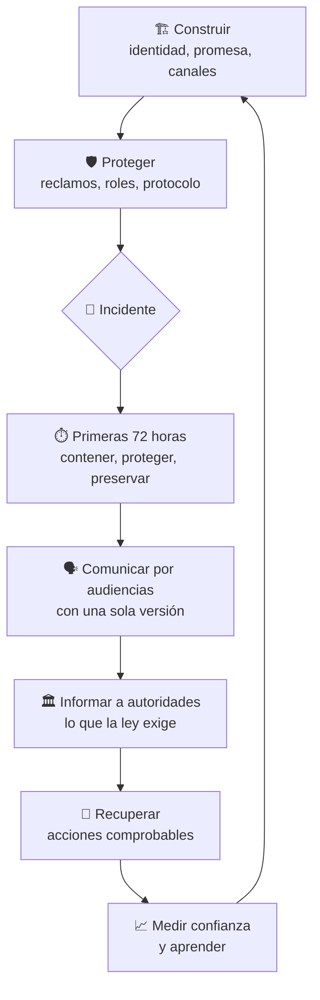

# 🤝 Reputación, crisis y confianza

**Cómo construir, proteger y recuperar la confianza de clientes, trabajadores, proveedores, socios, autoridades y comunidades.**

Esta guía amplía el programa **sin crear clases ni alterar la numeración**. Treinta y una clases
existentes enlazan sus secciones desde un bloque «Reputación y confianza» que el generador
renderiza desde `manifests/`. Los siete casos del [expediente de simulaciones](../case-studies/23-reputacion-y-crisis-siete-casos.md)
son **ilustrativos**: no describen empresas reales.

> [!IMPORTANT]
> **Qué es y qué no es.** Es material educativo de gestión. Distingue en cada punto lo que **la ley
> exige** de lo que es **recomendación profesional**. No reemplaza a un abogado, ni a un
> especialista en comunicaciones o en prevención de riesgos: la calificación jurídica de un hecho
> concreto y la estrategia de una crisis real las decide la empresa con asesoría.

**Fecha de verificación de la base legal:** 2026-11-25, contra el texto consolidado publicado por
la Biblioteca del Congreso Nacional (BCN). Ninguna fecha de vigencia de esta guía se presupone: las
que importan se leyeron en la norma (ver la sección 3.3).

## 🗺️ Mapa de la guía

## 1. Alcance, límites y cómo leer las obligaciones

**Qué cubre.** Lo que una persona fundadora, gerente o directora necesita para que su empresa sea
creíble antes de la crisis, actúe con orden durante ella y recupere confianza después, con medidas
proporcionadas al tamaño.

**Qué no cubre.** Relaciones públicas de gran escala, litigios, estrategia política ni defensa
penal. Tampoco exige comprar herramientas: todo lo que sigue se resuelve con políticas, roles,
registros y hábitos.

**Tres reglas de lectura.**

1. Cada afirmación se marca con una etiqueta: **[Obligación legal]**, **[Recomendación profesional]** o **[Voluntaria]** (medida que la ley no exige, pero que mejora la posición de la empresa).
2. Un hecho se escribe en una de cinco categorías, y no se mezclan: **verificado**, **alegado**, **actuación de una autoridad**, **respuesta de la empresa** e **interpretación**.
3. Primero las personas afectadas, después la imagen: una frase pública que perjudica a quien sufrió el daño cuesta más que el silencio.

## 2. Auditoría del repositorio y matriz de contenidos

### 2.1 Qué se revisó

`README.md`, `CURRICULUM.md`, `STATUS.md`, `CONTRIBUTING.md`, los manifiestos (`curriculum`,
`classes`, `part_packs`, `pedagogia`, `legal_sources`), el registro de fuentes, el glosario, las
guías `docs/`, los casos, las plantillas y las pruebas. Se examinaron las partes 14, 19, 20 y 21 y
las clases 284 y 292. El repositorio no tiene `AGENTS.md`; la regla operativa vive en
`CONTRIBUTING.md`: el contenido se edita en `manifests/` y los README se generan.

### 2.2 Qué ya existía (no se repite)

| Tema | Dónde estaba | Qué cubría |
|---|---|---|
| Crisis reputacional | Clase 284 | Clasificación de evidencia (hecho, alegación, actuación regulatoria), vocería, escalamiento; caso MEDVi |
| Comunicación a trabajadores y clientes | Clase 292 | Audiencias, cadencia, rumor frente a información |
| Reclamos y voz del cliente | Clase 194 | Soporte y gestión de reclamos como operación |
| Respuesta a incidentes y evidencia | Clases 154, 290 | Ciclo técnico y preservación de evidencia |
| Continuidad y recuperación | Clases 282, 283, 294 | BCP, DR, plan de vuelta a crecimiento |
| Denuncias e investigaciones | Clase 258 | Canal y debido proceso |

### 2.3 Brechas encontradas

1. No había **identidad y reputación como activo que se construye desde el día uno**: la marca (clase 184) se trataba como posicionamiento comercial, no como promesa verificable.
2. No existía un **umbral común de severidad**: la clase 284 pedía «umbrales», sin darlos.
3. Faltaban **sustitutos** (¿quién habla si el vocero no está?) y el **comité de crisis dimensionado** a una microempresa o a una pyme.
4. Los **conflictos con trabajadores y con proveedores** se trataban como temas jurídicos o de compras, no como crisis con audiencia pública.
5. La comunicación sobre **liquidez y continuidad** (clases 285, 286, 292) no distinguía qué se debe informar por ley de qué conviene informar.
6. **Asuntos públicos y relaciones institucionales** (Ley 20.730) no estaban tratados.
7. No había **indicadores de confianza** ni **simulaciones** ejecutables.
8. Una **fecha de vigencia desactualizada** (Ley 21.719) aparecía en decenas de lugares del programa (clases, partes, guías y manifiestos); se corrigió (sección 3.3).

### 2.4 Matriz: qué se amplió y dónde

| Capacidad | Sección | Clases que la integran |
|---|---:|---|
| Reputación y comunicación con clientes | 4 | 184, 187, 193, 195 |
| Relaciones institucionales y asuntos públicos | 5 | 253, 274, 276 |
| Reclamos y controversias | 6 | 194, 258, 176 |
| Política, severidad, roles y vocería | 7 a 9 | 268, 281, 284 |
| Respuesta a incidentes y control de daños | 10 | 154, 283, 290 |
| Fallas operacionales y de producto | 11 | 176, 264, 265 |
| Protección de personas afectadas | 12 | 284 |
| Obligaciones con autoridades | 13 | 154, 166, 264 |
| Conflictos laborales y con proveedores | 14 | 163, 164, 168, 179, 286, 291 |
| Liquidez y continuidad | 15 | 285, 287, 292 |
| Recuperación e indicadores | 16 | 293, 294 |

## 3. Marco normativo verificado: obligación frente a recomendación

### 3.1 Qué exige la ley

Cada fila se leyó en el texto consolidado de la BCN el 2026-11-25.

| Tema | Norma y artículo | Qué exige | Aplica a |
|---|---|---|---|
| Seguridad del producto | Ley 19.496, art. 3 letra d) y art. 45 | Seguridad en el consumo; advertencias e instructivos en español para productos potencialmente peligrosos. Su incumplimiento tiene multa de hasta 2.250 UTM | Todo proveedor |
| Riesgos descubiertos después | Ley 19.496, art. 46 | Quien se percata de peligros no previstos debe ponerlos **sin demora** en conocimiento de la autoridad competente, sin perjuicio de advertir a los consumidores | Fabricante, importador, distribuidor o prestador |
| Cambio o restitución | Ley 19.496, arts. 47 y 48 | Declarada la peligrosidad, responden solidariamente productor, importador y primer distribuidor; el proveedor cambia el bien o restituye lo pagado | Ídem |
| Retiro del mercado | Ley 19.496, art. 49 | El juez puede disponer el retiro del mercado de los bienes | Ídem |
| Publicidad e información | Ley 19.496, arts. 28 y 33 | La publicidad no puede inducir a error o engaño; la información debe ser susceptible de comprobación | Todo proveedor |
| Cumplir lo ofrecido | Ley 19.496, art. 12 | Respetar términos, condiciones y modalidades ofrecidos | Todo proveedor |
| Fiscalización | Ley 19.496, art. 58 | El SERNAC fiscaliza; los proveedores deben dar facilidades y no negarse a entregar la información requerida | Todo proveedor |
| Solución colectiva voluntaria | Ley 19.496, art. 54 H | Procedimiento voluntario del SERNAC para conductas que afecten el interés colectivo o difuso | Opcional para el proveedor |
| Aclaración y rectificación | Ley 19.733, arts. 16 a 21 | Toda persona **natural o jurídica** ofendida o injustamente aludida por un medio de comunicación social puede exigir que su aclaración se difunda gratuitamente; máximo 1.000 palabras; el derecho **prescribe a los 20 días** de la emisión; no procede contra apreciaciones de comentarios especializados | Empresa afectada por un medio |
| Calumnia e injuria | Código Penal, arts. 412, 416, 418, 421 y 422 | Calumnia es imputar un delito determinado pero falso; injuria, toda expresión en deshonra o descrédito; se agrava cuando se propaga por escrito y con publicidad; vale también por alegorías, caricaturas o alusiones | Quien publica y quien se defiende |
| Lobby y gestión de intereses | Ley 20.730, arts. 3, 4 y ss. | Los sujetos pasivos (autoridades) registran audiencias y reuniones; quien pide una reunión debe informar a nombre de quién gestiona y si recibe remuneración; omitirlo o falsearlo se multa (10 a 50 UTM) | Empresa que se reúne con autoridades |
| Reglamento y reclamos internos | Código del Trabajo, art. 154 | El reglamento interno debe designar ante quién los trabajadores plantean peticiones y reclamos y contener el protocolo contra acoso y violencia | Empresas obligadas a tener reglamento |
| Protocolo sin reglamento | Código del Trabajo, art. 154 bis | Quien no está obligado a tener reglamento debe dar a conocer el protocolo al firmar el contrato | Empresas sin reglamento |
| Investigación de denuncias | Código del Trabajo, art. 211-C | Recibida la denuncia, investigación interna o remisión a la Inspección en 3 días; la investigación concluye en **30 días** | Empleador |
| Huelga | Código del Trabajo, art. 345 | Se prohíbe el reemplazo de trabajadores en huelga; su infracción es práctica desleal grave | Empleador |
| Libertad sindical | Código del Trabajo, arts. 289 y 291 | Son prácticas antisindicales las acciones que atenten contra la libertad sindical, entre ellas presionar con pérdida del empleo o cierre | Empleador |
| Término por necesidades de la empresa | Código del Trabajo, arts. 161 y 162 | Causal de necesidades de la empresa; comunicación escrita al trabajador | Empleador |
| Accidentes graves y fatales | Ley 16.744, art. 76 | Denuncia inmediata al organismo administrador; informar **inmediatamente** a la Inspección del Trabajo y a la SEREMI de Salud; suspender de inmediato las faenas afectadas; multa de 50 a 150 UTM | Empleador |
| Pago a proveedores | Ley 21.131 (art. 2 de la Ley 19.983) | Pago del saldo de la factura en 30 días corridos desde su recepción; plazos mayores solo por acuerdo escrito inscrito en el Ministerio de Economía | Quien compra con factura |
| Reorganización | Ley 20.720, art. 54 y definiciones | La empresa deudora puede solicitar su reorganización; la protección financiera concursal impide solicitar o declarar la liquidación e iniciar ejecuciones durante su vigencia | Empresa deudora |
| Hecho esencial | Ley 18.045, arts. 9 y 10 | Las entidades inscritas en el Registro de Valores deben divulgar información esencial veraz, suficiente y oportuna | **Solo** entidades inscritas |
| Ciberincidentes | Ley 21.663, arts. 4, 9 y 27 | Las instituciones comprendidas (servicios esenciales y operadores de importancia vital) reportan al CSIRT Nacional: alerta en **3 horas**, actualización en **72 horas** (24 horas para un operador de importancia vital cuyo servicio esencial se ve afectado) e informe final en **15 días corridos** | Servicios esenciales y operadores de importancia vital |
| Vulneración de datos personales | Ley 21.719 (art. 14 sexies de la Ley 19.628 sustituida) | Reportar a la Agencia, por los medios más expeditos y sin dilaciones indebidas, las vulneraciones con riesgo razonable para los titulares; avisarles si hay datos sensibles, de menores de 14 años o económicos; registrar cada caso | Responsable de datos, **desde la vigencia** (3.3) |

### 3.2 Lo que **no** es obligación legal

Para no confundir al estudiante, esto es **[Recomendación profesional]** salvo que una norma sectorial
o un contrato diga otra cosa:

- Emitir un comunicado público, pedir disculpas o nombrar un vocero.
- Avisar a los clientes de una falla que no genera riesgo a su seguridad ni a sus datos.
- Informar públicamente problemas de caja de una empresa que no está inscrita en el Registro de Valores. La ley obliga a **no engañar** (arts. 28 y 33 de la Ley 19.496) y a respetar lo ofrecido (art. 12), no a divulgar los estados financieros.
- Responder a una publicación falsa de forma pública: el derecho de aclaración existe, pero ejercerlo es voluntario y caduca en 20 días.
- Contratar una agencia de comunicaciones o crear un comité de crisis formal.

Cuando la empresa **elige** comunicar, lo que dice queda sometido a las normas de publicidad e
información veraz. Una comunicación incompleta puede ser más riesgosa que no emitir ninguna.

### 3.3 Hallazgo de validación: la vigencia de la Ley 21.719

La Ley 21.719 se publicó el 13-12-2024 y su texto original fijaba la vigencia en el «día primero
del mes vigésimo cuarto» posterior a la publicación, es decir, el 1-12-2026. Al validar la base
legal se encontró que la **Ley 21.855**, publicada en el Diario Oficial el **23-11-2026**,
sustituyó esa frase por **«15 de octubre de 2027»** (artículo único, numeral 2) y reorganizó la
designación del Consejo de la Agencia. La ficha de la BCN registra la vigencia diferida de la
Ley 21.719 en esa fecha.

**Consecuencia para el programa.** Todas las menciones a «1 de diciembre de 2026» como fecha de
vigencia se actualizaron a 15-10-2027. Mientras tanto rige la Ley 19.628 en su texto vigente. El
deber de reportar vulneraciones del art. 14 sexies **no** es exigible hoy como tal: la obligación
de notificar puede venir de la Ley 21.663 (si la empresa es una institución comprendida), de
normativa sectorial o de contratos. **La empresa debe diseñar el protocolo ya**, porque el
estándar es el que se exigirá y porque el aviso a los afectados es una buena práctica
independiente de la fecha.

> [!WARNING]
> Las fechas de vigencia cambian por ley. Antes de usar cualquier plazo de esta guía, abre la
> norma en la BCN y comprueba la versión vigente. La clase 147 conserva su título original por
> respeto a la numeración y a los enlaces; su contenido ya refleja la nueva fecha.

## 4. Construcción inicial de reputación: identidad, promesa y canales

La reputación se construye en tiempos de calma y se gasta en la crisis. Una empresa nueva no tiene
historial: tiene **promesas verificables**.

**Promesa verificable.** Una frase que el cliente puede comprobar: «respondemos en 24 horas
hábiles», «devolvemos el dinero en 10 días», «el precio incluye despacho». La promesa vaga
(«calidad premium») no se puede cumplir ni incumplir, y por eso no construye confianza. La ley la
respalda: lo ofrecido obliga (Ley 19.496, art. 12) y la información debe poder comprobarse (art. 33).

| Elemento | Qué definir | Tamaño mínimo |
|---|---|---|
| **Identidad corporativa** | Razón social, nombre de fantasía, RUT y datos de contacto, iguales en la web, las facturas, las redes y los contratos | Una ficha de una hoja |
| **Promesa y límites** | Tres promesas medibles y tres cosas que la empresa **no** hace | Texto de cinco líneas |
| **Canal oficial** | Qué canal se usa para reclamar y cuál para novedades; todo lo demás es «no oficial» | Un correo y una cuenta |
| **Tono** | Cómo habla la empresa cuando hay buenas y malas noticias | Tres ejemplos de frase |
| **Prueba social honesta** | Reseñas y casos reales con permiso; nunca reseñas inventadas | Una carpeta de autorizaciones |

**Comunicación con clientes en la operación.** Los momentos que construyen reputación son los
pequeños: confirmar un pedido, avisar un retraso antes de que el cliente pregunte, explicar un
cobro. **[Recomendación profesional]** Definir una plantilla de aviso proactivo para cada falla
probable.

**Error frecuente.** Contar logros que aún no existen. La promesa exagerada es publicidad
engañosa si induce a error (Ley 19.496, art. 28) y es, además, la que más se cita en una crisis.

## 5. Relaciones institucionales y asuntos públicos

Una empresa se relaciona con autoridades por trámites, fiscalizaciones, licitaciones, permisos y
gremios. Eso es **relación institucional**; cuando busca influir en una decisión pública, es
**gestión de intereses particulares**.

**[Obligación legal]** En las reuniones con sujetos pasivos de la Ley 20.730 (ministros,
subsecretarios, jefes de servicio, alcaldes y otras autoridades de los arts. 3 y 4), la persona que
solicita la audiencia debe informar a nombre de quién gestiona y si recibe remuneración; la
autoridad la registra. Omitirlo o falsearlo se multa.

| Nivel | Práctica proporcionada |
|---|---|
| **Microempresa** | Una carpeta con trámites y plazos; un solo interlocutor con cada servicio; correos de solicitud guardados |
| **Pyme** | Mapa de autoridades relevantes, calendario de fiscalizaciones y permisos, y regla escrita: ninguna reunión con autoridad sin acta ni persona acompañante |
| **Gran empresa** | Política de asuntos públicos, registro de audiencias, revisión legal de toda gestión y coordinación con el gremio |

**[Recomendación profesional]** Construir la relación **antes** de necesitarla: una autoridad que
conoce a la empresa por su cumplimiento la recibe distinto que una que la conoce por un reclamo.
Nunca se ofrecen beneficios a quien decide (ver clase 261 sobre regalos y conflictos).

## 6. Gestión de reclamos y controversias

Un reclamo bien resuelto es el mejor activo reputacional; uno ignorado se vuelve publicación.

**Ciclo de reclamo (proporcional al tamaño).**

1. **Recibir** por un canal definido, con número y fecha.
2. **Acusar recibo** con plazo comprometido de respuesta.
3. **Clasificar** con la matriz de severidad (sección 8): un reclamo por seguridad o por datos no es un reclamo de atención.
4. **Investigar** con evidencia: pedido, conversaciones, registros.
5. **Responder** con una solución, una explicación o una negativa fundada.
6. **Cerrar** preguntando si quedó resuelto y registrando la causa.
7. **Aprender**: cada tres meses, los diez reclamos más repetidos se convierten en una corrección de proceso.

**Controversia pública.** Cuando el reclamo sale de la bandeja y llega a una red social:

- **No borrar ni discutir.** Se responde una vez, en público, con el canal para resolver en privado.
- **Verificar antes de responder.** Si el hecho es cierto, se reconoce y se corrige; si es falso, se aclara con evidencia y sin atacar a la persona.
- **Proteger datos.** No se publican datos del cliente para defenderse.
- **Aclaración legal.** Si la afirmación es falsa y la difunde un medio de comunicación social, el derecho de aclaración dura 20 días (Ley 19.733, art. 20); si imputa un delito falso, calumnia (Código Penal, art. 412). Estas vías son una decisión con abogado, no un primer reflejo.

## 7. Política de comunicación corporativa

Una política de comunicación es un documento breve que responde: quién habla, de qué, por qué
canal y con qué verificación. La [plantilla 25](../templates/25_politica_comunicacion_corporativa.md)
trae una versión de dos páginas.

| Principio | Regla operativa |
|---|---|
| **Una sola voz** | Solo las personas designadas hablan en nombre de la empresa; el resto deriva |
| **Verdad verificable** | Nada se afirma sin evidencia; lo que no se sabe se dice como «no lo sabemos aún» |
| **Personas primero** | Se informa y se protege a los afectados antes de defender la imagen |
| **Oportunidad** | Se comunica con lo que se sabe y se compromete la próxima actualización |
| **Coherencia entre audiencias** | Trabajadores, clientes y autoridades reciben la misma versión de los hechos |
| **Registro** | Cada comunicado queda con fecha, autor, aprobador y evidencia |

## 8. Matriz de severidad reputacional

Sin un umbral, todo incidente parece urgente o ninguno lo parece. La matriz usa dos ejes: **daño a
personas o a derechos** y **alcance de la audiencia**. La [plantilla 26](../templates/26_matriz_severidad_reputacional.csv)
la entrega en forma editable.

| Nivel | Nombre | Criterio | Quién decide | Tiempo de primera respuesta |
|---|---|---|---|---|
| **S0** | Observación | Comentario aislado sin daño ni riesgo | Responsable de atención | 2 días hábiles |
| **S1** | Reclamo individual | Un cliente o trabajador afectado, sin riesgo para terceros | Jefatura del área | 24 horas |
| **S2** | Controversia | Varias personas afectadas o publicación con tracción local; sin riesgo a la seguridad | Gerencia y vocería | 8 horas |
| **S3** | Crisis | Riesgo para la seguridad o los datos de personas, autoridad involucrada, medios o continuidad amenazada | Comité de crisis | 2 horas |
| **S4** | Crisis mayor | Daño grave a personas, fallecimiento, riesgo de cierre o investigación formal | Dirección con asesoría externa | Inmediata |

**Reglas de escalamiento.** Se sube un nivel si: hay un menor, un daño a la salud o un dato
sensible; interviene una autoridad; el hecho se repite en más de un canal; o la información no
puede verificarse en 24 horas. Se baja solo con registro de quien decide.

## 9. Responsables, sustitutos, comité de crisis y vocería

### 9.1 Roles mínimos

| Rol | Función | Sustituto obligatorio |
|---|---|---|
| **Responsable del incidente** | Dirige la respuesta y decide | Persona de otra área |
| **Vocería** | Única voz externa | Segunda persona entrenada |
| **Evidencia y registro** | Lleva el registro de hechos, decisiones y horarios | Otra persona |
| **Personas afectadas** | Contacto y protección de afectados | Otra persona |
| **Legal y cumplimiento** | Obligaciones con autoridades y revisión de textos | Abogado externo de turno |
| **Continuidad** | Mantiene la operación y los clientes críticos | Jefatura operativa |

### 9.2 Comité de crisis por tamaño

| Tamaño | Composición | Cómo sesiona |
|---|---|---|
| **Microempresa (1 a 9 personas)** | La persona fundadora, un socio o persona de confianza y un asesor externo de llamada (abogado o contador) | Teléfono, mismo día; registro de una hoja |
| **Pequeña y mediana (10 a 199)** | Gerencia general, operaciones, personas, legal y cumplimiento, comunicaciones o ventas | Sala o videollamada en 2 horas; acta; reunión cada 12 horas en S3 |
| **Gran empresa** | Comité con directorio informado, comité operativo y equipo de comunicación | Protocolo con turnos; contacto con autoridades por una sola vía |

### 9.3 Vocería de fundadores y representantes legales

**[Recomendación profesional]** El fundador es la voz más creíble, pero también la que más
compromete a la empresa. Reglas:

- **Preparar tres mensajes** antes de hablar: lo que se sabe, lo que se hace por los afectados y cuándo se vuelve a informar.
- **No especular, no culpar** a clientes, trabajadores o terceros sin evidencia.
- **No contradecir** lo que se comunica a las autoridades.
- **Nada «off the record».**
- **Cuando el representante legal está personalmente involucrado** en el hecho, delega la vocería en otra persona y cuida que sus declaraciones no comprometan su situación jurídica; consulta primero a su abogado.

El protocolo está en la [plantilla 28](../templates/28_protocolo_escalamiento_y_voceria.md).

## 10. Protocolo de respuesta ante incidentes y control de daños

El control de daños es una secuencia corta y ordenada. Se complementa con el ciclo técnico de la
[plantilla 20](../templates/20_incident_response.md) y la preservación de evidencia de la clase 290.

| Ventana | Acción | Producto |
|---|---|---|
| **0 a 2 horas** | Confirmar el hecho, clasificarlo (matriz), asignar responsable, detener el daño que continúa | Registro del incidente abierto |
| **2 a 8 horas** | Proteger a las personas afectadas, preservar evidencia, citar al comité, redactar mensaje base | Mensaje base aprobado |
| **8 a 24 horas** | Informar a trabajadores y clientes afectados, evaluar obligaciones con autoridades, activar continuidad | Comunicados por audiencia |
| **24 a 72 horas** | Informar a autoridades si corresponde, publicar actualización, iniciar investigación de causa | Informe de causa preliminar |
| **72 horas a 30 días** | Corregir, compensar, comprobar y comunicar los avances | Plan de recuperación |

**Qué no hacer.** Borrar publicaciones, mensajes o registros (destruye evidencia y puede agravar la
responsabilidad); declarar causas sin investigar; prometer lo que no se puede cumplir; cambiar la
versión entre audiencias.

El procedimiento de la [plantilla 27](../templates/27_procedimiento_control_de_danos.md) lo
convierte en una lista de verificación y el [registro de incidentes](../templates/29_registro_incidentes_reputacionales.csv)
deja el rastro que exigirán abogados, seguros y autoridades.

## 11. Comunicación durante fallas operacionales y de producto

| Situación | Obligación o recomendación | Mensaje |
|---|---|---|
| **Falla de servicio sin riesgo a las personas** | **[Recomendación]** Aviso proactivo al cliente con hora de actualización | Qué falló, a quién afecta, qué se hace, cuándo se informa de nuevo |
| **Falla de un producto con riesgo a la seguridad** | **[Obligación legal]** Advertir y poner **sin demora** el hecho en conocimiento de la autoridad competente (Ley 19.496, arts. 45 y 46) | Qué producto, qué riesgo, qué hacer ahora, cómo cambiarlo o devolverlo (arts. 47 y 48) |
| **Falla que expone datos personales** | Ver la sección 13 | Qué datos, cuándo, qué se hizo, qué debe hacer la persona |
| **Cobro o entrega errónea** | **[Obligación legal]** Respetar lo ofrecido (art. 12) y corregir | Reconocer, corregir y compensar |

La comunicación de un retiro de producto se mide por su **tasa de contacto**: cuántos de los
clientes afectados fueron efectivamente alcanzados, no cuántos mensajes se enviaron.

## 12. Protección de personas afectadas

La protección es la primera decisión y la que más pesa en la recuperación de confianza.

1. **Detener el daño continuo:** retirar el producto, suspender el servicio o bloquear el acceso.
2. **Atención directa y humana:** un canal con una persona, no solo un formulario.
3. **Proteger la identidad:** no exponer datos de afectados, denunciantes ni trabajadores involucrados.
4. **Protegerlos de represalias:** especialmente en conflictos laborales y denuncias; el art. 211-C del Código del Trabajo exige investigación escrita, reservada y que oiga a ambas partes.
5. **Reparar:** cambio, restitución o compensación (Ley 19.496, arts. 47 y 48); la compensación se decide por el daño, no por la presión pública.
6. **Accidentes de trabajo graves o fatales:** informar de inmediato a la Inspección del Trabajo y a la SEREMI de Salud y suspender las faenas (Ley 16.744, art. 76). La comunicación pública espera: primero la persona y su familia.

## 13. Obligaciones de información y colaboración con autoridades

| Si ocurre | Se informa a | Fundamento | Naturaleza |
|---|---|---|---|
| Peligro de un producto descubierto después de venderlo | Autoridad competente (sin demora) y consumidores | Ley 19.496, art. 46 y art. 45 | Obligación legal |
| Fiscalización del SERNAC | SERNAC: dar facilidades e información | Ley 19.496, art. 58 | Obligación legal |
| Accidente laboral grave o fatal | Inspección del Trabajo, SEREMI de Salud y organismo administrador | Ley 16.744, art. 76 | Obligación legal |
| Ciberincidente en un servicio esencial u operador de importancia vital | CSIRT Nacional: 3 horas, 72 horas, 15 días | Ley 21.663, art. 9 | Obligación legal para esas instituciones |
| Vulneración de datos personales con riesgo para titulares | Agencia de Protección de Datos Personales y, en ciertos casos, los titulares | Ley 21.719, art. 14 sexies | Obligación legal **desde su vigencia** (3.3) |
| Denuncia de acoso o violencia en el trabajo | Investigación en 30 días o remisión a la Inspección en 3 días | Código del Trabajo, art. 211-C | Obligación legal |
| Hecho esencial de una entidad inscrita | Comisión para el Mercado Financiero y el público | Ley 18.045, arts. 9 y 10 | **Solo** entidades inscritas |
| Delito (fraude, hackeo, amenaza) | Ministerio Público o policías | Decisión con abogado | Depende del caso |

**Colaborar con una autoridad** significa responder lo que se pide, en plazo, por escrito y con
registro; designar a una sola persona de contacto; no entregar información que la ley o un deber de
confidencialidad protegen sin asesoría; y **no destruir documentos**. Colaborar no obliga a
autoinculparse: el abogado define qué se entrega y cómo.

## 14. Conflictos laborales y con proveedores

### 14.1 Conflicto laboral público

La empresa habla a dos audiencias a la vez: sus trabajadores y el público. Un mensaje al público
que contradice lo dicho a los trabajadores se convierte en la noticia.

- **No presionar ni amenazar** con pérdida de empleo o cierre para impedir la organización sindical (arts. 289 y 291).
- **No reemplazar** a trabajadores en huelga (art. 345).
- **Mensaje base:** reconocer el conflicto, afirmar la disposición a negociar, proteger la continuidad para los clientes y no denigrar a las personas.
- **Término de contratos** por necesidades de la empresa (art. 161) exige comunicación escrita (art. 162); decidirlo en medio del conflicto refuerza la lectura de represalia, por lo que se consulta primero al abogado laboral.
- **Denuncias de acoso o violencia:** se investigan con el procedimiento del art. 211-C, con reserva.

### 14.2 Conflicto con proveedores

- **Verificar el contrato y las facturas** antes de hablar: plazo pactado, hitos y evidencia de recepción.
- **Pago a 30 días corridos** desde la recepción de la factura, salvo acuerdo escrito inscrito (Ley 21.131).
- **No usar la reputación como arma:** una publicación que imputa un incumplimiento no probado puede ser injuria o calumnia (Código Penal, arts. 412 y 416).
- **Proteger la cadena crítica:** identificar qué proveedores no se pueden sustituir en 30 días y negociar con ellos por separado (clase 286).

## 15. Comunicación sobre problemas financieros y continuidad

Aquí se mezclan tres cosas que conviene separar:

| Qué se comunica | A quién | Regla |
|---|---|---|
| **Que el servicio continúa** | Clientes | Solo se afirma lo que se puede cumplir; lo ofrecido obliga (Ley 19.496, art. 12) |
| **Que habrá cambios en pagos o plazos** | Proveedores y acreedores | Cada uno por separado, por escrito, con propuesta concreta; nunca la misma promesa a todos si no alcanza para todos |
| **Que la empresa está en dificultades** | Trabajadores, socios y entidades financieras | Con cifras, medidas y calendario; el rumor se llena con lo peor |

**[Obligación legal]** No engañar: no decir «todo está normal» si hay un hecho que, de ocultarse,
induce a error a quien contrata o paga por adelantado (Ley 19.496, arts. 28 y 33).
**[Obligación legal]** Si la empresa tiene valores inscritos, la información esencial se divulga
(Ley 18.045, arts. 9 y 10).
**[Voluntaria]** Reorganizar con apoyo del procedimiento de la Ley 20.720: la protección financiera
concursal detiene liquidaciones y ejecuciones mientras dura, pero la decisión es judicial y debe
tomarse antes de que la empresa no pueda pagar; clase 289.

**Regla de oro.** Nunca se promete una fecha de pago, una devolución o una continuidad que el flujo
de caja de 13 semanas no respalde (plantilla 07).

## 16. Recuperación de confianza con acciones comprobables

La confianza se recupera con **hechos que un tercero puede comprobar**, no con declaraciones.

| Compromiso | Evidencia comprobable |
|---|---|
| «Corregimos la causa» | Informe de causa raíz con la corrección y su fecha |
| «Compensamos a los afectados» | Cantidad de personas compensadas, plazo y monto agregado |
| «Mejoramos el control» | Procedimiento nuevo, capacitación registrada, auditoría |
| «Respondemos más rápido» | Tiempo mediano de respuesta, publicado cada mes |
| «Escuchamos» | Cantidad de reclamos y porcentaje resuelto en plazo |

### Indicadores de confianza

La [plantilla 32](../templates/32_indicadores_de_confianza.csv) define 16 indicadores. Los ocho
básicos son:

1. Tiempo mediano de primera respuesta al reclamo.
2. Porcentaje de reclamos resueltos en plazo.
3. Reclamos repetidos sobre la misma causa.
4. Tasa de contacto efectiva en una campaña de aviso.
5. Recompra o renovación de clientes afectados.
6. Rotación voluntaria de trabajadores tras el incidente.
7. Pagos a proveedores dentro del plazo comprometido.
8. Cumplimiento de las actualizaciones comprometidas.

**Seguimiento.** Reunión a 7, 30, 90 y 180 días con el mismo tablero; cada indicador tiene un
responsable y un umbral. Una empresa que publica su avance y lo cumple recupera más rápido que una
que anuncia un cambio y no vuelve a hablar.

## 17. Simulaciones para empresas pequeñas y medianas

La [plantilla 33](../templates/33_simulaciones_crisis_pyme.md) trae diez simulaciones de mesa de 60
a 90 minutos. Cada una define el escenario, las «inyecciones» que llegan cada 10 minutos, las
decisiones esperadas, lo que se evalúa y cómo se registra el aprendizaje.

**Cómo se mide.** Tiempo hasta la primera decisión, tiempo hasta el primer mensaje al afectado,
corrección de la clasificación, coherencia entre audiencias y calidad del registro. **Una simulación
sin registro no se cuenta como realizada.**

## 18. Los siete casos de simulación

El [expediente](../case-studies/23-reputacion-y-crisis-siete-casos.md) desarrolla, con diagnóstico,
responsables, evidencia, alternativas, decisiones, consecuencias y seguimiento:

1. Microempresa con una controversia pública.
2. Empresa con fallas de un producto.
3. Negocio afectado por publicaciones falsas.
4. Empresa que sufre una filtración de datos.
5. Empresa con conflicto laboral público.
6. Startup que pierde un socio importante.
7. Empresa con problemas de liquidez y reclamos.

Son **ilustrativos y propios del programa**: no representan a ninguna empresa real, y las cifras son
supuestos de trabajo.

## 19. Dónde se integra en el currículo

Cada clase mencionada incorpora un bloque «Reputación y confianza» con tres niveles de medida
(micro, pyme, gran empresa), una actividad, la distinción entre obligación y recomendación y los
términos bilingües. No se creó ninguna clase; la numeración 1 a 336 es la misma.

| Parte | Clases con bloque |
|---|---|
| 11 · Consumidor, comercio electrónico, privacidad y seguridad digital | 154 |
| 12 · Personas y relaciones laborales | 163, 164, 166, 168 |
| 13 · Operaciones y cadena de suministro | 176, 179 |
| 14 · Ventas, marketing y experiencia del cliente | 184, 187, 193, 194, 195 |
| 19 · Compliance, riesgos y responsabilidad | 253, 258, 264, 265 |
| 20 · Escalamiento, organización y gobierno | 268, 274, 276 |
| 21 · Crisis, continuidad, insolvencia y recuperación | 281, 283, 284, 285, 286, 287, 289, 290, 291, 292, 293, 294 |

## 20. Terminología bilingüe

| Español | English |
|---|---|
| Reputación corporativa | Corporate reputation |
| Gestión de crisis | Crisis management |
| Comunicación de crisis | Crisis communication |
| Control de daños | Damage control |
| Vocería | Spokesperson role |
| Partes interesadas | Stakeholders |
| Asuntos públicos | Public affairs |
| Matriz de severidad | Severity matrix |
| Declaración en el lugar de la oscuridad («holding statement») | Holding statement |
| Ejercicio de mesa | Tabletop exercise |
| Recuperación de confianza | Trust recovery |
| Causa raíz | Root cause |
| Gestión de reclamos | Complaint handling |
| Notificación de vulneración | Breach notification |

## 21. Límites y brechas residuales

1. **Quedan fuera de la lectura de esta pasada**: la normativa sectorial de bancos, salud y transporte; el reglamento y las instrucciones de la Agencia Nacional de Ciberseguridad sobre el contenido de los reportes; las circulares de la Superintendencia de Seguridad Social sobre accidentes; la normativa del SERNAC sobre reclamos; la Ley 21.459 (solo identificada) y los demás artículos de la Ley 20.720 distintos del art. 54 y de las definiciones.
2. **No se verificaron sanciones** de la Ley 21.719, porque su texto vigente aún no rige; se leerán cuando su fecha esté cerca.
3. **Jurisprudencia** (criterios de tribunales y del SERNAC en retiros y publicidad) queda fuera.
4. **Las cifras** de los casos son supuestos pedagógicos, no estadísticas de mercado.
5. **La clase 147** conserva su título histórico con la fecha anterior; su contenido está corregido.
6. Cada empresa real necesita un **abogado y, si corresponde, un especialista en comunicaciones**: esta guía ordena la conversación con ellos, no la reemplaza.
